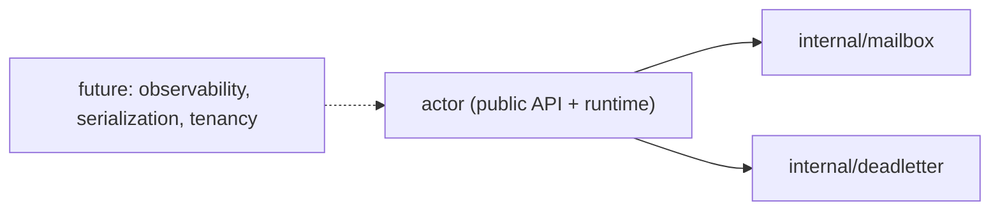

# ADR 0011: Target layout of the pekko-actor module

- Status: accepted
- Scope change (2026-10-17, Owner): there is no `pekko-tenancy` module. The mentions of tenancy below as a future importer of
  `pekko-actor` (and of its `spi/`) are replaced and kept as history. The layout decisions themselves are unchanged.
- Date: 2026-10-09
- Stage: 1

## Feature

The package and file layout of `pekko-actor`, so that each file and package has
one responsibility, dependencies point toward the core, and the layout rules in
`CLAUDE.md` hold as the module grows (ask, supervision, watch). This ADR moves
no code and changes no behavior.

## How Pekko solves it

- Module: `pekko-actor` (Pekko's `actor` module).
- Concept: the classic runtime is one package, `org.apache.pekko.actor`, and the
  cross-cutting concerns are sibling packages: `dispatch`, `event`, `pattern`,
  `routing`, `serialization`, `util`, `io`. A package is split off when it is a
  separate concern with its own consumers, not by file size.
- Files: `upstream/pekko/actor/src/main/scala/org/apache/pekko/` (top-level
  directories), `.../actor/*.scala` (29 files in one package).

## How GoAkt solves it

- Package: `reference/goakt/actor` (not initialized in this worktree; ADR 0010
  cites it), with the supervisor in a separate package.
- Concept: one large `actor` package for PID, receive context and lifecycle,
  with other concerns as sibling packages. This ADR does not consult GoAkt
  further: Pekko wins when all else is equal.

## Evidence

- Benchmark: none. Nothing here changes runtime behavior.
- Judge: none affected. The behavior is guarded by existing unit tests, listed
  under "Validation".
- Complexity: `pekko-actor` has 3 packages and 700 non-test lines in
  `actor/`, 86 in `internal/mailbox`, 149 in `internal/deadletter`.
- Idiomatic in Go: yes. Go splits packages by dependency direction and by
  consumers, not by type; the generic cell, `Ref[T]` and `Context[T]` reference
  each other, so moving any of them to another package forces exported hooks or
  an import cycle.

### Inventory (verified against `origin/develop` e4574ce)

| Package | Non-test files | Responsibility | Imports (in module) |
|---|---|---|---|
| `actor` | `cell.go` 188, `system.go` 264, `stop.go` 78, `ref.go` 48, `deadletter.go` 53, `mailbox.go` 39, `executor.go` 18, `doc.go` 12 | Public API and the runtime behind it | `internal/mailbox`, `internal/deadletter` |
| `internal/mailbox` | `queue.go` | Generic circular FIFO `Queue[T]`, no locking | none |
| `internal/deadletter` | `hub.go` | Generic publication hub `Hub[E]` with subscribers and an in-flight barrier | none |
| `spi` | `doc.go` (4 lines, no types) | Placeholder | none, and nothing imports it |

Public API (all in `actor`): `ID`, `Handle`, `Ref[T]`, `Actor[T]`,
`PreStarter[T]`, `PostStopper[T]`, `Context[T]`, `Config`, `System`
(`Done`, `Stop`, `SubscribeDeadLetters`), `DeadLetter`, `NewSystem`, `Spawn`,
`FactoryPanicValue`, `ErrNilActor`, `ErrFactoryPanic`, `ErrNameTaken`,
`ErrUnknownHandle`. (Note, U4, ADR 0017 S10: `ErrNilActor`, `ErrFactoryPanic` and
`FactoryPanicValue` stay exported, but they are no longer errors that `Spawn`
returns; they describe the cause of the `*InitializationError` that a decider or
an event receives when the factory fails. The layout below is unchanged.)

Consumers: **none**. No Go code outside the module imports `pekko-actor`.
`go.work` lists it; `scripts/deps.allow` lets `pekko-observability`,
`pekko-serialization` and `pekko-tenancy` import it in the future. Gates
(`check_deps.sh`, `check_coverage.sh`, `.golangci.yml`, CI) enumerate modules
from `go.work` and hard-code no package path; only `.github/dependabot.yml`
names the directory `/pekko-actor`, which does not move.

### What already complies

- The module root has `README.md`, `go.mod`, `go.sum` and no `.go` files.
- Dependencies point toward the leaves: `actor` -> `internal/*`; the leaves
  import nothing. No cycles, no `util`/`common`, no Go facade at the root.
- `internal/mailbox` and `internal/deadletter` are real boundaries: each is
  generic, knows nothing about actors, and has its own tests.
- The package split of a previous PR already moved the code out of the root.

### What needs reorganization

1. **`actor/system.go` mixes seven concerns in 264 lines:** identifiers,
   sentinel errors and `FactoryPanicValue`, test seams, the registry, `System`,
   `Spawn`, and the factory guards. A reader looking for "how are names
   reserved" or "what can Spawn return" has no file to open.
2. **`actor/cell.go` defines the contract users implement** (`Actor`,
   `PreStarter`, `PostStopper`, `Context`) together with the cell machinery.
3. **`spi/` is an empty placeholder.** It has no type and no importer, which
   breaks "no empty directories or speculative interfaces". ADR 0008 plans to
   put `Metadata` and `Key` there; that ADR is proposed and unimplemented.

### Alternatives evaluated and rejected

- **Split `actor` into packages** (for example `internal/cell`, `internal/registry`
  and a thin public `actor`). Rejected: `Ref[T]`, `Context[T]` and the generic
  cell reference each other, and the registry stores cells through `record`.
  Splitting forces exported methods or type aliases for no new behavior, no new
  consumer and no new boundary.
- **Extract the registry to `internal/registry`.** Rejected: about 50 lines,
  one consumer, and it shares `System.mu` with the dead-letter wiring and `ID`.
  Revisit when a second consumer exists (see Consequences).
- **A Go facade at the module root.** Prohibited by `CLAUDE.md`.
- **Keep the current layout and only document it.** Viable, but leaves
  `system.go` as the file every new feature (ask, watch, children) will grow.

## Decision

Keep the three-package structure. Reorganize by **file** inside `actor`, and
remove the empty `spi/` until it has a real port. No exported identifier,
import path, or behavior changes.

### Target tree

```text
pekko-actor/
├── README.md
├── go.mod
├── go.sum
├── actor/                  # public API + runtime behind it
│   ├── doc.go
│   ├── actor.go            # Actor, PreStarter, PostStopper, Context
│   ├── id.go               # ID, Handle, idSeq
│   ├── errors.go           # sentinel errors, factoryPanicError, FactoryPanicValue
│   ├── system.go           # System (with its registry fields), Config, NewSystem,
│   │                       #   Done, emit, closedChan, eventSink, options
│   ├── spawn.go            # Spawn, callFactory, isNilActor
│   ├── registry.go         # System methods reserve/register/lookup/..., record, stats
│   ├── executor.go         # executor interface, goroutineExecutor
│   ├── cell.go             # cell, drain, protect, hook calls, snapshot
│   ├── mailbox.go          # cell <-> internal/mailbox glue
│   ├── ref.go              # Ref[T], Tell
│   ├── stop.go             # Stop, acceptStop, finish, PostStop
│   ├── deadletter.go       # DeadLetter, SubscribeDeadLetters
│   └── *_test.go           # unchanged
└── internal/
    ├── mailbox/            # Queue[T]
    └── deadletter/         # Hub[E]
```

`spi/` disappears from the tree until a real port required by ADR 0008 exists
(see "Owner decisions").

### Package responsibilities

| Package | Responsibility | Does not own |
|---|---|---|
| `actor` | Public API (`System`, `Spawn`, `Ref`, `Context`, hooks, dead letters) and the cell state machine behind it | Queue storage, publication mechanics |
| `internal/mailbox` | Circular FIFO storage; no locking, no actors | Locks and counters (the cell owns them) |
| `internal/deadletter` | Subscribers, publication, in-flight barrier; generic over the event | What a dead letter is (`actor.DeadLetter`) |

### Dependency direction



Solid edges exist today; the dotted edge is allowed by `scripts/deps.allow` and
unused. `actor` imports no other goPekko module, and `internal/*` import
nothing from the module.

### Current file -> target map

| Today | Destination | Content |
|---|---|---|
| `system.go:12-16,30-31` | `id.go` | `ID`, `Handle`, `idSeq` |
| `system.go:18-28,40-64` | `errors.go` | sentinel errors, `factoryPanicError`, `FactoryPanicValue` |
| `system.go:33-38` | `system.go` (stays) | `closedChan`, used only by `Done` |
| `system.go:66-68` | `executor.go` | `executor` interface, next to `goroutineExecutor` |
| `system.go:70-85` | `system.go` (stays) | `eventSink`, `options` |
| `system.go:87-92` | `system.go` (stays) | `Config` |
| `system.go:94-105` | `registry.go` | `stats`, `record` |
| `system.go:107-139` | `system.go` (stays) | `System` struct (its `mu`, `names`, `byID` fields cannot leave the struct), `NewSystem`, `newSystem` |
| `system.go:140-145,249-256` | `system.go` (stays) | `emit`, `Done` |
| `system.go:146-190,257-264` | `registry.go` | `System` methods `reserve`, `unreserve`, `register`, `releaseName`, `lookup`, `stats` |
| `system.go:191-247` | `spawn.go` | `callFactory`, `isNilActor`, `Spawn` |
| `cell.go:22-43` | `actor.go` | `Actor`, `PreStarter`, `PostStopper`, `Context` with their doc comments |
| everything else | unchanged | `cell.go`, `mailbox.go`, `ref.go`, `stop.go`, `deadletter.go`, `doc.go`, `internal/*` |

Line numbers are those of e4574ce; PRs move whole declarations, so ranges guide
and do not bind. `system.go` shrinks from 264 to about 130 lines and keeps what
is about the system itself; the registry methods and the factory guards leave.
`actor.go` carries a `Ported from .../actor/Actor.scala` header, because
`CLAUDE.md` requires one on ported code and these declarations come from
Pekko's actor contract; `id.go`, `errors.go`, `registry.go` and `spawn.go` need
none (`system.go` has none today, and `.github/scripts/check-headers.sh` checks
only files that already say "Ported from").

### Imports and consumers affected

None. Every package keeps its import path, so no file outside `pekko-actor`
changes for the Go code. Documentation to update: `pekko-actor/README.md`
(layout table, and the `spi/` mentions at lines 54 and 68) in the PR that
changes the layout. `CLAUDE.md` needs no edit: it states that `spi/` holds
ports, a rule about content, not a requirement that the folder exist.
`docs/actor-core-first-cut.md` names symbols only, not files.

### API breaks

None. No exported identifier, signature, or package path changes.

### Sequence of PRs

Each PR compiles and passes every gate on its own (`gofmt`, `go vet`,
`go mod tidy -diff`, `go test -race`, `golangci-lint`, gocyclo <= 10,
coverage >= 85% per module). Every PR is a move-only change.

| PR | Content | Moved lines (approx.) |
|---|---|---|
| 1 | This ADR (docs only) | 0 code |
| 2 | `id.go`, `errors.go` out of `system.go`; README layout table | about 70 |
| 3 | `registry.go`, `spawn.go` out of `system.go`; `executor` interface into `executor.go` | about 120 |
| 4 | `actor.go` out of `cell.go` (with its `Ported from` header) | about 30 |
| 5 | Remove `pekko-actor/spi/` and update the README; decided, see Owner decisions | about 10 |

PRs 2-4 are independent of each other apart from textual conflicts in
`system.go`; merge them in order. Authored-line counts stay below the 400-line
heuristic because a moved declaration counts once as a deletion and once as an
addition.

### Validation (behavior preserved)

For every code PR, before and after:

1. **Move-only proof:** `git diff -M --color-moved=dimmed-zebra` shows only moved
   blocks; `git diff --stat -- '*_test.go'` is empty (no test is edited, so no
   assertion is weakened).
2. **API identical:** `go doc -all ./actor` output is byte-identical before and
   after.
3. **Gates:** `go test -race -count=1 ./...`, `golangci-lint run`,
   `gocyclo -over 10`, coverage per module not lower than before.
4. **Named behavior guards must run and pass**, verified with
   `go test -race -run '<names>' -v`:

| Behavior | Tests |
|---|---|
| FIFO | `TestTellAndSerialProcessing` (`behavior_test.go:20`); "publishes waiting messages once, in FIFO order, before Done closes" (`deadletter_test.go:42`) |
| Stop | `TestStopRaces`, `TestNameReuse` (`stop_race_test.go`); `TestStopFinish` (`cell_internal_test.go:159`); `TestPostStopHooks` (`lifecycle_internal_test.go:296`); `TestStopCounters`, `TestStopRacesTell` (`throughput_internal_test.go`) |
| Dead letters | `TestDeadLetters` (`deadletter_test.go:40`); `TestSystemDeadLetterWiring` (`deadletter_internal_test.go:15`); `TestHubSubscribe` and `TestDeadLetterBarrier*` in `internal/deadletter` |
| Wrapped pending messages (mailbox wrap-around while a Stop is accepted) | `TestStopWithWrappedPending` (`stop_wrap_test.go:46`); `TestQueueStorageFollowsPendingNotHistory`, `TestQueueTakePendingAndReuse` in `internal/mailbox` |

If a guard is renamed or removed by a PR, that PR fails this validation.

## Consequences

- No behavior, API, or consumer changes. Future features land in a file named
  for the behavior (ask in `ask.go`, watch in `watch.go`) instead of growing
  `system.go`.
- A new package is created only when a boundary has its own consumer or a seam
  free of cycles: (a) a second user of the registry or of `record` (for
  example children or watch needing lookup by path) can justify
  `internal/registry`; (b) a goPekko module that needs only `Metadata`/`Key`
  justifies `spi/`; (c) supervision strategies with their own type surface can
  justify a public package. Revisit at each of these.
- Rules out: root-level Go files, `util`/`common`, and splitting `actor` by
  type name.
- ADR 0008 plans `pekko-actor/spi` with `Metadata`, `Key`, `ID`. Removing the
  empty `spi/` does not decide that: it returns with its first real content.
  Moving `ID` there would be a breaking change decided by ADR 0008, not here.
- `docs/design.md` "SPIs" stays as the list of intended ports; none lives in
  `pekko-actor` today.

## Owner decisions

Recorded 2026-10-09 from the owner's answer to this proposal.

1. **`pekko-actor/spi/` is removed** in the implementation PR (PR 5 of the
   sequence). It has no type and no importer. `spi/` is created again when a
   real port required by ADR 0008 exists (its `Metadata` and `Key`, lines
   129-131), together with that port and not before. Removing it does not
   decide ADR 0008. `pekko-observability`, `pekko-serialization` and
   `pekko-tenancy` also have an `spi/`; they are out of scope and unchanged.
2. **`actor/` stays one cohesive package**, with its files organized by
   responsibility as in the target tree. No new package is created if it
   would need to expose internal details (exported methods, aliases or hooks)
   without a concrete benefit; the criteria in Consequences decide when that
   changes.

3. **The ADR is accepted** (2026-10-09, after #30 merged as 75a7765). The owner
   authorized the reorganization of `actor/system.go` starting with PR 2:
   `id.go` and `errors.go` (merged as #31, c045fe9). The owner then authorized
   PR 3 (`registry.go`, `spawn.go`, the `executor` interface into
   `executor.go`), merged as #32 (138ec9e), and PR 4 (`actor.go`), merged as #33
   (452e950).
4. **PR 5 is authorized and removes `pekko-actor/spi/`** (it held only a
   4-line `doc.go`; nothing imported it). The directory is created again, with
   its first real port, when ADR 0008 requires one. The only edit outside the
   deletion and the README is one sentence of the `actor` package comment
   (`actor/doc.go`) that pointed to `../spi` as if it existed; no declaration,
   signature, behavior or test changes. With this PR the sequence of this ADR is
   complete.

## Review record

An independent architect reviewed this ADR against the code and the rules
(2026-10-09). Core decision confirmed: file-level split only; splitting `actor`
into packages is unsound because `cell[T]`, `ref[T]`, `Context[T]` and `Spawn`
are mutually generic and unexported, and `record` calls `acceptStop` and
`snapshot` on the cell. Blockers raised and resolved in this text:

1. The file map omitted `Config`, mislabeled `registry.go` (the `names`/`byID`
   fields belong to the `System` struct), put `closedChan` in `registry.go`
   although only `Done` uses it, and had inexact ranges. Corrected in the map.
2. `seams.go` would have separated the production `executor` interface from
   `goroutineExecutor`. Dropped: `executor` moves to `executor.go`, and
   `eventSink` and `options` stay in `system.go`.

Non-blocking points adopted: the `CLAUDE.md` edit was removed, the licence
header decision for `actor.go` is stated, the scope of the `spi/` removal is
explicit, and the line count is corrected.
