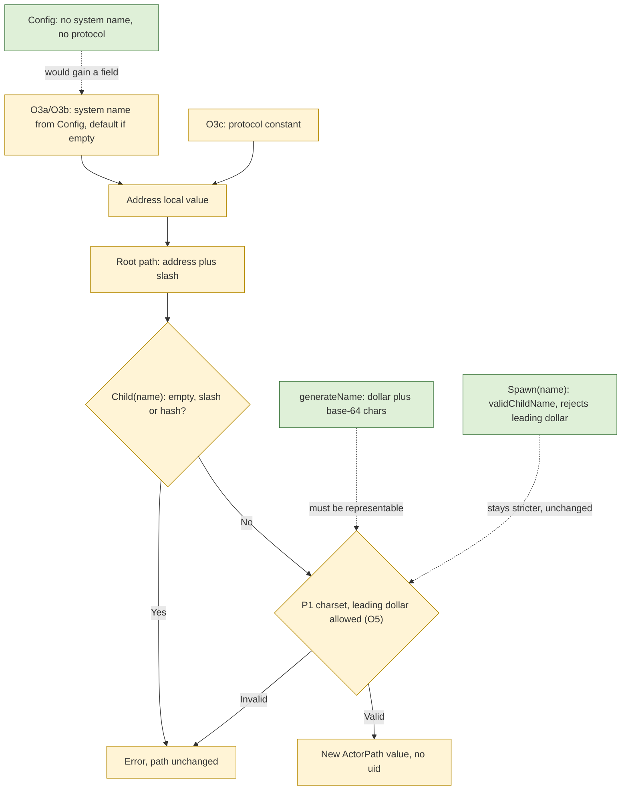

# ADR 0031: Local `Address` and `ActorPath` values (diagnostic paths, not identity)

- Status: **accepted** (decisions O1, O2, O3a, O3b, O3c, O4 and O5, exactly as proposed in the version of PR #1006 at head
  `4b6940d740a735a0bbd9a25ae448e4d1b9e6acd4`). No code implements it yet.
  - Accepted by the Owner on 2026-10-24 through an explicit message in the working session (Claude Code), not a GitHub comment. The
    Owner's words, literally: "Apruebo O1, O2, O3a, O3b, O3c con protocolo local "pekko", O4 y O5 según la propuesta del PR #1006 en
    el commit 4b6940d740a735a0bbd9a25ae448e4d1b9e6acd4. Acepto ADR 0031 con esas decisiones."
  - Scope of the acceptance: the proposals as written at that commit, including the stated alternatives that were **not** chosen. It
    does not accept the implementation, any API name, the evidence class of any Pekko claim, or parity. Pekko statements remain
    **Source** only; no JVM run exists. The same message did not authorize the merge.
  - Before that message no Owner decision on this subject existed in #766, #746, #747, #765, #812, #682, PR #1006 or the ADRs. The
    acceptance covers the decisions as written at `4b6940d`; later edits to this file recorded the acceptance and aligned its wording.
    The acceptance is of the documented contract only; the implementation is pending.
  - Implementation note (2026-10-26, reconciliation; not a new acceptance and not a change of any decision above): the sentences "No code
    implements it yet" and "the implementation is pending" describe 2026-10-24. Since then `develop` integrates the local `Address`
    value (IDN-13, PR #1010, `cff473f0c9c6176db6e07bb291925e7c02312e40`), the system name and address (IDN-15, PR #1012,
    `a3aa35d039a9b79d3d8ffe31d237cb02923af3ca`) and the local `ActorPath` value (IDN-14, PR #1011, `13fb9953879462adba4218114d6615dc3d3156b9`).
    The "not implemented" labels of the Contract, the differences list and the diagram below are historical for those items. Still
    not implemented: navigation (#852), parsing and formatting (#812), incarnation identity (#853) and exact reference strings (#894).
    The evidence of each delivery is its PR's (author-run gates and review); no JVM run exists and no parity is claimed. Matrix:
    `docs/parity/gov-48-dth-02-reconciliation-2026-10-26.md`, section 11.
- Date: 2026-10-24
- Stage: 1 (actor core)
- Module: `pekko-actor`
- Issues: #766 (IDN-02, this story); epic #747; program #746; inventory `ACTINV-003`.
  #682 is **closed as superseded** and concerns `ActorSelection`; it is neither blocked by nor a dependency of this story.
- Stories that own what is excluded here: #812 (IDN-03, "Parse and format local actor paths", open, lists #766 as a dependency),
  #852 (IDN-04, navigation), #853 (IDN-05, incarnation identity), #894 (IDN-09, exact reference strings). None is changed by this ADR.
- Sources: Apache Pekko `v1.7.1`, commit `9a54d1294c3ac7821bbed3c940769c3d5027d1ff` (the submodule pin, unchanged). Paths are relative
  to `upstream/pekko/actor/src/main/scala/org/apache/pekko/actor`.

## Context

Today a goPekko actor is identified by its actor ID; a logical path is "at most metadata" and "there is no path API"
(`pekko-actor/README.md`). The only path rule implemented is the validator of user-supplied names (`pekko-actor/actor/names.go`,
from `ActorPath.scala:77-148`). This ADR specifies local-only value types so later stories share one contract. It does not specify
remote addressing, parsing, resolution of a path to a live actor, serialization, or tenancy.

## Evidence classes

| Class | Meaning |
|---|---|
| **Source** | Read in the pinned Pekko files at the cited lines. Not executed. |
| **Executed** | Observed by running Pekko. **None exists for this ADR**: no JVM run, no differential test. |
| **Go today** | Read in this repository (merge base with `develop` `edb55cfdcb6174403910570eb11318159eb89ded`). |
| **Decision** | A choice accepted by the Owner as a documented contract; not implemented. Anything that differs from Pekko is listed under "Intentional differences". |

## Pekko contract (class: Source)

| Id | File | Lines | What it fixes |
|---|---|---|---|
| A1 | `Address.scala` | 37-44 | `Address(protocol, system, host: Option, port: Option)`; local constructor `(protocol, system)` |
| A2 | same | 64-75 | `hasLocalScope = host.isEmpty`; `hasGlobalScope = host.isDefined` |
| A3 | same | 86-94 | `toString`: `protocol://system`, then `@host` if defined, then `:port` if defined |
| A4 | same | 138-145 | ordering: protocol, system, host (absent as `""`), port (absent as 0) |
| A5 | same | 185-232 | `AddressFromURIString` and `ActorPathExtractor` parse through `java.net.URI` (the parser; out of scope here) |
| P1 | `ActorPath.scala` | 77-148 | `isValidPathElement`: ASCII letters, digits, `-_.*$+:@&=,!~';` or `%XX`; not empty; **not starting with `$`**. Doc: "User defined Actor names may not start from a `$` sign - these are reserved for system names" (122) |
| P2 | same | 172-257 | `ActorPath` members: `address`, `name`, `parent`, `/`, `elements`, `root`, `toStringWithoutAddress`, `toStringWithAddress`, `toSerializationFormat`, `toSerializationFormatWithAddress` |
| P3 | same | 203-204 | `/ Iterable[String]` skips empty elements |
| P4 | same | 279-305 | `RootActorPath(address, name = "/")`: after its first character `name` has no `/`; no `#`; `toString = address + name`; `toSerializationFormat = toString`, so **no uid** |
| P5 | same | 328-335 | `ChildActorPath`: rejects `/` and `#` in the name. It does **not** check the character set, a leading `$`, or emptiness |
| P6 | same | 163-168, 454-466 | equality compares names and parents to the root; the uid is **not** compared ("does not necessarily mean that they point to the same incarnation") |
| P7 | same | 369-378, 449-452 | `ChildActorPath.toString` has no uid; `ChildActorPath.toSerializationFormat` appends `#uid` unless it is undefined. This holds for that class and that method only |
| P8 | same | 481-494 | `compareTo` compares names from right to left |
| C1 | `dungeon/Children.scala` | 59-65, 269-277 | explicit names go through `checkName` (`ActorPath.validatePathElement`); anonymous children use `randomName()` and are not validated |
| C2 | same | 80-83 | `addFunctionRef`: name is `"$$" + random`, optionally `"-" + name`; the suffix is not validated; the path is built directly |
| C3 | same | 316-320 | `makeChild` builds `new ChildActorPath(...)` after `reserveChild`, with no element validation |
| U1 | `ActorCell.scala` | 390-404 | `undefinedUid = 0`; `newUid` is a random non-zero `Int`; `splitNameAndUid` splits `name#n` |
| S1 | `ActorRefProvider.scala` | 385-402 | in `LocalActorRefProvider`, whose constructor takes `_systemName: String`: `rootPath = RootActorPath(Address("pekko", _systemName))`. This is the **only** `"pekko"` literal in that file; the file says nothing about other providers' protocols, and this ADR did not read them |
| S2 | `ActorSystem.scala` | 829-843 | `ActorSystemImpl` constructor: name must match `^[a-zA-Z0-9][a-zA-Z0-9-_]*$`, else `IllegalArgumentException` |
| S3 | same | 263 | the no-argument `ActorSystem()` uses the name `"default"`; a named factory takes the name from its caller |

S2 is a rule for the **system name**. It is unrelated to P1, the rule for **path elements** (P1 allows `.`, `*`, `$`, `:`, `%XX` and
more; S2 allows only letters, digits, and non-leading `-` and `_`).

## Go today (class: Go today)

- `validChildName` (names.go) implements P1 and is applied by `Spawn` to every name a caller supplies. It rejects a leading `$`.
- `generateName` (IDN-01, names.go) yields `"$"` + characters of the base-64 alphabet `a-zA-Z0-9+~`. All of those characters are in P1's
  set, so the **only** thing `validChildName` would reject in a generated name is its leading `$`.
- `Config` has `Throughput`, `GuardianStrategy` and `Logger` (system.go). `NewSystem(Config)` takes only a `Config`, and the zero
  `Config` is valid. **There is no system name and no protocol.**
- Guardians are `/`, `/user`, `/system` (README). No exported path or address type exists.

## Contract (class: Decision, accepted, not implemented)

| # | Accepted contract item | Basis |
|---|---|---|
| P-1 | `Address` is an immutable value with `Protocol`, `System` and, reserved, optional `Host` and `Port`. Only a local constructor exists in the first implementation. Local scope is "no host" (A2). | A1, A2; O1 |
| P-2 | A local `Address` prints as `protocol://system`. The `@host:port` forms are not produced. | A3 |
| P-3 | `Address` ordering: protocol, system, host, port, as A4. | A4 |
| P-4 | `ActorPath` is an immutable value: a root `Address`, the root name and a sequence of element names. Members mirror P2 for the local case: `Address`, `Name`, `Parent`, `Root`, `Elements`, `Child`, `Descendant` (skips empty names, P3). Package: `pekko-actor/actor`, next to `Ref`; no new module and no new dependency. | P2, P3 |
| P-5 | **Representable element** (see O5): `Child` rejects an empty name, `/` and `#`, and checks P1's character set but **allows** a leading `$`. | P5, C1-C3, O5 |
| P-6 | **Equality.** Two `ActorPath` values are equal when addresses, root names and element names are equal. Incarnation is never part of equality. A slice of elements makes Go `==` unavailable, so an `Equal` method is the likely shape; that is an implementation detail, not a decision. Address equality compares all fields. | P6 |
| P-7 | **[Withdrawn by the amendment 2026-11-04 (b) below; original text kept.]** **Incarnation.** The path value carries no uid and its text never shows one. A uid-bearing form is a separate function owned by #853 and #894. `Child` does **not** split `name#uid` as Pekko's `/` does (U1); `#` is an error. | P6, P7, U1 |
| P-8 | **Text.** `String()` is `address + "/"` for the root and `address + "/" + elements joined by "/"` otherwise, matching `RootActorPath.toString` and `ChildActorPath.toString` (P4, P7). Elements are written as validated; nothing is escaped or decoded (`%41` stays `%41`). No escaping exists because `/` and `#` cannot occur in an element. This claim covers `toString` only; no serialization form is proposed. | P4, P7 |

Intentional differences from Pekko (accepted with this contract, not implemented): (a) no global-scope `Address` (O1); (b) `Child` rejects `#` instead
of splitting a uid; (c) `Child` rejects an empty name, which `ChildActorPath` accepts (P5); (d) `Child` checks P1's character set, which
`ChildActorPath` does not (P5, C3); (e) fixed root name (O4); (f) no parser (O2); (g) a default system name for the zero `Config` (O3b).

Green boxes exist today; yellow boxes are accepted decisions that are **not implemented yet**. No dotted arrow is implemented.

## Decisions (all decided by the Owner, as written at `4b6940d`)

| Id | Question | Evidence | Accepted decision | Alternatives | Consequence | State | Approval |
|---|---|---|---|---|---|---|---|
| O1 | Local-only `Address`, or expose host and port? | A1, A2 allow both. #766 out of scope: "No remote or cluster implementation". | Local only | Expose host/port now | No remote ADR dependency; a global constructor can be added later without breaking | **Decided** | Owner, 2026-10-24, see Status |
| O2 | Parsing in the first implementation? | A5 depends on `java.net.URI`. #812 is "Parse and format local actor paths" and lists #766 as a dependency. | Exclude from #766 and the first implementation of these values; #812 owns it | Include a minimal parser | #766 stays a decision slice; no grammar is defined here | **Decided** | Owner, 2026-10-24, see Status |
| O3a | Where does the system name come from? | Pekko: `LocalActorRefProvider` receives `_systemName` (S1) and the system validates it (S2). Go: nothing exists; `NewSystem(Config)`. | A new field of `Config`, set once at creation, immutable. The field name and its documentation belong to the implementation story | A second argument of `NewSystem` (breaking change of an exported function); no name at all (the address would carry an empty system, which Pekko's rule S2 forbids) | Additive for existing callers. Validation, if adopted, would reuse S2 verbatim and is separate from P1. **No API is defined by this ADR.** | **Decided** | Owner, 2026-10-24, see Status |
| O3b | Value when the name is empty (the zero `Config`)? | Pekko has no implicit default for a named creation; only the no-argument factory uses `"default"` (S3). Go: the zero `Config` is valid today. | `"default"`, as **goPekko's own decision** taken from Pekko's no-argument factory, applied only when the name is empty | Reject an empty name (breaks every existing `NewSystem(Config{})`); a different literal (no source) | Existing code keeps working; paths of unnamed systems print `…://default/…` | **Decided** | Owner, 2026-10-24, see Status |
| O3c | Local protocol literal and its meaning | Source: `"pekko"` appears at `ActorRefProvider.scala:402` in the local provider, and in comments of `Address.scala:193,196`. That is where a literal appears, not a rule that goPekko must adopt it. | A package constant `"pekko"` that means only: the scheme printed in the textual form of a local address. Not configurable | `"gopekko"` (avoids suggesting interoperability with Pekko peers); no scheme | Text looks like Pekko's `pekko://system/user/a`. **It implies no transport, serialization or remote resolution compatibility.** Changing it later changes every printed path | **Decided** | Owner, 2026-10-24, see Status |
| O4 | Is the root name fixed at `"/"`? | P4 allows a custom name; goPekko has only the guardians `/`, `/user`, `/system`. | Fixed `"/"` | Configurable root name | No root-name validation | **Decided** | Owner, 2026-10-24, see Status |
| O5 | Which elements can an `ActorPath` represent? | Three separate things: **(1)** representable element: Pekko's `ChildActorPath` checks only `/` and `#` (P5), and generated or internal names are never validated (C1-C3). **(2)** public `Spawn` names: Pekko validates with P1, including the leading `$` rule (C1). **(3)** generated names: `generateName` makes `$…` (Go today) | (1) P1's character set, empty/`/`/`#` rejected, leading `$` allowed. (2) `Spawn` unchanged: `validChildName` still rejects a leading `$`. (3) `generateName` unchanged and always representable | (1-alt) Pekko-like: only `/`, `#` (and empty) rejected | `validChildName` cannot be reused as is for (1) because it rejects `$`; the implementation needs the shared charset check without the leading-`$` rule. (1) is stricter than Pekko (difference d) | **Decided** | Owner, 2026-10-24, see Status |

## Amendment 2026-11-04: identity text follows Pekko's behavior (Owner decision)

- **Authorization.** Given by the Owner on 2026-11-04 (author: Owner, pablogore). The words, literally:
  > Principio: "toda decisión funcional debe ser tal cual apache pekko". Solo se aceptan diferencias de forma propias de Go. Esto REVISA las decisiones del 2026-10-29 ("sí a todas" de #1187 y la aceptación de la adenda de #1186) en todo lo que difiera funcionalmente de Pekko v1.7.1.
  >
  > 1. Path absoluto: se acepta exactamente lo que acepta ActorPath.fromString de Pekko, con el mismo resultado (segmentos vacíos y barra final como Pekko; "pekko://sys" da la raíz). `#uid` se separa del path como en Pekko. Se rechaza lo que Pekko rechaza (incluido `_` en el sistema, como fromString).
  > 2. Path relativo: como RelativeActorPath de Pekko (segmentos vacíos conservados, texto vacío, `baz#1234` como elemento).
  > 3. String exacto: formato `path#uid` como en Pekko. uid entero distinto de cero. Sin uid, o con `#0`, significa cualquier encarnación. La forma de generar el uid es implementación Go, con dos condiciones: entero de 32 bits distinto de cero, y distinto para cada encarnación del mismo path.
  > 4. Resolución de un string obsoleto: como Pekko. Se obtiene una referencia que entrega a dead letters, no un error.
  > 5. Lo ya implementado que difiere (#812, parser estricto; #894, token epoch-número) se corrige. Ninguna diferencia queda aceptada.
  > 6. Cuando la evidencia no sea un escenario diferencial, se registra según ADR 0033 D13. Esto no declara paridad.
- **What it revises, and only that.** Wherever the accepted grammar addendum (#1187), the accepted token-form addendum (#1186) or the
  contract above differs in observable behavior from Pekko v1.7.1, the Owner's text of 2026-11-04 prevails. Pekko's `ActorPath.fromString`
  and `RelativeActorPath` are the oracle for what is accepted, rejected and returned. The decisions of 2026-10-24 (O1 to O5) are not
  withdrawn by this amendment except where they conflict with the text above. Neither addendum has been applied to this ADR; when one is, it must follow
  this amendment.
- **Open divergences, none accepted** (each is corrected by a unit that cites this amendment):
  (a) the strict parser of #812 (`parseActorPath`, `pekko-actor/actor/parse_actor_path.go`, contract of #1307/#1308): it rejects an empty segment, a trailing
  slash, any `#` and `pekko://sys` without a slash, and accepts `_` in the system name; the Owner's text 1 requires Pekko's results (empty segments and trailing
  slash as `fromString`, `#uid` split off, `pekko://sys` is the root, `_` in the system rejected); owner: #1322. (b) the exact reference string of #894
  (`ExactRefString`, token `path#<epoch>-<number>`) is not `path#uid` with a non-zero 32-bit uid distinct per incarnation; owner: #1323.
  (c) relative path text, unscoped: #1089. (d) resolution of an exact string, a stale string yielding a reference that delivers to dead letters
  and not an error: #1092 (blocked by #893). (e) the addenda #1186 and #1187 are to be re-proposed against this text. (f) navigation (added by the amendment 2026-11-04 (b)): `Child` and `Descendant` reject inputs that Pekko's `/` accepts (an empty name, `name#uid`, any character other than `/` and `#`); owner: #1328, after #1323.
- **Not decided by this amendment:** how the uid is generated beyond the two conditions of text 3, any API name, and the evidence class of any Pekko claim.
- **No parity claim.** Evidence that is not a differential scenario is recorded under ADR 0033 D13.

## Amendment 2026-11-04 (b): `ActorPath` carries a uid; `Child` and `Descendant` behave as Pekko's `/` (Owner decision)

- **Authorization.** Given by the Owner on 2026-11-04 (author: Owner, pablogore). The words, literally:
  > ## DECISIÓN DEL OWNER — uid en ActorPath y navegación (#1328, #1323)
  > Fecha: 2026-11-04. Autor: Owner (pablogore). Texto literal.
  >
  > Principio: "toda decisión funcional debe ser tal cual apache pekko". Solo se aceptan diferencias de forma propias de Go.
  >
  > 1. ActorPath lleva uid, como en Pekko: un entero de 32 bits con signo. La igualdad de paths no lo considera; se puede leer. Sin uid, el valor es 0 y significa "cualquier encarnación". Este punto retira ADR 0031 P-7 ("el path no lleva uid; Child no separa name#uid").
  > 2. Child y Descendant se comportan como el / de Pekko:
  >    a. un nombre vacío da un hijo de nombre vacío;
  >    b. "name#uid" se separa en nombre y uid;
  >    c. dan error solo donde Pekko lanza excepción: "/" en el nombre, o un uid no entero o fuera de rango (por ejemplo "a#", "a#x", "a#5#6"). El error es la forma Go de la excepción, igual que D-3;
  >    d. todo lo demás se acepta, como en Pekko.
  > 3. La validación de nombres de actor sigue en Spawn, como en Pekko (Children.scala:274), no en la navegación.
  > 4. #1323 es dueño del uid (generación, rango y texto path#uid); #1328 lo consume. Orden: primero #1323, después #1328.
  > 5. Ninguna diferencia queda aceptada. La evidencia sigue ADR 0033 D13. Esto no declara paridad.
- **What it withdraws, and only that.** P-7 (path carries no uid; `Child` does not split `name#uid`) is withdrawn; its text stays above, marked. Where P-4/P-5/O5 (the character set and the empty-name check applied by `Child` and `Descendant`) differ in observable behavior from Pekko's `/` (`ActorPath.scala:203-204, 328-335`; `ActorCell.scala:400-404`), the Owner's text prevails. The other decisions are not withdrawn.
- **Open divergence, none accepted:** (f) in the list of the amendment 2026-11-04 above. Owners: #1323 (uid: generation, range, `path#uid` text), then #1328 (navigation). The test `pekko-actor/actor/actor_path_divergence_test.go` pins today's behavior with the mark `OPEN DIVERGENCE #1328`; it is inverted, not deleted, when the divergence is corrected.
- **Not decided here:** how the uid is generated beyond "32-bit signed integer, non-zero for an incarnation, distinct per incarnation of one path" (the amendment 2026-11-04 above, text 3), any API name, and the evidence class of any Pekko claim.
- **No parity claim.** Evidence that is not a differential scenario is recorded under ADR 0033 D13.

### Note 2026-11-04 (additive): equality of `ActorPath` and generation of the uid (Owner decision, U-2, #1323)

Added to amendment (b); its text is not changed. The words of the Owner, literally:

> ## DECISIÓN DEL OWNER — igualdad de ActorPath y generación del uid (U-2, #1323)
> Fecha: 2026-11-04. Autor: Owner (pablogore). Texto literal.
>
> Principio: "toda decisión funcional debe ser tal cual apache pekko". Solo se aceptan diferencias de forma propias de Go.
>
> 1. Igualdad (opción B): ActorPath lleva el campo uid. El operador == de Go compara también el uid; esa es una diferencia de forma, con el mismo precedente que time.Time. La igualdad de Pekko (dirección y elementos, sin uid) es el método Equal. String() y cualquier Compare ignoran el uid, como ActorPath.toString y compareTo de Pekko. WithUID(0) da el valor sin uid, para usarlo como clave de un mapa. El godoc y el README lo dicen explícitamente.
> 2. Generación: cada encarnación de un padre tiene un contador propio que arranca en un valor aleatorio de 32 bits (crypto/rand). El uid de cada hijo es una biyección de (inicio + k) sobre los enteros de 32 bits, saltando el 0. Al agotarse da la vuelta: nunca hay panic ni falla de spawn por el uid, como en Pekko.
> 3. Garantía: el uid es estrictamente distinto entre los hijos de una misma encarnación del padre. Entre encarnaciones distintas del padre (un padre que se detiene y se vuelve a crear con el mismo nombre) es probabilístico, como el sorteo de Pekko. Esto precisa el punto 3 de la enmienda de identidad (537002a) y el punto 1 de la enmienda (b) (3d15ed4).
> 4. Ninguna diferencia funcional queda aceptada. La evidencia sigue ADR 0033 D13. Esto no declara paridad.

## Out of scope

Remote transport and global-scope types; parsing and `AddressFromURIString` (#812); navigation (#852); incarnation identity and stale
references (#853); exact reference strings and serialization (#894); path resolution and `ActorSelection`; tenancy policy (ADR 0016);
any Go implementation of these values; any change to `Spawn`, `Ref` or existing exported symbols. Future work found here (the shared
charset check of O5, the `Config` field of O3a) belongs to the implementation story and is not created by this ADR.

## Evidence and limits

- All Pekko statements are **Source** only. **No JVM run and no differential test was made.** A4, P6, P7 and P8 are not observed.
  Parity is not claimed.
- The text claims (P-8) were derived from `toString` code, not from output. Nothing is asserted about `toStringWithAddress` or any
  serialization method.
- `go run .github/scripts/ci-fast.go` and `git diff --check` check the repository's fast gates only. They are not evidence of
  semantic equivalence with Pekko, and this change has no executable test.
- Go facts come from the checkout merged with `develop` at `edb55cfdcb6174403910570eb11318159eb89ded`.

## Consequences

With the decisions accepted, an implementation story (not created by this ADR) adds `Address` and `ActorPath` to `pekko-actor` as specified,
records the differences above in the README, and leaves `Spawn` and the actor ID unchanged. Until that story lands, the README keeps
"there is no path API". This ADR accepts the documented contract only; it is not an implementation, a release gate or evidence of
parity.
