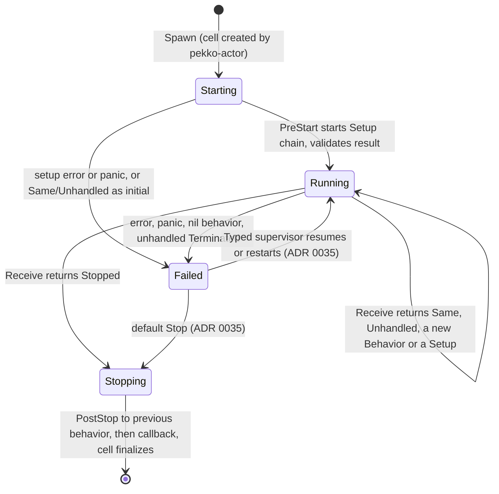

# ADR 0034: Typed `Behavior[T]` boundary on the shared runtime

- Status: **partly accepted** by the Owner on 2026-10-27 (decision B-1, `docs/parity/typed-owner-decisions-2026-10-27.md` section 0): P1, P2,
  P3, P4, P6, P8, P5 except how `Terminated{Ref}` and `ChildFailed{Ref, Cause}` get their `Ref` and cause, P7 as written, and X1, X3,
  X5, as published at `develop` `2029305`. Still **proposed**: the cause half of that construction (`ChildFailed`, B-2, issue #1250), X2 (B-3), X4 and X6 (B-4); interceptors are a
  deferred capability. **Amended on 2026-10-28:** the Owner accepted B-2 for `Terminated` only (by `ID`) and the wording of P6, see "Amendment (accepted)" at the end. Before that decision the whole ADR was **proposed**. Revised on 2026-10-26 (audit #004, block 3): line citations of B9, B10, B13, B15 and X5 corrected and X6 **Amended on 2026-11-04** (additive, ADR 0036 decisions): X4 is decided by ADR 0036 (closes when the stream is delivered), X6 stays open (pending the `UnhandledMessage`/`Dropped` oracle), so B-4 is only partially resolved *(Superseded by Amendment (2026-11-05): X6 is resolved)*; interceptors are accepted, delivery pending. See "Amendment (2026-11-04)" at the end; the text above is unchanged. **Amended on 2026-11-05** (additive, [EVT-1 oracle](../parity/oracles/evt-1-unhandled-dropped-2026-11-05.md)): X6 is resolved, so B-4 is resolved (X4 by ADR 0036, X6 by this amendment); see "Amendment (2026-11-05)" at the end. **Amended on 2026-11-05 (d)** (additive, Owner decision of 2026-11-06): the rule of P6 is unchanged; the owner of the capture of the death pact is #1379 and the owner of the delivery of `ChildFailed` is #1346 (#1250 and #976 in the text above are superseded); see "Amendment (2026-11-05, d)" at the end.
  added; no decision changed. Revised on 2026-10-27 (audit #004, final validation): labels of P2, P5, P7, X2, X4 and X6 and citations of B10, B12, B14
  and X5 aligned with the decision package `docs/parity/typed-behavior-decision-package-2026-10-27.md` (PR #1217); no decision changed. Until 2026-10-27 nothing in this ADR was accepted and every "Decision" in it was the Architect's proposal; the
  parts not named above still are. It changes no code, no other ADR and no issue. See ADR 0037 (2026-11-05) for `Port` as a Go adaptation.
- Date: 2026-10-26
- Stage: 1 (actor core, Typed profile)
- Module: `pekko-actor-typed` (new module, ADR 0033 D3; not created yet), consuming `pekko-actor`
- Issues: #809 (TYP-01, this story); epic #763; program #746. Consumers: #847 (TYP-02, first implementation story), #1063 (GOV-01,
  Typed supervision, proposed as [ADR 0035](0035-typed-supervision.md)), #956, #994.
- Number: 0034 was free on 2026-10-26 in `origin/develop` (`13fb995`, ADRs up to 0033) and in every remote branch (0032 exists only on
  the branch of PR #1014). #1063 proposed 0034 for itself; this file takes 0034 because #1063 builds on it. Re-check at publication.
- Sources: Apache Pekko `v1.7.1`, `9a54d1294c3ac7821bbed3c940769c3d5027d1ff`. `T` = `upstream/pekko/actor-typed/src/main/scala/org/apache/pekko/actor/typed`,
  `AA` = `T/internal/adapter`, `TT` = `upstream/pekko/actor-typed-tests/src/test/scala/org/apache/pekko/actor/typed`. goPekko facts
  describe `develop` at `13fb9953879462adba4218114d6615dc3d3156b9`.
- Evidence levels: **SPEC** = a Pekko test asserts it (the test body was opened); **READ** = Pekko code only, no spec found by the
  search named in the row ("no spec found" is not "no oracle"). Nothing was run. Verification of the citations: the author opened
  `Behavior.scala:150-316`, `AA/ActorAdapter.scala:232-260`, `AA/ActorContextAdapter.scala:66-75`, `T/scaladsl/adapter/package.scala:54-62`,
  `T/ActorSystem.scala:300-306` and `AA/GuardianStartupBehavior.scala:35-52`; the remaining citations come from read-only research passes
  of 2026-10-26 that opened them, and were not all re-opened by the author.

## Feature

How a Typed `Behavior[T]` computes the next behavior on the existing actor cell of `pekko-actor`: setup, receive, the special
behaviors, signals, the initial-behavior rule, the extension point, failures, and what is owned by the cell. Supervision strategies are
[ADR 0035](0035-typed-supervision.md); this ADR only states the outcome a failed turn hands to supervision.

## Answer first

| Question | Proposed answer |
|---|---|
| Is there a second runtime? | No. A Typed actor is one `pekko-actor` actor whose `Actor[T]` is an interpreter of the current `Behavior[T]` (ADR 0033 D1). Pekko does the same: `ActorAdapter extends classic.Actor` (`AA/ActorAdapter.scala:65-66`) |
| What does `setup` do? | Runs when the actor starts (in `PreStart`), not when the behavior is built, and again on a Typed restart |
| What is rejected as an initial behavior? | Only `Same` and `Unhandled`. A deferred (`Setup`) behavior **is** valid: it is started before it is validated. `Stopped` is valid for an actor, not for a Typed System guardian |
| What happens to an unhandled `Terminated`? | A death pact: a failure with cause `ErrDeathPact`, which Typed supervision can catch |
| How does a failure look in Go? | A behavior function returns `(Behavior[T], error)`; a non-nil error or a panic is a failure, as in the accepted Classic contract |
| New `pekko-actor` exports needed by this boundary? | None. Exports needed by later stories are listed in the readiness document, section 3 |

## How Pekko solves it

| # | Guarantee | Pekko implementation | Observing spec | Level |
|---|---|---|---|---|
| B1 | `setup` is lazy: evaluated when the actor starts | `T/scaladsl/Behaviors.scala:39-40`; `T/internal/BehaviorImpl.scala:123-133`; `AA/ActorAdapter.scala:298-305` | `TT/DeferredSpec.scala:51` "must create underlying" | SPEC |
| B2 | Nested deferred, and deferred wrapped by interceptors or `supervise`, are started by `Behavior.start` | `T/Behavior.scala:198-212` | `TT/DeferredSpec.scala:99`, `:111`, `:129` | SPEC |
| B3 | `setup` runs again on a Typed restart | `T/internal/Supervision.scala:404` | `TT/ActorContextSpec.scala:255` "reset behavior upon restart"; contrast `:281` (resume keeps state) | SPEC |
| B4 | `validateAsInitial` rejects only `same` and `unhandled` (IllegalArgumentException); deferred and stopped pass | `T/Behavior.scala:235-243` | `same` through setup: `TT/DeferredSpec.scala:147`; stopped as initial: `TT/scaladsl/StopSpec.scala:95` | SPEC (partial: no spec spawns a bare `same`) |
| B5 | Validation of a spawned actor happens at actor construction (`preStart`), not at the spawn call: an invalid initial behavior is an `ActorInitializationException` plus `Terminated` | `AA/ActorRefFactoryAdapter.scala:50` (inside the props thunk); `AA/ActorAdapter.scala:302` | `TT/DeferredSpec.scala:147` | SPEC |
| B6 | A Typed System guardian is validated synchronously and must also be alive (`stopped` rejected) | `T/ActorSystem.scala:303-304` | no spec found (searched `ActorSystemSpec` for a stopped guardian) | READ |
| B7 | The value returned by receive is the next behavior; `canonicalize` maps `same` and `unhandled` to the current behavior and starts a returned deferred | `T/Behavior.scala:183-192`; `AA/ActorAdapter.scala:165-178` | `TT/ActorContextSpec.scala:100` "canonicalize behaviors"; `TT/BehaviorSpec.scala:280-293` | SPEC |
| B8 | `stopped` stops the actor; `PostStop` goes to the **previous** behavior, then the optional callback runs | `T/internal/BehaviorImpl.scala:97-121`; `AA/ActorAdapter.scala:173-176, 338-361` | `TT/scaladsl/StopSpec.scala:43`, `:55` (order: signal then callback) | SPEC |
| B9 | `empty`: every message and signal is unhandled | `T/Behavior.scala:305-306` | `TT/AskSpec.scala:96`; `TT/scaladsl/AdaptationFailureSpec.scala:105` | SPEC |
| B10 | `ignore`: every message and signal is `same`, nothing published | `T/Behavior.scala:297-298` | signals: `TT/scaladsl/AdaptationFailureSpec.scala:105`; messages: `TT/scaladsl/ActorContextAskSpec.scala:147` (an `ignore` ask target that never replies, indirect) | SPEC (signal), SPEC indirect (message) |
| B11 | `same`/`unhandled` are return values only; interpreting them, or an unstarted deferred, is an error | `T/Behavior.scala:289-295` | `TT/BehaviorSpec.scala:257` (marker only) | READ |
| B12 | A null behavior **returned** by a handler fails the turn with `NullPointerException` (`b._tag` on null); `InvalidMessageException` applies only to a null **current** behavior | `T/internal/adapter/ActorAdapter.scala:165`; `T/Behavior.scala:285-286` | no spec found (searched `InvalidMessageException`) | READ |
| B13 | An unhandled message is published as `UnhandledMessage` on the event stream; an unhandled signal other than `Terminated` and `MessageAdaptionFailure` is dropped | `AA/ActorAdapter.scala:220-230`; classic `Actor.scala:656-660` | `TT/ActorContextSpec.scala:100`; `TT/scaladsl/ActorContextDelegateSpec.scala:82` | SPEC |
| B14 | An unhandled `Terminated` (and `ChildFailed`, a subclass) throws `DeathPactException` inside `interpretSignal`, so supervision can catch it | `T/Behavior.scala:270-276`; `T/MessageAndSignals.scala:63-66, 104` | `TT/WatchSpec.scala:165`; `TT/ActorContextSpec.scala:483`; `TT/SupervisionSpec.scala:1408` | SPEC (Terminated); ChildFailed variant: `TT/WatchSpec.scala:165` exercises it when the failing child is watched by a Typed parent (INFERENCE from `T/internal/adapter/ActorAdapter.scala:94-101, 247-273`) |
| B15 | The default `receive*` behaviors rethrow an unhandled `MessageAdaptionFailure` | `T/internal/BehaviorImpl.scala:73-76`; `AA/ActorAdapter.scala:197-213` | `TT/scaladsl/AdaptationFailureSpec.scala:91` | SPEC |
| B16 | Signals are `PreRestart`, `PostStop`, `Terminated`, `ChildFailed`, `MessageAdaptionFailure`; there is no `PreStart` signal | `T/MessageAndSignals.scala`; `AA/ActorAdapter.scala:99-106, 307-336` | `TT/ActorContextSpec.scala:136`, `:159`; `TT/BehaviorSpec.scala:206` is `pending` | SPEC |
| B17 | `PostStop` is not delivered to a deferred behavior that never started | `AA/ActorAdapter.scala:324-336` | no spec found | READ |
| B18 | `ExtensibleBehavior` (`receive`, `receiveSignal`) is the public extension point; `BehaviorInterceptor` is a separate contract for wrappers | `T/Behavior.scala:99-140`; `T/BehaviorInterceptor.scala` | indirect: `TT/BehaviorSpec.scala:467`, `:528`; `TT/InterceptSpec.scala` | SPEC (indirect) |
| B19 | One actor, one mailbox: `context.self` is the classic self; children are classic children; message adapters enqueue to self | `AA/ActorContextAdapter.scala:56, 67-74, 138`; `AA/PropsAdapter.scala:31-51` | indirect (every Typed spec) | READ |
| B20 | `same`, `unhandled`, `empty`, `ignore` and plain `stopped` are singletons; dispatch is a tag switch | `T/internal/BehaviorImpl.scala:30-44, 59-71, 78-92, 99` | — | READ |
| B21 | A null message is rejected synchronously at `tell` (`InvalidMessageException`) | `AA/ActorRefAdapter.scala:35-36` | `TT/ActorContextSpec.scala:662` | SPEC |

**Correction to the #809 reconciliation of 2026-10-24.** It asks to "add: validateAsInitial rejects deferred/same/unhandled as initial
behavior (Behavior.scala:240)". The code (`T/Behavior.scala:235-243`) rejects only `same` and `unhandled`, and its own doc says
"Starting out with a `Stopped` behavior is allowed". A deferred behavior is never seen by `validateAsInitial` unstarted: callers run
`Behavior.start` first (`AA/ActorAdapter.scala:302, 320`; `T/internal/Supervision.scala:404`). What rejects an unstarted deferred is
the interpreter (`T/Behavior.scala:294-295`), which is an internal invariant, not an initial-behavior rule. **Validating** a behavior
and **starting** a deferred one are two different steps.

## How GoAkt solves it

Not consulted. No ADR shows GoAkt solving this better; Pekko is the default source (`CLAUDE.md`).

## goPekko baseline (what the boundary consumes)

| Runtime piece | Where | Used for |
|---|---|---|
| `Actor[T].Receive(*Context[T], T) error`; a returned error or a panic is a failure (`*PanicError`) | `pekko-actor/actor/actor.go:15-21`; `supervision.go:114-118` | the interpreter's `Receive` |
| `PreStarter`, `PostStopper`, `TerminatedHandler` (`OnTerminated`), `PreRestarter`, `PostRestarter` | `actor.go:27-44`; `supervision_hooks.go:55-68` | start of `setup`, `PostStop`, `Terminated`, runtime restart |
| Without `OnTerminated` a terminated subject is a death pact (`ErrDeathPact`); the default decider stops on it | `actor.go:41-44`; `errors.go:56-58`; `supervision.go:103-110` | B14 |
| `Spawn`/`SpawnAnonymous` over a `Spawner` (`*System`, `*Context[T]`); the factory re-runs on a runtime restart | `spawn.go:85, 98`; `hierarchy.go:10-29` | child creation |
| `Watch`, `WatchWith`, `Unwatch`, `Stop`, `StopSelf`, `Children` | `watch.go:107-119`; `stop.go:31`; `actor.go:52-53`; `hierarchy.go:409-422` | context operations |
| `Port` / `PortHandler[T]`: untyped posts into the cell, ordered with the mailbox | `port.go:25-62` | internal messages (adapted messages, scheduled restarts) |
| `Tell` never blocks and never fails; no nil check | `ref.go:47-60` | B21 is the open divergence #452 (X2) |

## Decision (proposed)

**P1. One interpreter actor.** `pekko-actor-typed` spawns each Typed actor as one `pekko-actor` actor whose `Actor[T]` value holds the
current `Behavior[T]`. It implements `PreStarter`, `PostStopper`, `TerminatedHandler`, `PreRestarter` and `PortHandler`. The Typed
`ActorRef[T]` is the native `actor.Ref[T]` of that actor, not a wrapper, so `Watch`, `Ask` and `Done` keep working (`askTarget` and the
watch resolver accept only native refs, `ask_endpoint.go:126-142`, `errors.go:55`). Identity, mailbox, ID, name, children and
termination are the cell's; the interpreter owns only the behavior value. Becoming happens inside the interpreter; no runtime
`become` is added (ADR 0010 keeps it excluded).

**P2. Go shape (Architect choice, names indicative).** `Behavior[T]` is a sealed interface (an unexported method). Constructors:
`Setup`, `Receive`, `ReceiveMessage`, `ReceiveSignal` (on a receive behavior), `Same`, `Unhandled`, `Stopped`, `StoppedWith(func())`,
`Empty`, `Ignore`, and `Extend(ExtensibleBehavior[T])`. Handlers have the shape `func(ctx *Context[T], msg T) (Behavior[T], error)`.
`ExtensibleBehavior[T]` is a public interface with `Receive` and `ReceiveSignal`, both returning `(Behavior[T], error)`; `Extend` adapts
it to `Behavior[T]`. The special behaviors are zero-size values of unexported types, so returning them does not allocate (B20).
*Rejected alternative:* make `Behavior[T]` itself the user-implementable interface (closer to Pekko's class hierarchy) — it would let
user types impersonate `Same` or `Stopped` and needs a run-time tag check on every turn. Interceptors (`BehaviorInterceptor`,
`transformMessages`, `monitor`) are not in this list: they are a **deferred capability**, not a language adaptation.

**P3. Start.** In `PreStart` the interpreter starts the initial behavior: it evaluates every `Setup` (nested or wrapped) until a
non-deferred behavior results (B1, B2), then validates it. `Same` or `Unhandled` as the result is a start failure with cause
`ErrInvalidInitialBehavior`. Unless a Typed supervisor handles it (ADR 0035), the runtime reports a start failure as an
`*InitializationError` (`actor.go:22-27`), as Pekko reports an `ActorInitializationException` (B5). `Stopped` is valid: the actor stops after start and runs its `PostStop` as in B8. Validation
happens at actor start, not at the spawn call (B5); the Typed System constructor (#994) additionally validates the guardian
synchronously and rejects `Stopped` (B6).

**P4. Turn.** For a message the interpreter calls the current behavior and canonicalizes the result (B7):

| Result | Next behavior | Observable |
|---|---|---|
| `Same` | current | none |
| `Unhandled` | current | `UnhandledMessage` published (see P7) |
| `Setup(...)` | its started result, canonicalized | — |
| `Stopped` / `StoppedWith(cb)` | stopping | `StopSelf`; `PostStop` to the previous behavior, then `cb` (B8) |
| any other | that behavior | none |
| `(nil, nil)` | — | failure with cause `ErrNilBehavior`; Pekko fails with `NullPointerException` (B12). Both are supervisable failures; whether a matcher selects it like an NPE is open (decision package, Q1) |
| `(_, err)` with `err != nil`, or a panic | — | failure with that cause (or `*actor.PanicError`); the returned behavior is ignored |

`Empty` and `Ignore` follow B9 and B10.

**P5. Signals.** `Signal` is a sealed set: `PreRestart`, `PostStop`, `Terminated{Ref}`, `ChildFailed{Ref, Cause}`,
`MessageAdaptionFailure{Cause}`. `PostStop` comes from `PostStopper`, `Terminated` from `OnTerminated`, `PreRestart` from Typed
supervision (ADR 0035), `MessageAdaptionFailure` from a `Port` post. `PostStop` is not delivered to a behavior that never started (B17).
There is no `PreStart` signal (B16). **B-2 (decision package), amended 2026-10-28:** the runtime `Terminated` carries only an ID
(`pekko-actor/actor/watch.go:22`). For `Terminated`, the interpreter builds the signal from that ID and the signal identifies the terminated actor by it (see "Amendment (accepted)"). How `ChildFailed{Ref, Cause}` gets its `Ref` and cause stays **open** (issue #1250).

**P6. Death pact.** If the active behavior has no signal handler when `Terminated` arrives (or `ChildFailed`, once #1250 (superseded, see Amendment 2026-11-05, d) delivers it), the interpreter generates a failure that wraps `actor.ErrDeathPact` and names the subject, while interpreting the signal (B14, `Behavior.scala:270-277`). If a Typed supervision that captures that failure exists (ADR 0035, #976 (superseded, see Amendment 2026-11-05, d)), it decides. Otherwise the interpreter applies the default Stop of mechanism M-B (ADR 0035): it stops the actor and returns no error to the runtime (this is the M-B path, for an actor started by Classic or the system; the M-A path, a Typed parent, is #1250 (superseded, see Amendment 2026-11-05, d)), so the parent's decider is not consulted, `PostStop` runs once and a watcher of this actor sees a plain `Terminated`. The failure is thus handled before the runtime sees it, as described here. Until #976 (superseded, see Amendment 2026-11-05, d) delivers it, no Typed supervision captures the failure. A handler that exists and handles the signal never produces a death pact; "handled" includes returning `Same` (partial delivery: an explicit decline of the signal stays pending in #925, which keeps the unhandled marker; corrected from #1181 on 2026-10-28, see "Correction (accepted)").
An unhandled `MessageAdaptionFailure` from the default receive behaviors is a failure with its cause (B15); `Empty` and `Ignore`
survive it. Other unhandled signals are dropped.

**P7. Unhandled messages.** The outcome is fixed here; the publication target is not. An unhandled message must be observable as an
`UnhandledMessage{Msg, Recipient}` once an event stream exists (Pekko's also carries the sender, `Actor.scala:659`; see X6); `pekko-actor` has none today (only dead letters, `deadletter.go:22-42`).
Until the event-stream decision (readiness document, decision 5), the implementation story records the unhandled message through a
module-local hook and states that it is not yet published. It is never sent as a `DeadLetter`. Until it is published this is a **deferred capability** (X4), not an intentional difference.

**P8. Failure outcome handed to supervision.** A failed turn produces a cause (error, `*actor.PanicError`, `ErrDeathPact` wrap). What
happens next (stop by default, resume, restart, who decides) is [ADR 0035](0035-typed-supervision.md). This ADR records no supervision
decision.

### Lifecycle on the shared cell

## Differences (proposed; each row labelled)

| # | Difference | Reason |
|---|---|---|
| X1 | Failures are `(Behavior[T], error)` returns or panics, not exceptions | accepted Go contract: `Receive` returns `error` (`actor.go:15-21`; ADR 0010 decision (a), style A3) |
| X2 | `Tell` of a nil value is not rejected (Pekko: `InvalidMessageException`, B21) | **Open divergence, not a language adaptation:** the same gap as Classic #452; ADR 0017 (`0017-supervision.md:348-352`) does not authorize accepting nil. Decision B-3 of the decision package |
| X3 | `Behavior[T]` is sealed; extension goes through `Extend(ExtensibleBehavior[T])` | P2 |
| X4 | No `UnhandledMessage` publication until an event stream exists | **Deferred capability** (P7): `TT/ActorContextSpec.scala:100`, `TT/AskSpec.scala:96` and `TT/scaladsl/ActorContextDelegateSpec.scala:82` assert the publication. Decision B-4 |
| X5 | No `failed(cause)` behavior value; a failure is a returned error | Pekko's `failed` is internal (`BehaviorImpl.scala:71`) |
| X6 | `UnhandledMessage` has no sender field until a sender exists in the runtime envelope | ADR 0032 (partly accepted, only in PR #1014) defines the sender; `Tell` carries none today. **Deferred capability**, not an intentional difference. Decision B-4. *Superseded by Amendment (2026-11-05): the premise "no sender field" is incorrect.* |

## ADR impact list (ADR 0033 D5)

| ADR | Status read from the file | Impact |
|---|---|---|
| 0033 D1, D2, D3, D11, D12 | accepted 2026-10-24 | D1: satisfied by P1. D2: supervision left to ADR 0035. D3: no export needed by this ADR. D12: adapters out of scope |
| 0033 line 29 | accepted | cites the allocation risk at "ADR 0010:56"; the row is at `0010-actor-api.md:57`. Citation fix only |
| 0010 | proposed, partly accepted (watch, supervision) | A2 (`Behavior[T]`) is now a layer, not the runtime API; "Excluded for now" (`:236`) unchanged: no runtime `become`. Allocation risk (`:57`): P2 removes allocation for the special behaviors; closures of `Receive` are built once per behavior, not per message (B20); not measured |
| 0017 | accepted 2026-10-14 | none here; Typed supervision is ADR 0035 |
| 0011 owner decision 2 | accepted | no new export |
| 0015 D6, D7 | accepted parts | P1 keeps native refs, so Typed `Ask` reuses `actor.Ask`; `context.ask` waits for D7 (#1020 index, readiness doc) |
| 0032 | partly accepted, only in PR #1014, not in `develop` | D5 stays open; it does not block this boundary (ADR 0033 D6) |

## Evidence

- Benchmark: none. Judge: none for Typed (ADR 0033 Consequences). Complexity: one interpreter type, about a dozen constructors.
- Oracle per guarantee: the "Observing spec" column. Rows marked READ need an oracle-applicability determination (ADR 0033 D13)
  before their Go tests count as alternative evidence.

## Owner decisions

The questions are decisions B-1 to B-5 of `docs/parity/typed-behavior-decision-package-2026-10-27.md`; they supersede readiness decision 1. B-1 was accepted on 2026-10-27 (status line). X2, X4, X6 and the
construction mechanism of P5 (B-2) are not part of B-1 and stayed open; B-2 was accepted for `Terminated` only on 2026-10-28 (see "Amendment (accepted)"), and its cause half stays open (#1250). Everything else above is an Architect choice inside ADR 0033 and does not need a separate approval.

## Consequences

- #847 (TYP-02) can implement P1 to P4 and P6 (P5 is open for `ChildFailed` only, B-2 cause half, #1250) once this ADR is accepted and the module exists (#1096).
- No `pekko-actor` change follows from this ADR.
- Stale text found, not changed here: `pekko-actor/actor/actor.go:18, 26` say an actor without a declared strategy stops; the code
  applies `DefaultStrategy` (Restart) to every non-guardian actor (`supervision.go:103-110`). It is a comment of production code and is
  left to a code story.

## Amendment (accepted, 2026-10-28): construction of `Terminated` (B-2) and the wording of P6

**Status of this amendment: ACCEPTED by the Owner on 2026-10-28**, at the text of PR #1251 at SHA `730f6250267a5e517daac0ecf41615f0c01d9a54`, with three points: (1) B-2 is resolved **only for `Terminated`, by `ID`**; `ChildFailed` stays pending in #1250 (superseded, see Amendment 2026-11-05, d). (2) P6 follows M-B: generate `ErrDeathPact` during the interpretation; Typed supervision decides whether to capture it once implemented; otherwise `StopSelf` without returning the error to the runtime or consulting the Classic decider. (3) `Same` counts as handled; an explicit decline stays pending in #925 (the Owner's acceptance named #1181; corrected on 2026-10-28, see "Correction (accepted)"). The acceptance does not authorize anticipating the supervision of #976, merges or closing issues. It records the Owner's G2 choices for #954 Slice B (D-B1 option A and D-B5, `docs/scopes/954-slice-b-terminated-death-pact.md`, Log L2 and L3, PR #1249). It changes no code and no issue, and no decision of another ADR: the only edit outside ADR 0034 is the status row for ADR 0034 in `docs/adr/0035-typed-supervision.md`, which restates this acceptance. The derived edits to this ADR and to `docs/parity/` are listed below and were applied in the same PR.

**B-2, representation of `Terminated` (D-B1 option A).** B-2 asks two things: how `Terminated{Ref}` gets its `Ref`, and how `ChildFailed{Ref, Cause}` gets its cause. This amendment answers **only the first, for `Terminated`**. The decision package proposed mechanism (a) for both (`docs/parity/typed-owner-decisions-2026-10-27.md`, B-2: the interpreter records the cause of each watched child and resolves the `Ref` from a watch table); **this amendment does not adopt that wording** for `Terminated`, because the Owner chose option A (G2, L3) and no watch table exists before #1171, so the field named `Ref` in P5 is read, for `Terminated`, as the identity of the terminated actor. The cause half of B-2 (`ChildFailed`) **stays open** and belongs to #1250. The interpreter builds `Terminated` only from the runtime's `actor.Terminated.Who()`. The signal identifies the terminated actor by its runtime `ID`, which is comparable
and unique in the process (`pekko-actor/actor/id.go`). This is a documented difference from Pekko's `Terminated.ref: ActorRef[Nothing]` (`MessageAndSignals.scala:81-93`), classified for the Owner under ADR 0033 D13:

| Pekko operation | State with `ID` |
|---|---|
| identity (`equals`, `hashCode`) | conserved |
| later use as a `Watch`/`Stop` subject, sending, `toString`, ordering | not available from the signal alone (see the comparison in the scope, D-B1) |
| `path` | not available (`ActorPath` is not linked to a reference or an `ID`) |

The shape of `ChildFailed{Ref, Cause}` and the cause mechanism are **not** decided here: they belong to issue #1250 (superseded, see Amendment 2026-11-05, d) (`TYP-52`). The name of the exported accessor that returns the `ID` is also not fixed by this text; the implementing PR (B2) proposes it and its QA reviews it, and it adds nothing else to the public surface. This amendment does not re-slice #954 or #1171 and claims no Pekko parity.

**P6, first sentence replaced (applied in P6 above).** The accepted wording is the one now in P6: the failure is generated during the interpretation; Typed supervision (#976 (superseded, see Amendment 2026-11-05, d)) decides whether to capture it once implemented; otherwise the default Stop of M-B applies without returning the error to the runtime or consulting the Classic decider; `Same` counts as handled and an explicit decline stays pending in #925 (corrected from #1181 on 2026-10-28, see "Correction (accepted)"). The sentence about `MessageAdaptionFailure` (B15, `Empty`, `Ignore`) and "Other unhandled signals are dropped." stay as they were.

**Edits applied on acceptance (same PR).** In this ADR: the status line, the B-2 sentence of P5, the first sentence of P6, the "Owner decisions" paragraph and the Consequences line. In `docs/parity/`: a pointer on the B-2 row of `typed-owner-decisions-2026-10-27.md` and of `typed-behavior-decision-package-2026-10-27.md`, and on `typed-supervision-stories-reconciliation-2026-10-26.md` (items 1-2 of the #954 criteria). Not edited, because they are dated records approved at their time: `docs/scopes/847-typed-behavior-install.md`, `954-typed-lifecycle-signals.md` and `956-typed-default-stop.md`. Left to the implementing PR (B2), not to this one: the comment at `pekko-actor-typed/typed/signal.go:30` and all code.

Evidence: Pekko v1.7.1 `9a54d1294c3ac7821bbed3c940769c3d5027d1ff`, read, not executed: `Behavior.scala:270-277`, `scaladsl/adapter/PropsAdapter.scala:34`, `internal/adapter/ActorAdapter.scala:94-101, 220-227`. No Typed oracle exists (ADR 0033),
so this is alternative evidence pending Owner approval (ADR 0033 D13).

## Correction (accepted, 2026-10-28): the explicit decline is pending #925, not #1181

**Status: ACCEPTED by the Owner on 2026-10-28** (the Owner's message reached the TL partly corrupted; the legible fragment is "ADR 0034: #925; #1181 empty/ignore. aceptada"). History: this section was merged as PROPOSED by PR #1257 (squash `c826d3504d2956ba3e09177d4722e56478f60111`, reviewed head `665e8e9bc63945f2dd73ed9c6b69e633e4a0362f`) with the accepted text untouched; the follow-up that records the acceptance applied the three replacements of the table below **in place**, each marked with a pointer to this section, and kept the previous wording in the column "Previous text (accepted 2026-10-28, before the correction)". It changes no code, no decision of another ADR and no issue.

**Why.** The explicit decline of a signal by a handler (Pekko `Behaviors.unhandled`, `scaladsl/Behaviors.scala:65`) is the `Unhandled` result. Issue #925 (`TYP-03`) keeps the unhandled marker (its reconciliation: "SPLIT; keep (a) the unhandled marker"). Issue #1181 (`TYP-47`) delivers the `empty` and `ignore` behaviors over that marker (its R3 concerns an `empty` behavior failing on an unhandled `Terminated`), and #1182 delivers `stopped`. The accepted text names #1181 as the pending owner of the decline; the intent (an explicit decline is pending and not covered) is unchanged, only the issue is wrong.

**Exact wording, three places** (the replaced part is the final clause of each sentence).

| # | Where | Previous text (accepted 2026-10-28, before the correction) | Text now in force |
|---|---|---|---|
| 1 | P6, last sentence | "... \"handled\" includes returning `Same` (partial delivery: an explicit decline of the signal stays pending in #1181)." | "... \"handled\" includes returning `Same` (partial delivery: an explicit decline of the signal stays pending in #925, which keeps the unhandled marker)." |
| 2 | Status paragraph of "Amendment (accepted)", point (3) | "(3) `Same` counts as handled; an explicit decline stays pending in #1181." | "(3) `Same` counts as handled; an explicit decline stays pending in #925." |
| 3 | "P6, first sentence replaced" paragraph | "`Same` counts as handled and an explicit decline stays pending in #1181." | "`Same` counts as handled and an explicit decline stays pending in #925." |

Row 2 paraphrases the Owner's acceptance of 2026-10-28; the Owner's own words are not altered. Joint references "#925, #1181" elsewhere stay as they are. Texts outside this ADR that carry the old attribution are corrected by the notes recorded in `migration/stage-1/typed-954-slice-b/EXECUTION-RECORD.md` section 10; the kit `RULEBOOK.md` and `manifest.tsv` are not edited (closed package).

## Amendment (2026-11-04): publication of unhandled and dropped messages, and interceptors

Additive. The text above is unchanged and keeps its historical wording. Source: ADR 0036 (accepted by the Owner on 2026-11-04), ADR 0033 D14.

| Item above | Replaced by | Effect |
|---|---|---|
| P7 "the publication target is not [fixed]" and the module-local hook | ADR 0036, "EVT-1: publication to the EventStream" | Target decided: `UnhandledMessage` is published to the `EventStream` of `pekko-actor`. The local hook stays until the stream exists. |
| X4 "No `UnhandledMessage` publication until an event stream exists" | ADR 0036, "EVT-1" and "Consequences" | Decided by ADR 0036: it is still a deferred capability and closes when the stream is delivered. |
| X6 "`UnhandledMessage` has no sender field until a sender exists" | ADR 0036 covers the `Dropped` case only (no sender, the actor as recipient) | **Open**: no decision for the sender field of `UnhandledMessage`; it waits for the `UnhandledMessage`/`Dropped` oracle, which has not been run. X6 stays as written. B-4 is therefore **partially resolved** (X4 by ADR 0036; X6 open). *Superseded by Amendment (2026-11-05): X6 is resolved.* |
| P2 and the status line: interceptor constructors are a "deferred capability" | ADR 0036, "Interceptors" | The Pekko equivalents of `BehaviorInterceptor`, `Behaviors.intercept`, `Behaviors.monitor` and `Behaviors.logMessages` are accepted; delivery is pending. Nested ordering, `transformMessages` and `withMDC` are **To be verified** in ADR 0036. |

## Amendment (2026-11-05): the sender of `UnhandledMessage` (X6)

- Status: **Accepted** by the Owner on 2026-11-05 (text: "ok", accepting the proposal recorded here). Additive: the text above is unchanged; the phrases marked "Superseded by Amendment (2026-11-05)" are replaced by it.
- Principle applied: ADR 0033 D14. Oracle: [`evt-1-unhandled-dropped-2026-11-05.md`](../parity/oracles/evt-1-unhandled-dropped-2026-11-05.md), Pekko 1.7.1.
- Superseded: the premise of X6 that `UnhandledMessage` "has no sender field". Pekko's event has the field (`Actor.scala:297`, `:659`).

**Decision (D14).**
1. The `UnhandledMessage` event of goPekko has the fields `message`, `sender` and `recipient`, as in Pekko (`Actor.scala:297`, published at `Actor.scala:655-660`). The Typed route is `Behaviors.unhandled` -> `ActorAdapter.next` (`ActorAdapter.scala:166-167`) -> `ActorAdapter.unhandled` (`:220-229`) -> `Actor.unhandled` -> `eventStream.publish` (oracle, section 1).
2. Value of `sender`:
   - Typed sends (a `tell` from a Typed actor, from outside the system, or an ask): the `deadLetters` ref of the system. It is not nil and not the temporary actor of an ask (oracle, scenarios U1, U2, U3).
   - A send with an explicit sender (the Classic equivalent, if goPekko exposes one): that sender (oracle, scenario U5).
3. Unhandled signals (for example `PostStop`): nothing is published (oracle, scenario U4; `ActorAdapter.scala:226`).
4. Logging, observed only (no ADR decides anything about logging unhandled messages): with `pekko.actor.debug.unhandled = on` a DEBUG line "unhandled message from <sender>: <msg>" is logged (`Logging.scala:154-163`); in both modes the dead-letter listener logs an INFO line "was unhandled" (`DeadLetterListener.scala:43`, `:130-133`). Oracle, section 3.1.

**Effect on B-4.** X4 is decided by ADR 0036 (it closes when the stream is delivered) and X6 by this amendment, so B-4 is resolved. Delivery of the event stays pending (deferred capability).

## Amendment (2026-11-05, d): the owners of the P6 capture and of the delivery of `ChildFailed`

- Status: **Accepted** by the Owner on 2026-11-06 (session decision: "si — apruebo actualizar en ADR 0034 los dueños de P6 por enmienda"). Additive: the text above is unchanged except that each old owner pointer in P6 (line 137), in the status paragraph of "Amendment (accepted, 2026-10-28)" and in "P6, first sentence replaced" carries the marker "(superseded, see Amendment 2026-11-05, d)"; nothing was deleted.
- **The rule of P6 does not change.** The failure is generated during the interpretation; a Typed supervision that captures it decides; otherwise the default Stop of mechanism M-B applies; `Same` counts as handled.
- **Owners.** The capture of the death pact by a `Supervise` (ADR 0035 contract 10) belongs to #1379. #976 delivered `Supervise`, `OnFailure` and `Restart` and was closed on 2026-11-06 **without** delivering that capture. The delivery of `ChildFailed` (the cause half of B-2) belongs to #1346: #1250 was closed as not planned on 2026-11-06, and #1368 (#976 slice 3c-2, M-A-lite) delivered the stop half of the Typed-parent strategy. Every other mention in this ADR of #1250 as the owner of `ChildFailed` (status line, P5, "Owner decisions", Consequences, the B-2 paragraph of the 2026-10-28 amendment) reads #1346, and every mention of #976 as the owner of the capture reads #1379.

| Date | Owner decision (literal text) | Effect on this ADR |
|---|---|---|
| 2026-11-06 | "si — apruebo actualizar en ADR 0034 los dueños de P6 por enmienda: la captura del death pact por Supervise pasa a #1379 y la entrega de ChildFailed pasa de #1250 a #1346; la regla de P6 no cambia." | Owner pointers only; no rule, decision or disposition changes. |
