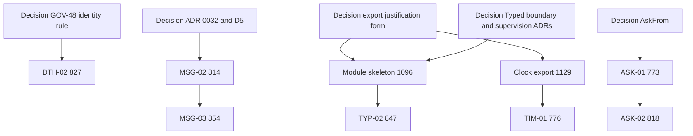

# Design closure record for `actor` and `actor-typed` against Apache Pekko v1.7.1 (2026-10-26)

**Status: the design is not closed.** This record does not declare parity, an implemented module or a closed design. It records what was reviewed, what was verified and by whom, which decisions exist and which are missing, and why none of the nine slice candidates evaluated in section 7 could start at `cad059c`. It makes no statement about slices outside that table. Nothing here changes an ADR, an issue, a label or code.

**Reconciled with `develop` at `13fb9953879462adba4218114d6615dc3d3156b9` (2026-10-26) in [`block-1-reconciliation.md`](block-1-reconciliation.md).** Where that file and this one differ, that file is the later and narrower statement. Sections 1, 4 and 7.2 below were corrected for the points listed in its section 3; everything else keeps its original wording and its original baseline (`cad059c`).

Normative source: `upstream/pekko` at `9a54d1294c3ac7821bbed3c940769c3d5027d1ff` (tag `v1.7.1`, pin confirmed in the tree of `develop`). Every statement about Pekko cites a path and lines in that checkout. "Code" means the implementation was read; "spec" means a test body that exercises and observes the behavior was read.

## 1. Baselines

| Item | State when this record was written |
|---|---|
| goPekko `develop` | `cad059c177b37f62c27b8a2e89a2826972817f18` (2026-10-26) |
| Base of the deep pass and of the first audit | `9abfb40f6669f30ba5a05699408154a55953f253` |
| Changes in `develop` between the two | 6 documentation PRs and 1 code PR: #1201 to #1206 and #1207, the cross-System watch chain (GOV-15 option B). They amend ADR 0010, 0015, 0017 and 0024 and implement DTH-01 (#785) in `pekko-actor/actor/watch.go`, `stop.go`, `ref.go`, `errors.go` and tests. Nothing else changed |
| Audit PR #1198 | open, base `9abfb40`, head `550287c` when last read. Its statements about cross-System watch (DTH-01 blocked, ADR amendments pending) are historical now |
| PR #1199 | closed, replaced by #1201 to #1207 |
| PR #1014 (ADR 0032) | open, not integrated, head `71854b1` |
| PR #1011 (IDN-14, `ActorPath` value) | open when this record was written; **merged afterwards** into `develop` as `13fb995`. The code is now in `develop`; issue #1008 is still open and labelled `status:ready` |
| PR #1013 (SYS-03) | open: its code is only in the PR, not in `develop` |
| ACT2 backlog (GitHub, 2026-10-26) | 445 issues, 440 open: 53 `status:ready`, 363 `status:blocked`, 24 without status label |

Scope of the facts about goPekko in the deep-pass files: they describe `develop` at `9abfb40`. Only the watch area changed since (see above); no deep-pass story is about it.

## 2. What was done, and by whom

| Role | Work | What the role did not do |
|---|---|---|
| Architect (lead) | Baseline, scope, ADR reading, decision table, first-slice analysis, spot checks listed in section 8 | Did not re-open every claim of the delegated files |
| Technical Writer (independent verifiers V1 to V6) | Re-opened the cited Pekko lines and spec bodies of the highest-impact findings; checked wording discipline (D13, ADR 0032, Owner decisions); the corrections were then applied to the files | Sampled; they did not check every finding. Each verification file states what it did not verify |
| Deep-pass producers (D1 to D8) | Read the 182 stories not read in depth before and wrote per-story findings | Their `DEEP` marks are their own declaration; the verifiers confirmed a sample |
| Inventory producers (INV-A, INV-T) | Enumerated public capabilities from the Pekko source tree and classified them against ADR 0033 and the backlog | Read spec titles, not assertion bodies, for most rows |

## 3. Depth reached

The first audit left 175 stories at shallow depth and 7 Typed stories unreviewed. The second pass covers all 182. Counts below come from the `Depth` field of each story section.

| Group | Content | Stories | DEEP | PARTIAL |
|---|---|---|---|---|
| D1 | Typed core A | 25 | 19 | 6 |
| D2 | Typed core B | 24 | 19 | 5 |
| D3 | Typed services and delivery | 15 | 15 | 0 |
| D4 | Supervision and system | 20 | 14 | 6 |
| D5a | Event stream and logging | 15 | 14 | 1 |
| D5b | Patterns and serialization | 16 | 16 | 0 |
| D6 | Routing, FSM, core identity | 20 | 14 | 6 |
| D7a | io | 17 | 1 | 16 |
| D7b | Typed testkit | 13 | 11 | 2 |
| D8 | Judge, governance, closure | 17 | 3 | 14 |
| | **Total** | **182** | **126** | **56** |

The two stories of D7b that the verifier showed were not read in full (#1141, #1150) were moved from `DEEP` to `PARTIAL` after verification. The producers' own summary lines differed from the story sections by one story in D4; the story sections are the record.

The seven Typed stories that were unreviewed: #978, #988 and #990 are now `DEEP`; #958, #982, #983 and #989 remain `PARTIAL`, with the missing evidence listed in each story section. Those four are not audited in depth.

Verification of the deep pass (independent, sampled):

| Verifier | Files | Findings checked in full | Result |
|---|---|---|---|
| V1 | D1 | 19 (+9 on code only) | 26 confirmed, 2 wrong, 1 overstated, 5 not verified |
| V2 | D2 | 15 (+12 partial) | 29 confirmed, 0 wrong, 3 overstated, 8 not verified |
| V3 | D3, D4 | about 31 (+24 partial) | well over 50 confirmed, 1 wrong, 4 overstated, 7 not verified |
| V4 | D5a, D5b | about 75 of 84 rows | 68 confirmed, 2 wrong, 10 overstated, 3 partial |
| V5 | D6, D7a | about 40 of 60 (+13 partial) | about 52 confirmed, 0 wrong, 6 overstated, 2 not verified |
| V6 | D7b, D8 | about 62 of 81 rows | 66 confirmed, 6 wrong, 6 overstated, 1 not verified, 2 partial |

Every file in `deep-pass/` starts with a verification-status block. Statements the verifiers did not cover keep the producer's wording and are not independently verified.

## 4. Inventory

Enumerated from the Pekko source tree (`inventory/INV-A-actor.md`, `inventory/INV-T-typed.md`), then classified only with what ADR 0033, the accepted ADRs and the backlog state.

| Module | Rows | included (story) | included, no story | excluded, recorded | excluded, only proposed | unclassified |
|---|---|---|---|---|---|---|
| `actor` | 211 | 93 | 29 | 12 | 9 | 67 |
| `actor-typed`, `actor-testkit-typed` | 127 | 96 | 0 | 2 | 7 | 19 |

The `actor` total includes 1 internal row and the `actor-typed` total includes 3 rows of another kind; none of them is in the columns.

Open points the inventory shows (each is an open question, not a decision):
- 86 rows have no classification in any accepted record. In `actor` they are mostly `util` (15 of 18), all of `japi`, JVM and Java facades in `dispatch` and `event`, and the `reference.conf` key groups. In `actor-typed` they include `ExtensibleBehavior`, `ActorRefResolverSetup`, the Typed `ActorSystem` accessors and the Java surface.
- Ten `ACTINV` rows are "retained existing implementation" in the disposition table of #746 and no ACT2 story cites their ids: `ACTINV-001, 008, 010, 037, 038, 048, 053, 055, 085, 091`. **This record first said they have "no evidence path"; that was wrong for nine of them.** Two audits already record evidence per capability, with named tests and evidence levels, at older SHAs (`docs/parity/actor-local-fidelity-audit-2026-10-22.md` at `590e86b`, `docs/parity/actor-local-closure-audit-2026-10-23.md` at `a807fed`). `ACTINV-091` (serializer registry, module `pekko-serialization`) appears in neither audit. What is missing is the link from each id to that evidence, evidence at the current SHA, and an oracle status. Detail and the mapping of each row: `block-1-reconciliation.md`, section 5.
- The "29 `actor` rows included without story" mix two things: 20 of the 29 rows have open stories for their extension (the retained baseline needs none by the design of #746), 3 have only closed stories, and 6 have no story at all (`preStart`/`postStop`, unbounded FIFO mailbox, serializers, and three internal rows). The ten ids above fall in 18 of the 29 rows, so the two counts overlap and are not additive.
- ADR 0033 D8 excludes network `io` as a category, while epic #762 still holds blocked TCP, UDP and DNS stories (#921 to #996). The exclusion records (GOV #1069 to #1072, #1088) are proposals.
- 25 of 253 Classic stories carry no inventory-row id; 59 are missing from the disposition table of #746; stories after TYP-33 and TSD-16 and all testkit stories carry no `ACTINV` id (the table ends at `ACTINV-126`).
- `orElse` has no definition in the v1.7.1 source of `actor-typed`, although the earlier inventory lists it.

Limits: the inventories read spec titles, not assertion bodies, for most rows; `scala-2.12` and `scala-3` duplicate sources were not enumerated; `pekko-serialization` is not in the snapshot used, so the goPekko column for serialization comes from ADR and story text.

## 5. Decisions

> **Update 2026-10-26, after this record was written.** The Owner answered decision 1 of section 5.3 (GOV-48, #1195) in the working thread. The decision, its reconciliation with `develop` and the residual scope of DTH-02 are recorded in `docs/parity/gov-48-dth-02-reconciliation-2026-10-26.md` (separate draft PR). That decision does not approve any other proposal of this record, authorizes no bulk change to the backlog and changes no other contract. The rest of this record is unchanged and still describes `cad059c`.

Rule used: an Owner decision is an explicit Owner instruction. Evidence is accepted when an accepted ADR quotes it, or the Owner wrote it in the request that started this work. A paraphrase in an issue body is not evidence.

### 5.1 Accepted by the Owner, with evidence

| Decision | Evidence | Integrated in `develop` |
|---|---|---|
| ADR 0033, D1 to D13 (scope, profiles, module, mandatory capabilities, D13) | Status line of ADR 0033: accepted by the Owner on 2026-10-24 in the working session. The ADR does not quote the words | yes |
| ADR 0031 (Address and ActorPath values) | Words quoted in the ADR | yes |
| ADR 0030 D1 to D8 (bounded mailbox) | Words quoted in the ADR | yes |
| ADR 0024 D1 to D5, and its amendment of 2026-10-25 | Words quoted in the ADR (2026-10-20 and 2026-10-25) | yes |
| ADR 0010 amendment of 2026-10-25: handles of another local System in `Watch`, `WatchWith`, `Unwatch`; carrier B with the `defer` of Q5; GOV-51 design | Words quoted in ADR 0010: "Apruebo como diseño: …" | yes; code in #1207 |
| ADR 0015 sentence for the same case; ADR 0017 explicit amendment | Words quoted in ADR 0024 and ADR 0017 | yes |
| GOV-15 option B: accept handles of another local System in `Watch`, `WatchWith`, `Unwatch`; `Done` and `Ask` keep their validations; remoting and cluster out | The Owner's request that started the first audit, and ADR 0010 | yes |
| ADR 0017 (supervision, Classic) | Status: accepted 2026-10-14 by the Owner | yes |
| ADR 0014, 0012, 0011, 0021 | Status lines: accepted | yes |
| ADR 0032 D1 (A3), D2 (Handle), D3 (explicit absence, revisit with #896), D4 (`TellFrom`), D6 (keep), D7 (accept) | Owner words quoted in the ADR text of PR #1014 | **no** (open PR) |

ADR 0032 is not integrated authority. Stories that cite it as accepted are listed in section 6.

### 5.2 Architect proposals (not decisions)

- The addition to ADR 0033 D2 about default failure outcomes per parent and child kind: text in `docs/parity/actor-typed-design-audit-2026-10-25/README.md` section 13.4 (PR #1198). It is limited to cases a spec observes; the other cases are open questions there.
- The per-story corrections in `deep-pass/` and `verification/`. They propose edits to issue text; none was applied to GitHub.
- The slice analysis in section 7.

### 5.3 Pending the Owner

| # | Decision needed | What blocks until it is answered |
|---|---|---|
| 1 | GOV-48 (#1195): identity rule for cleaning cross-System registrations (acceptance criterion 1 of DTH-02). The issue body states that the proposal has no Owner decision. It also records an Architect finding: under the accepted eventual release the stop path does not need a registration generation, because IDs are never reused; a generation is still needed to discard stale notifications, a mechanism with no Pekko counterpart | DTH-02 (#827) |
| 2 | Typed `Behavior[T]` boundary ADR (#809) and Typed supervision ADR (#1063), including the tension of ADR 0033 D2 with the observed Pekko outcomes per parent and child kind | #1096, #847 and every Typed implementation story |
| 3 | ADR 0032: integrate PR #1014 as is, amend it, or defer; D5 (sender of `Terminated` and the `WatchWith` message) is open | At least 8 stories cite D3, D4, D6 as accepted; MSG-02 (#814), MSG-03 (#854) and their consumers |
| 4 | `AskFrom`: ADR 0010 D4/D7 call it decided, ADR 0015 D1/D7 defer it (GOV-18 #1068) | #773, #818, #856, #857, #859 |
| 5 | Form of the individual ADR 0011 justification per export and the scope of its index (GOV-03 #1021, GOV-02 #1020). #1020 lists only the exports Typed needs | #1096, #1098, #1129 and the stories that need a new export |
| 6 | Individual classification of the ADR 0010 "Excluded for now" items (GOV-04 to GOV-14). ADR 0010 is still `proposed` outside the parts accepted above | The stories that depend on become, unhandled, receive timeout, `PoisonPill`, `Kill`, selection, dispatcher, mailbox, routers, FSM |
| 7 | What "applicable oracle" means in ADR 0033 D13 for rows that have Pekko source and specs but no judge scenario (JDG-04 #1034 forces a binary label) | Any V3 claim |
| 8 | Exclusion records for the 86 unclassified inventory rows and for the network `io` stories | Closure criteria in section 9 |
| 9 | Where the closed exclusion-reason vocabulary lives: 19 or more stories cite it as D13; it is enumerated in the dossier (`docs/actor-typed-completion-design.md:342`) and referenced by ADR 0033 row D-10 | Wording of exclusion records |
| 10 | Whether the ledger of corrections is applied to the ACT2 issue bodies, and in what form | Issue text still contains the defects listed in `verification/` |
| 11 | What to do with PR #1198 now that its cross-System watch sections are historical | Consistency of the audit record |

## 6. ADR contradictions to resolve before implementing (ADR 0033 D5)

For each area that a candidate first slice touches. "Resolved" means an accepted record settles it; the others are open.

| Area | Contradiction | State | Stories that depend on it |
|---|---|---|---|
| Sender | ADR 0010 D2, ADR 0017:691 and ADR 0030 P-1 say there is no sender; ADR 0032 (open PR #1014) defines one. Pekko replaces a missing sender with `system.deadLetters` (`dispatch/AbstractDispatcher.scala:51`) and `DeadLetter` requires a non-null sender (`actor/ActorRef.scala:592-593`); ADR 0032 D3 says an absent sender is `nil`, to be revisited with #896 | open | #814, #854, #896, #1023, #1024, #1091, #1093, #1099, #1167, #1169, #906, #1057, #1103, #1106 |
| Ask | `AskFrom`: ADR 0010 D4/D7 versus ADR 0015 D1/D7. ADR 0015 is `proposed` with parts approved by the Owner on 2026-10-10 | open | #773, #818, #856, #857, #859 |
| Typed default failure outcome | ADR 0033 D2 words it as a profile selected at creation; Pekko decides it by parent kind and failing-child kind (`actor-typed/.../internal/adapter/ActorAdapter.scala:232-266`, `:168-172`) | open; proposal in PR #1198 section 13 | #956, #1063 and the stories that depend on them |
| Cross-System watch | ADR 0010 `Handles` bullet, ADR 0015 R2, ADR 0017 H5b/D-1 and ADR 0024 item 2 | resolved by the amendments of 2026-10-25 (design accepted, DTH-01 implemented in #1207) | DTH-02 (#827) |
| Exclusions | ADR 0010 "Excluded for now" is proposed, so the items are not recorded exclusions | open | see 5.3 item 6 |
| Imports | ADR 0011 versus ADR 0021 on `pekko-serialization` imports (named in ADR 0033) | open | stories that need serializers in `pekko-actor` |
| Envelope status | ADR 0008 is `proposed`; ADR 0032 and 0010 rely on it | open | #814, #854 |

## 7. First slice

### 7.1 Conditions

A slice may start only if all five hold: (C1) its contract is backed by Pekko, (C2) it depends on no open Owner decision, (C3) the ADRs it touches are resolved, (C4) it has an atomic story with verifiable criteria, dependencies and defined evidence, and (C5) it contradicts no accepted ADR.

### 7.2 Candidates

| Candidate | C1 | C2 | C3 | C4 | C5 | Result |
|---|---|---|---|---|---|---|
| #827 DTH-02, clean up cross-System watches | yes for the release and discard rules (`DeathWatch.scala:103-104`, `:165-180`) | **no at `cad059c`**: acceptance criterion 1 depended on GOV-48 (#1195). **Decided by the Owner on 2026-10-26** (see the update at the start of section 5) | yes (amendments of 2026-10-25) | criterion 1 is Go-only; its wording is the one open confirmation | yes | Was blocked by decision 1 of section 5.3. After the decision its residual scope is tests and a wording confirmation, not production code (`block-1-reconciliation.md`, section 2) |
| #785 DTH-01, watch across two Systems | yes | yes | yes | yes | yes | Implemented by #1207; the issue is still open and labelled `ready`. Reconciling its evidence is not a new slice |
| #775 ASK-11, test synchronization | **no**: it fixes a Go test; Pekko order is complete, stop, unregister (`pattern/AskSupport.scala:739-742`, `:671-672`) | yes | yes | yes | yes | Does not satisfy C1. The race is plausible by code order (`close(c.done)` before `c.sys.signal(...)`, `stop.go`) and was not executed |
| #788 DTH-07, log a root guardian failure | partly: Pekko has two log sites (`ActorRefProvider.scala:479`, `:518-522`) | yes | yes | **no**: the story does not say which site, and its premise that Go logs nothing is unproven, because the root guardian strategy goes through the supervision logger when `Config.Logger` is set | yes | Needs its criteria corrected first |
| #791 MBX-13, evidence closure of ADR 0030 | n/a (traceability) | yes | yes | yes | yes | No code |
| #1052 EVT-15, `kit-logger` test fake | **no**: ADR 0033 D11 (accepted) defines it; Pekko has no counterpart | yes | yes | yes | yes | Does not satisfy C1 |
| #1090 IDN-19, child lookup | yes | R2 evidence classification open | yes | `Child` and `Children` already exist with tests | yes | Already implemented; not a new slice |
| #1008 IDN-14, `ActorPath` value | yes (ADR 0031) | yes | yes | yes | yes | Implemented at `cad059c` only in open PR #1011; **integrated in `develop` since `13fb995`**. Not a new slice; the issue is still open and `ready` |
| #809 TYP-01, Typed boundary ADR | yes | open (D2 tension, decision 2) | no | yes | open | Documentation slice; acceptance is the Owner's |

**Conclusion: none of the nine candidates in this table satisfies C1 to C5 at `cad059c`.** The table is not a survey of the backlog: slices outside it were not evaluated, and this record does not claim that no other slice can start. No code was written.

The shortest unblock identified at `cad059c` was decision 1 of section 5.3. The Owner answered it on 2026-10-26. This paragraph is kept as it was written; its conclusion about DTH-02 is replaced by `block-1-reconciliation.md`, section 2, which also records what in DTH-02 is already in `develop` and what a test slice would still need.

### 7.3 Lanes and parallelism

Prerequisites are as declared in the issue bodies; file-level disjointness between `pekko-actor` lanes was not verified.

| Lane | Starts when | Edits | Independent of |
|---|---|---|---|
| Cross-System watch cleanup | decision 1 | `pekko-actor` watch and stop paths | the Typed lane |
| Typed foundation | decisions 2 and 5, then #1096 | new module `pekko-actor-typed`, `go.work`, `scripts/deps.allow`, `CLAUDE.md` | the Classic lanes until it needs an export from `pekko-actor` |
| Sender and envelope | decision 3 | `pekko-actor` send and cell paths | the Typed lane |
| Ask | decision 4 | `pekko-actor` ask paths | the Typed lane |
| Clock and scheduler | decision 5, then #1129 | `pekko-actor` clock seam, then timers | other lanes only after the TIM-01 ADR exists |

## 8. Verification record

Checked by the Architect directly, beyond the delegated work:
- The tree of `develop` pins `upstream/pekko` at `9a54d1294c3ac7821bbed3c940769c3d5027d1ff`.
- The full text of ADR 0032 (from PR #1014) and the status line of each ADR cited here.
- The diff of ADR 0010, 0015, 0017 and 0024 between `9abfb40` and `cad059c`, which quotes the Owner's words.
- `EffectfulActorContext.scala:191`: `cancelAll` iterates `(key, value)` tuples and passes each to `cancel`, which expects the key. By code reading, it cancels nothing; no spec covers it and it was not executed.
- `Envelope.apply` (`dispatch/AbstractDispatcher.scala:51`) and `DeadLetter` (`actor/ActorRef.scala:587-593`).
- Finalize order in `stop.go` and the form of the terminated-recipient test, for #775.

Executed: read-only analyses only. `gentle-ai review assess` over the committed range of the first audit returned `passive`, `review_due: false`; no review lifecycle was started. No Go test, build or lint was run, because no code was changed.

Not verified: the Pekko behavior of the stories that remain `PARTIAL`; every finding outside the verifiers' samples; the Mermaid diagram was not rendered by a tool; spec bodies the inventories did not open; the `scala-2.12`/`scala-3` sources; SLF4J behavior, outside the pinned checkout.

## 9. What is missing to close `actor` and `actor-typed`

| Criterion | State |
|---|---|
| Every included capability has contract, classification, story and evidence | not met: 86 unclassified rows; of the 29 `actor` rows marked included without story, 6 have no story at all (see section 4 and `block-1-reconciliation.md`) |
| Every exclusion has justification and source | not met: only 14 recorded; the rest are proposals |
| ADR contradictions that block the capabilities are resolved | not met: section 6 |
| Acceptance criteria correspond to Pekko or declare an approved adaptation | not met: the corrections in `verification/` are not applied to the issues |
| Inventory, plan, issues and judge do not contradict each other | not met: no crosswalk between `ACTINV` ids, plan rows and story keys; the judge covers only the Classic core and has no Typed harness |
| Evidence limits are visible | met in this record |

## 10. Files

- `deep-pass/D1_typ_a.md` to `D8_jdg_gov_cls.md`: per-story findings with Pekko path and lines, the spec that observes the behavior or the search that found none, the dependency corrections and the D13 status of each story.
- `verification/V1_D1.md` to `V6_D7b_D8.md`: the independent checks, with what was and was not verified.
- `inventory/INV-A-actor.md`, `inventory/INV-T-typed.md`: capability tables.
- Earlier record: `docs/parity/actor-typed-design-audit-2026-10-25/` in PR #1198.

The files in `deep-pass/`, `verification/` and `inventory/` mention working inputs by name, such as `issues_all2.json`, `bundles2/`, `ctx/` or `develop:`. Those inputs are not in the repository. They stand for the snapshot of the ACT2 issue bodies taken from GitHub on 2026-10-25, for the text of ADR 0032 from the branch of PR #1014, and for the tree of `develop` at `9abfb40`. A story's current text is its GitHub issue, not the snapshot.

## 11. Reconciliation 2026-10-27

This record keeps its baselines (`cad059c`, then `13fb995`). These corrections apply; they do not rewrite the files they name.

| Statement | Correction |
|---|---|
| "86 unclassified" rows, "verified with a rewritten parser" (`block-1-reconciliation.md` sections 5 and 6; this README) | The tables at `80a6912` hold **88** rows whose scope cell starts with `uncl` (INV-A 67, INV-T 21): 82 in capability tables, 4 `reference.conf` key groups (INV-A lines 288, 292, 293, 297) and 2 rows of the INV-T Java table (lines 188, 189). INV-T's own summary counts 19 of its 21. The 86 equals 88 minus the two Java-table rows; the original parser is not kept, so that explanation is consistent but not proven. The canonical row set and counts are in PR #1215 (`docs/parity/typed-q2-q6-classification-2026-10-27.md`, section 8) |
| INV-T line 120: cross-kind supervision "included (stated in ADR 0033 D2 as default per profile)" | ADR 0033 D2 does not decide it. The outcome depends on the parent kind, the matcher, the cause class, the phase and the parent's strategy (verified in Pekko v1.7.1 code on 2026-10-27; `docs/parity/typed-supervision-decision-package-2026-10-27.md`, PR #1217). It is decided only when ADR 0035 is accepted |
| INV-A line 67 and Q5 "link only ... #1114" | #1114 covers only the public Classic stopping strategy and puts the guardian strategy out of scope. The guardian strategy is implemented (`pekko-actor/actor/guardian.go:65,70`) |
| Section 7.2, rows #775 and #788 | They describe `cad059c`. `develop` `77a9237` has since integrated #1213 (DTH-07, root guardian log) and #1214 (the #775 test) |
