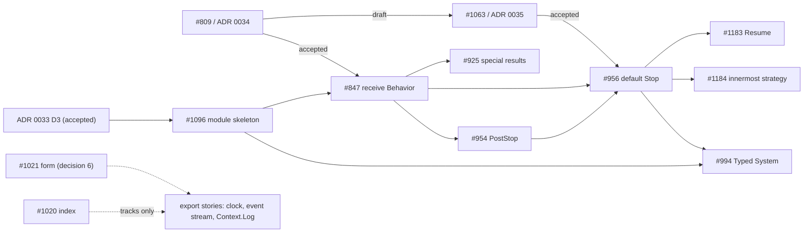

# Typed Behavior and supervision readiness (audit #004, block 2, 2026-10-26)

> **Reconciliation 2026-10-27 (no decision taken).** Section 5 decisions 1 to 4 are superseded by
> [`typed-owner-decisions-2026-10-27.md`](typed-owner-decisions-2026-10-27.md), the single current list, backed by the decision packages
> (B-1 to B-5 for ADR 0034, S-1 to S-6 for ADR 0035). Decision 3's recommendation, "the divergence (stop)", followed the Scaladoc
> (`SupervisorStrategy.scala:263`), not Pekko's code, and is withdrawn: the recommendation is now S-2 (follow Pekko), whose outcome
> depends on the matcher, the cause class, the phase and the parent's strategy. The acceptance wordings of decisions 1 and 2 no longer
> apply. In section 3, the message-adapter "difference F1" is a deferred capability (B-5). The text below is kept as written on 2026-10-26.

**Status: documentation only. Nothing is implemented, accepted or changed on GitHub by this document.** It accompanies two proposed
ADRs, [ADR 0034](../adr/0034-typed-behavior-boundary.md) (Typed `Behavior[T]` boundary, #809) and
[ADR 0035](../adr/0035-typed-supervision.md) (Typed supervision, #1063). It adds four things:
- the module-boundary table that #1020 and #1021 need;
- a reconciliation of eight Typed stories and the ten Q1 inventory rows against Pekko;
- the minimum Owner decisions;
- the first code story those decisions enable.

Issue corrections are written here as exact proposals; no issue body, label or state was changed.

Baselines: goPekko `develop` `13fb9953879462adba4218114d6615dc3d3156b9` (checked on 2026-10-26); Apache Pekko v1.7.1,
`9a54d1294c3ac7821bbed3c940769c3d5027d1ff` (submodule pin). Block 1 state was re-checked first: #1008, #785 and #1065 are closed as
completed; #1195, #827 and #746 are open; draft PR #1209 is at `3df192d`. The implementation notes of ADR 0010, 0015, 0017, 0024 and
0031 exist only in #1209, so this branch, cut from `develop`, does not contain them.

## 1. What is decided, what is the Architect's, what is the Owner's

| Class | Items |
|---|---|
| **Already accepted** (no new approval needed) | ADR 0033 D1 (one runtime, a `Behavior[T]` layer), D2 (two profiles, Typed default Stop, a Typed supervision ADR required), D3 (separate module, each export justified), D4 (stash and timers mandatory), D11 (logging with kit-logger `With`), D12 (adapters one by one), D13 (oracle rule). ADR 0017 (Classic supervision). ADR 0011 owner decision 2. ADR 0010 watch and supervision parts. ADR 0015 accepted parts |
| **Architect choices inside those contracts** (recorded, not submitted for approval) | The Go shape of `Behavior[T]` (sealed interface, `(Behavior[T], error)` handlers, `Extend`); one interpreter actor per Typed actor with a native `actor.Ref[T]`; restart, limits, backoff and the restart stash implemented in the layer; mechanisms M-A/M-B; the delivery order (stop and resume, then restart, then backoff and stash); ADR numbers 0034 and 0035 (checked free); following the code and specs where the Pekko Scaladoc disagrees (ADR 0035 D-b) |
| **Owner decisions** (section 5) | Acceptance of ADR 0034; acceptance of ADR 0035 alternative (a); the reading of ADR 0033 D2; the one Pekko behavior that looks like a defect (ADR 0035 decision 3); where `UnhandledMessage` and `Dropped` are published; the form of export justifications |
| **Evidence still pending** | Every READ row of ADR 0034 and 0035 needs an oracle-applicability determination (ADR 0033 D13). No Pekko spec was run; no Typed judge exists; no Go code exists. Pekko spec candidates per contract are named in the ADR tables |

## 2. Corrections found while preparing the contracts

| Where | Statement | Correction | Evidence |
|---|---|---|---|
| #809, reconciliation of 2026-10-24 | "validateAsInitial rejects deferred/same/unhandled as initial behavior (Behavior.scala:240)" | It rejects only `same` and `unhandled`; `stopped` is allowed; a deferred behavior is started by `Behavior.start` before validation. What rejects an **unstarted** deferred is the interpreter (`Behavior.scala:294-295`), an internal invariant | `T/Behavior.scala:198-212, 235-243`; `AA/ActorAdapter.scala:302, 320` |
| #809 criterion 3 and #1063 contract (1) | Both own "Typed default Stop" | A cycle in content. #809 states the failure outcome only; #1063 owns default Stop | ADR 0034 P8; ADR 0035 contract 1 |
| #1063 R4 and impact list | "ADR 0032 D3/D4/D6 (accepted)" | ADR 0032 is partly accepted (D1-D4, D6, D7) **only in PR #1014**; it is not in `develop` | `docs/adr/0032-local-sender-envelope.md` on branch `docs/msg-01-sender-envelope-adr-0032` |
| #1063 | proposed number 0034 | 0034 goes to #809, which #1063 builds on; #1063 becomes 0035 (both free on 2026-10-26) | `git ls-tree` of every remote branch |
| ADR 0033 line 29 | allocation risk at "ADR 0010:56" | the row is at `docs/adr/0010-actor-api.md:57` | file read |
| Dossier §11.2 vs delivery plan NEW-10 | the plan makes H-04 depend on a child-failure export | not needed: the runtime decider already receives the child and the cause (`pekko-actor/actor/supervision_decider.go:57-69`), which is Pekko's own mechanism (`AA/ActorAdapter.scala:232-273`) | ADR 0035 "Capabilities" |
| Dossier §11.2 and plan (J-01 depends on D-01) | Typed stash needs a mailbox head insert | Pekko Typed `unstashAll` runs the stashed messages synchronously in the current turn (`T/internal/StashBufferImpl.scala:156-203`); the head insert is a Classic `Stash` need | file read (research pass) |
| `pekko-actor/actor/actor.go:18, 26` | an actor without a declared strategy stops | the code applies `DefaultStrategy` (Restart) to every non-guardian actor (`supervision.go:103-110`). Production comment; left to a code story | file read |
| Block 1 reconciliation of #1208, section 5 | Q1: "Typed public API likely covered by existing stories", 10 rows | One row is fully covered, three partly, six by none (section 6) | issue bodies read |

## 3. Module boundary: what `pekko-actor-typed` needs from `pekko-actor`

No internal is published for convenience and no second runtime is created. "None" in "Proposed API" means the existing public API is
enough.

| Capability | Existing public API | Missing mechanism | Proposed API | Concrete benefit | ADR impact | Consumer |
|---|---|---|---|---|---|---|
| Behavior interpreter, signals, death pact | `Actor[T]`, `PreStarter`, `PostStopper`, `TerminatedHandler`, `PreRestarter` (`actor.go:15-44`; `supervision_hooks.go:55-68`); `ErrDeathPact` (`errors.go:56-58`) | none | none | — | ADR 0034 | #847, #925, #954 |
| Native Typed ref | `actor.Ref[T]` (`ref.go`) | none, if Typed `ActorRef[T]` **is** `actor.Ref[T]` | none | `Ask`, `Watch`, `Done` keep working (wrappers are rejected, `ask_endpoint.go:126-142`) | ADR 0034 P1 | all |
| Spawn, Typed `Props` | `Spawn`, `SpawnAnonymous`, `SpawnOption`, `WithMailboxCapacity` (`spawn.go:34-98`) | dispatcher selection; an external module cannot add a `SpawnOption` | none now; Typed `Props` maps onto `WithMailboxCapacity` | — | ADR 0010 "Excluded" (`:236`), reviewed per item (ADR 0033 D4); #767 | #1174, #1170 |
| Default Stop and `ChildFailed` | `Supervisor[T]`, `DeciderFunc` with child and cause (`Decider`, `supervision.go:48`; `supervision_decider.go:57-69`) | none | none (plan NEW-10 not needed) | — | ADR 0035 | #956, #1183 |
| Restart, limits, children stop | `Stop`, `Watch`, `OnTerminated`, `Children` | none | none | — | ADR 0035 | #976, #997 |
| Internal messages into the cell (adapted messages, scheduled restart, real-time timers) | `Port`, `PortHandler[T]` (`port.go:25-62`) | none | none | — | ADR 0034 P5 | #975, #986 |
| Manual time | none (`clock.go:8-26` unexported) | for Typed backoff and timers: none (a clock local to `pekko-actor-typed`); for one System-wide time source shared with Ask: an injectable System clock | none for Typed; the System clock seam belongs to #1129 (plan C-01) | Typed: none. #1129: Ask deadlines, ManualTime (#1149) and the judge on one clock | ADR 0011 owner decision 2; ADR 0015 D9 | #1129, #1149, the judge; not #986 (block 4, section 1) |
| `UnhandledMessage`, `Dropped` | dead letters only (`deadletter.go:22-42`) | an event stream | decision 5: a stream in `pekko-actor` introduced by its Classic stories (#870, #906, #897), or a per-System bus in `pekko-actor-typed` | Typed alone does not justify the export; the benefit is one stream for the whole dead-letter family, shared with Classic producers (block 4, section 2) | ADR 0011 owner decision 2 | #925 and #999 (publication only), testkit probes |
| Typed stash | none needed | none (layer-owned buffer) | none; the head insert (D-01) is Classic only | — | ADR 0033 D4 | #889, #927, #999 |
| Logger per actor | `Config.Logger`, no accessor (`system.go:80-89`) | a Classic `Context.Log` | none for Typed: the Typed System keeps the logger it passes to `NewSystem` and derives it with `With` per actor; `Context.Log` is #794's own export | Typed needs no export | ADR 0033 D11 | #1179; #794 (Classic) |
| Message adapter ref | `actor.Ref[T]` (exported methods only, `ref.go:18-21`), `Port` through `PortHandler.AttachPort` (`port.go:43-62`) | none | none: the Typed module implements `actor.Ref[U]` over the cell's `Port` (block 4, section 3) | — ; watching or asking an adapter ref fails (difference F1), and no Pekko spec found does either | none | #888, #975 |
| `/system` actors | `/system` guardian exists, spawn always targets `/user` (`hierarchy.go:23-25`) | spawn under `/system` | candidate (plan F-01) | termination order: `/system` stops after `/user` | ADR 0011 | receptionist (not this block) |
| Typed System from a guardian | `NewSystem`, `Terminate`, `WhenTerminated` (`system.go:118`; `system_shutdown.go:30-41`) | none | none | — | ADR 0034, 0035 | #994 |
| `context.ask`, `pipeToSelf` | blocking `Ask`; `AskFrom` deferred (ADR 0015 D7) | non-blocking ask | none required: a goroutine runs `actor.Ask` and posts the result through `Port` | — | ADR 0015 D7 vs ADR 0010 D4 (listed in ADR 0033) | Typed ask stories |

### #1020 and #1021: how to document each justification

| | #1020 GOV-02 (P0, ready) | #1021 GOV-03 (P1, ready) |
|---|---|---|
| Asks | an index row per candidate export, with consumers, the ADR 0011 criterion and where its justification lives | the form of a justification: (a) one ADR per export, (b) a record inside the story that introduces it, (c) one ADR with numbered decisions |
| Problem | lists "Form decision of #1021" as consumed but marks the edge `independent`; consumers (#847, #794, #767) depend on it although it "approves nothing" | lists "Candidate list of #1020" as consumed, also `independent`; AC-R3-1 asks for Pekko lines that R3 says do not exist; AC-R2-1 asks for a do-nothing option R2 does not list |

**Recommendation (decision 6):** form (b), a justification of five fixed lines in the PR and README of the story that introduces the
export:
- the symbol;
- the consumer story;
- why the public API is not enough;
- what internal detail it does **not** expose;
- the test that pins it.

#1020 becomes a tracking index that links those records. It blocks nothing. A separate ADR is written only when an export changes an
accepted contract, for example the clock against ADR 0015 D9. One ADR per export (a) multiplies documents with no extra decision
content. One ADR for all exports (c) would need re-acceptance every time an export is added. With this form, the dependency of #847,
#794 and #767 on #1020 is removed.

## 4. Stories: reconciliation against Pekko

Exact wording is proposed in English; "replace X with Y" quotes the current text. Readiness is the real state, separate from the label.

### #809 TYP-01: Behavior boundary (label `status:ready`, P0)

- **Correct.** No prerequisite. The anchors `canonicalize:184`, `interpretSignal` `:274` and the null check `:285-286` are right.
  Removing `Extensions.scala` and `adapter/package.scala` from traceability is right (ADR 0033 D12).
- **Criteria.** Replace the five criteria and the six "Acceptance-criteria changes required before implementation" with:
  1. "Specify `setup` (a deferred behavior started when the actor starts and again on a Typed restart), `receive` and the transition to the returned behavior, and the special behaviors `same`, `unhandled`, `stopped` (with and without a post-stop callback), `empty` and `ignore`, each with its Pekko source line and the spec that observes it, or `READ` when only code was found."
  2. "Specify the initial-behavior rule: `same` and `unhandled` are rejected (`Behavior.scala:235-243`); `stopped` is accepted; a deferred behavior is accepted and started before it is validated (`Behavior.scala:198-212`; `ActorAdapter.scala:302`). Keep validating a behavior distinct from starting a deferred one."
  3. "Specify canonicalization: `same` and `unhandled` keep the current behavior and a returned deferred is started and canonicalized (`Behavior.scala:183-192`); a nil behavior is a failure (`Behavior.scala:285-286`)."
  4. "Specify `ExtensibleBehavior` (`Behavior.scala:99-140`) as the public extension point, or record its exclusion with a reason."
  5. "Specify the signals `PreRestart`, `PostStop`, `Terminated`, `ChildFailed` and `MessageAdaptionFailure`, that an unhandled `Terminated` or `ChildFailed` is a supervisable death pact (`Behavior.scala:270-276`), and how an unhandled message is made observable."
  6. "Map cell identity, mailbox, children and lifecycle hooks to the existing `pekko-actor` kernel without a second runtime (ADR 0033 D1), and list each `pekko-actor` export the boundary needs, or state that none is needed."
  7. "State the failure outcome a turn hands to supervision (error, panic, death pact). Leave default Stop, its mechanism by parent kind and every strategy to the Typed supervision ADR (#1063); record no supervision decision here."
  8. "Record the ADR 0033 D5 impact list, the observable differences, the per-message allocation risk (`docs/adr/0010-actor-api.md:57`), the selected proposal and its rejected alternatives in a reviewable ADR with status `proposed`; do not mark it accepted without the Owner's decision."
  9. Keep: "Update the public contract and traceability for this slice; do not claim completion of sibling stories or full actor parity."
- **Dependencies.** Needed: none. Keep it so; do not add #847, #1096 or #1020. Outgoing: #847 and #1063 justified; #1096 not (see #1096).
- **Contract.** Produces ADR 0034 (proposed). Consumes ADR 0033, 0010, 0017.
- **Evidence.** Pekko specs named per row of ADR 0034; no Go test (document story).
- **Readiness.** Criteria 1 to 8 are met by ADR 0034 in this PR, as a proposal. The story can close only when the Owner accepts ADR 0034
  (decision 1) and the PR is integrated.

### #1096 TYP-34: module skeleton (label `status:blocked`, P0)

- **Correct.** Its scope is the five edits of ADR 0033 D3 (`go.work`, `scripts/deps.allow`, `go.mod` with `replace`, README, `CLAUDE.md`).
- **Criteria.** No AC change. Replace the dependency row "#809 → #1096 `depends_on` | Behavior-boundary ADR -> the module may only be created once D1/D3 shape is recorded" with "#809 → #1096 `independent` | the skeleton has no API; ADR 0033 D3 (accepted) is its only binding input". Delete the #1021 row: no requirement consumes it.
- **Dependencies.** Needed: ADR 0033 D3 only. Unjustified: #809, #1021.
- **Contract.** Produces the empty module and its dependency rule. Consumes ADR 0033 D3.
- **Evidence.** `scripts/check_deps.sh`, `.github/scripts/go-sdk-update.sh --check`, the module list; no Pekko spec applies.
- **Readiness.** Ready once the two edges are removed. The research pass reported an open choice in its body about the root README;
  that choice was not re-read in this block.

### #956 TYP-09: Typed default Stop (label `status:blocked`, P0)

- **Correct.** Default Stop with `PostStop` (`SupervisionSpec.scala:387, 492`).
- **Criteria.** Replace "An unwrapped ordinary failure stops the Typed actor." with "An unsupervised failure stops the Typed actor: `PostStop` is delivered, the actor terminates and the failure is logged at ERROR (`SupervisionSpec.scala:387-396`). Under a Typed parent the parent's strategy applies the stop and a watching parent receives `ChildFailed` (`WatchSpec.scala:100`); under any other parent the actor's own default stop applies it and the parent receives `Terminated` (`ClassicSupervisingTypedSpec.scala:105`) (ADR 0035, M-A and M-B)." Remove "Explicit matching Resume continues without rerunning setup." (moved to #1183) and drop "and Explicit Resume" from the title. Mark "stops descendants" as READ (Classic `context.stop`; no Typed spec asserts it for the default stop).
- **Dependencies.** Needed: ADR 0035 accepted (decisions 2 and 3), #847, and the `PostStop` story #954 (not listed today). #925 is not needed unless it delivers the failed result.
- **Contract.** Produces the default-Stop outcome. Consumes ADR 0034/0035 and #847.
- **Evidence.** `SupervisionSpec.scala:387, 492, 502`; `ClassicSupervisingTypedSpec.scala:74-160`; `WatchSpec.scala:100`. Go: one test per mechanism and a Classic-parent regression test showing a Classic child still restarts.
- **Readiness.** Blocked by decisions 2 and 3, #847 and #954.

### #1063 GOV-01: Typed supervision ADR (label `status:blocked`, P0)

- **Correct.** The twelve contracts and their lines (all fifteen lines re-opened in this block).
- **Criteria.**
  - In R4 and the impact list, replace "ADR 0032 D3/D4/D6 (accepted)" with "ADR 0032 D3/D4/D6 (partly accepted, PR #1014; not in `develop`)".
  - Add to R2: "(d) do nothing now: default Stop only, every other strategy pending".
  - Add to R6: "(13) strategy logging (`SupervisorStrategy.scala:35, 50, 238-243`; `SupervisionSpec.scala:1441`); (14) Resume of a failing deferred factory stops the actor (`SupervisionSpec.scala:1107`); (15) timers cancelled on failure (`Supervision.scala:298, 334`)".
  - Replace "The proposed number is 0034" with "The proposed number is 0035 (0034 is the Behavior boundary of #809)".
  - Replace "Behavior boundary draft from #809" with "Behavior boundary proposal of #809 (ADR 0034); acceptance of this ADR requires ADR 0034 accepted".
- **Dependencies.** Needed: #809 (draft to write against; acceptance to accept). Not needed: #1020.
- **Contract.** Produces ADR 0035 (proposed). Consumes ADR 0034, 0017, 0033 D2.
- **Evidence.** The contract table of ADR 0035.
- **Readiness.** Its outcome (a proposal with the named sections and the Owner decision pending) is met by ADR 0035 in this PR. It can
  close when the PR is integrated; acceptance is separate.

### #794 EVT-11: Classic actor-scoped logging (label `status:blocked`, P1)

- **Correct.** Go has no `Context.Log`; Pekko `ActorLogging` and `DiagnosticActorLogging` are per instance and per message
  (`actor/.../Actor.scala:340-385`).
- **Criteria.** Replace "The API uses kit-logger without requiring an observability backend." with "The actor context exposes a kit-logger `Logger` derived with `With` per actor (actor path as source, ADR 0033 D11), asserted with the #1052 fake; the export carries its ADR 0011 justification in the form chosen by #1021." Replace "Actor identity and source fields are stable across ordinary turns and explicit across restart." with "The source field equals the actor path, is identical on every turn and is unchanged after a restart." Remove "level/filter integration" from the scope (#1079).
- **Dependencies.** Needed: #1052, decision 6. Unjustified: #1020.
- **Contract.** Produces Classic `Context.Log`. Consumers: #848 and other Classic logging stories. **Not** a prerequisite of Typed logging (section 3).
- **Evidence.** No Pekko spec found for the log source (`LoggingReceiveSpec` not applicable); oracle applicability pending determination.
- **Readiness.** Blocked by #1052 and decision 6. Not on the Typed critical path.

### #994 TYP-29: Typed System from its guardian Behavior (label `status:blocked`, P1)

- **Correct.** The guardian replaces the user guardian (`T/ActorSystem.scala:297-321`); its stop terminates the System
  (`AA/GuardianStartupBehavior.scala:61-87`; `TT/internal/ActorSystemSpec.scala:74, 92, 103`). The reconciliation swapped two anchors:
  `systemActorOf` is at `:194`, `apply` at `:226`.
- **Criteria.** Delete "System actor creation uses an explicit documented systemActorOf boundary." (duplicate of #1176). Add "Creation rejects a guardian that is `same`, `unhandled` or not alive (`ActorSystem.scala:303-304`)." Add "Messages sent before the guardian starts are delivered after start in order, up to the buffer limit, or the Go adaptation documents why no pre-start window exists (`GuardianStartupBehavior.scala:35-52`; `TT/scaladsl/adapter/GuardianStartupSpec.scala:32-73`)."
- **Dependencies.** Needed: #847, #1096, #956. Unjustified: #982, #1055, #842.
- **Contract.** Produces the Typed System constructor. Consumes ADR 0034 (B6), ADR 0035 (M-B for the guardian).
- **Evidence.** `ActorSystemSpec.scala:74-126`; `GuardianStartupSpec.scala:32-73`.
- **Readiness.** Blocked by #847, #1096 and #956; the listed blockers #982 and #1055 are the wrong ones.

### #989 TYP-19: logMessages (label `status:blocked`, P1)

- **Correct.** The split from MDC (#1185) is right.
- **Criteria.** Replace "Static and per-message MDC merge with the accepted precedence." and "Fields are cleared after ordinary, failing and stopped results." with "`logMessages(opts)` logs each message as `actor [<path>] received message: <msg>` and each signal as `actor [<path>] received signal: <signal>` at `opts.level` (default DEBUG); a disabled option logs nothing (`InterceptorImpl.scala:159-160, 174-190`; `LogOptions.scala`)." Add "Record which logger `logMessages` uses; Pekko uses `opts.logger` or the interceptor's own logger, not the context logger (`InterceptorImpl.scala:174`)." Keep "Logging options do not change the returned Behavior or supervision decision." Update the title to drop "per-turn MDC".
- **Dependencies.** Needed: #978 (interceptor), #1052. Unjustified: #848, #794.
- **Evidence.** `TT/LogMessagesSpec.scala:35-147`.
- **Readiness.** Blocked by #978 and #1052.

### #767 IDN-10: immutable spawn descriptors (label `status:blocked`, P2)

- **Correct.** `Props.scala:183-210` (`withDispatcher`, `withMailbox`, `withRouter`, `withDeploy`, `withActorTags`); Go has
  `SpawnOption` and `WithMailboxCapacity` and no `Props` type.
- **Criteria.** Replace "Separate factory, mailbox choice, dispatcher choice, router settings and deployment metadata." with "Specify the descriptor as the factory plus an immutable options value, compared with the existing `SpawnOption` (`spawn.go:34`); mark dispatcher, mailbox, router and deploy options `pending` with links to #1040, #1041 and #1042." Append to "Record which upstream Props features are adapted or deferred and why" the clause "; a feature whose GOV decision is open is recorded as `pending <issue>`".
- **Dependencies.** Needed: none (a contract story). Unjustified as blockers: #1040, #1041, #1042 (a `pending` record suffices) and #1020 (a new Classic public type is not an exported internal).
- **Contract.** Produces the descriptor proposal. Consumers: #1174, #813, #843, #829.
- **Evidence.** `actor-tests/.../PropsCreationSpec.scala:54-78`; `TT/PropsSpec.scala:27, 31`.
- **Readiness.** Ready after the rewording; not on the Typed critical path.

## 5. Owner decisions, ordered by impact

Only decisions that are really pending are listed. Everything in section 1 under "Architect choices" is not resubmitted.

| # | Decision | Existing authority | Unresolved question | Alternatives | Architect recommendation | Stories unblocked | Proposed acceptance wording |
|---|---|---|---|---|---|---|---|
| 1 | Typed `Behavior[T]` contract | ADR 0033 D1 (one runtime), "Not decided here: the `Behavior[T]` boundary" | Is ADR 0034 (P1 to P8, X1 to X6) the boundary? | accept; accept with changes; keep `Behavior[T]` out until supervision is accepted | accept | #847, then #925, #954, #994; closes #809 when integrated | "I accept ADR 0034 as proposed in PR #1210 at commit <sha>: decisions P1 to P8 and the intentional differences X1 to X6. This accepts the contract only, not an implementation or parity." |
| 2 | Typed supervision contract | ADR 0033 D2 requires an ADR extending ADR 0017 | Is ADR 0035 alternative (a), with contracts 1 to 15, M-A/M-B and D-a to D-f, the Typed supervision contract, as a new ADR rather than an amendment of 0017? | (a), (b), (c), (d) of ADR 0035 | (a), as a new ADR 0035; delivery sliced | #956, #1183, #1184, #976, #997, then #986 and #999 when their capabilities exist | "I accept ADR 0035 as proposed in PR #1210 at commit <sha>, alternative (a), with contracts 1 to 15, mechanisms M-A and M-B and differences D-a to D-f. ADR 0017 is unchanged." |
| 3 | Pekko's replacement of the default stop wrapper | none (Pekko behavior, READ, no spec) | A Typed actor spawned outside a Typed context (M-B) with a match-all `Supervise(...).OnFailure(AnyError(), Restart.WithLimit(n, w))` exceeds the limit while handling a message or signal: does the Classic parent's strategy decide (Pekko: Restart by default, the limit count starts again) or does the actor stop? A narrower matcher, a backoff strategy and a start failure stop in Pekko too and are outside the question | replicate Pekko; keep the default stop wrapper so the actor stops (a **proposed divergence**) | the divergence (stop), because the limit stays effective under any parent; it is not folded into any story criterion until this decision is taken | #976 (one criterion), #1184 (one criterion) | Pekko: "In that case the Classic parent's strategy decides, as in Pekko." Divergence: "In that case the actor stops; this differs from Pekko, where the Classic parent's strategy decides and restarts it by default." |
| 4 | Reading of ADR 0033 D2 | ADR 0033 D2 (accepted) | Is the default Stop applied by the parent's Typed strategy under a Typed parent and by the actor's own default under any other parent, with Classic children keeping ADR 0017 under a Typed parent? | accept the precision; keep D2 as is and decide per story | accept, as a precision recorded in ADR 0035, not as a change of D2's acceptance | #956, #994 | "ADR 0033 D2 is read as stated in ADR 0035, section 'Proposed precision of ADR 0033 D2'. This records how D2 applies; it does not change its acceptance." |
| 5 | Where `UnhandledMessage` and `Dropped` are published | ADR 0011 owner decision 2; ADR 0033 Consequences ("an event stream with `Dropped` and `UnhandledMessage`" in `pekko-actor`, none pre-approved) | Is the event stream that carries `UnhandledMessage` and `Dropped` part of `pekko-actor`, introduced and justified by its Classic stories (#870, #906, #897), with Typed publishing into it once it exists? Or does `pekko-actor-typed` own a per-System bus that bridges dead letters? (Typed alone does not justify the export: block 4, section 2) | (a) stream in `pekko-actor` (plan E-01a); (b) per-System Typed bus; (c) no publication, the module-local hook only | (a): Classic needs the same events and Pekko delivers the whole dead-letter family on one stream; the export is justified in its Classic story under decision 6 | #925 (publication), #999, testkit probes | "The event stream that publishes `UnhandledMessage` and `Dropped` is part of `pekko-actor`, justified individually in its introducing story; until it exists, Typed records these events through a module-local hook and does not publish them." |
| 6 | Form of each export justification | ADR 0033 D3; ADR 0011 owner decision 2; #1021 | Which form records the justification of each `pekko-actor` export? | (a) one ADR per export; (b) a fixed record in the introducing story, indexed by #1020; (c) one ADR with numbered decisions | (b) | #794, the clock story, the event-stream story; removes #1020 as a blocker of #847, #794, #767 | "Each `pekko-actor` export needed by another module is justified in the story that introduces it, with the symbol, the consumer, why the public API is not enough, what it does not expose, and its test. #1020 indexes those records and blocks nothing. An ADR is written only when the export changes an accepted contract." |

Not listed, because they are not pending now: the clock export and the native adapter ref (each is justified in its own story once
decision 6 is taken); `become` and other ADR 0010 exclusions (ADR 0033 D4 reviews them per item); ADR 0032 D5 (stays open, does not
block Typed, ADR 0033 D6).

## 6. The ten Q1 inventory rows

The rows are reconstructed from `inventory/INV-T-typed.md` of PR #1208 (branch `docs/actor-typed-design-closure`); the file has no row
ids, so the line number in that file identifies each row. Covering stories were checked by reading their bodies.

| INV-T line | Pekko symbol | Covering story | Proposed home |
|---|---|---|---|
| L45 | `ExtensibleBehavior` (`Behavior.scala:106-140`) | none | #809 criterion 4 (ADR 0034 P2) |
| L50 | `ActorRefResolverSetup` (`ActorRefResolver.scala:95, 106`) | none | GOV classification row (C2 or C3) |
| L55 | `ActorSystem.scheduler`, `dispatchers`, `executionContext` (`ActorSystem.scala:99-109`) | `scheduler`: #1177; others none | `dispatchers`: a lookup story that does not exist; `executionContext`: JVM-only classification |
| L56 | `ActorSystem.name`, `address`, `startTime`, `uptime`, `log` | partly: #842 (Classic) | a Typed System accessor criterion in #994 or a sibling |
| L57 | `settings`, `logConfiguration`, `printTree`, `threadFactory`, `dynamicAccess`, `setup` | none (`dynamicAccess`: #1125) | GOV classification |
| L61 | `ExtensionSetup`, `AbstractExtensionSetup` (`Extensions.scala:175, 186`) | partly: #1084 | Typed extensions decision |
| L73 | `SupervisorStrategy.withLoggingEnabled`, `withLogLevel` (`SupervisorStrategy.scala:238-243`) | none | #1063 contract 13 (ADR 0035) |
| L118 | Scheduler `toClassic`/`toTyped` (`scaladsl/adapter/package.scala:182-194`) | none | an adapter decision under ADR 0033 D12 |
| L119 | `PropsAdapter.apply` (`PropsAdapter.scala:32`) | none | an adapter decision under ADR 0033 D12 |
| L121 | `GuardianStartupBehavior` | partly: #994 | #994 criterion "messages before start" (section 4) |

L99 (context thread-safety guard) and L223 (testkit `TestException`) could also count as Q1; neither has a covering story.

## 7. Dependency graph after the proposed changes

Edges removed: #809→#1096, #1021→#1096, #1020→#847, #1020→#794, #1020→#767, #982→#994, #1055→#994, #842→#994, #848→#989,
#794→#989, and the mutual "consumed" entries of #1020 and #1021. No cycle remains.

## 8. First code story enabled

**#847 TYP-02, "Install and replace a Typed receive Behavior"**, once decision 1 is taken and #1096 is delivered.
- #1096 can start now: it has no API and depends only on the accepted ADR 0033 D3, once its two unjustified edges are removed.
- #847 needs no `pekko-actor` export (section 3), so its `depends_on #1020` edge is removed.
- Its criteria fit ADR 0034 P1, P3 and P4. Proposed precision of its first criterion: replace "setup executes once for the accepted
  incarnation." with "`Setup` runs once when the actor starts, before the first message, and is not re-run by `Same` or by a
  replacement behavior (`DeferredSpec.scala:51`)."

## 9. Not verified, and limits

- No Pekko test was run; specs were read. No Go code exists for Typed; no Go suite was run (documentation-only change).
- Citations: the author re-opened the lines listed in the "Sources" bullet of ADR 0034 and 0035 and the fifteen supervision contract
  lines. Other citations come from read-only research passes of 2026-10-26 that opened them.
- The story analysis read the issue bodies as of 2026-10-26; #1096's open root-README choice was reported, not re-read.
- Category assignments of the Q1 rows (C2, C3) are the Architect's reading, not Owner decisions.
- Audits #1198 and #1208 are historical. This document supersedes only the statements listed in section 2.

## 10. Revision log

- 2026-10-27: reconciliation note added at the top; the body is unchanged.

- 2026-10-26, audit #004 block 3: decision 3 restated with the exact Pekko conditions and both acceptance wordings; references to X6, D-e,
  D-f and the `Decider` citation updated. Story reconciliation of #976, #997, #986, #999, #975, #1183, #1184, #925 and #954 is in
  `typed-supervision-stories-reconciliation-2026-10-26.md`.
- 2026-10-26, audit #004 block 4: section 3 rows for manual time, `UnhandledMessage`/`Dropped` and the message adapter, and decision 5,
  restated after checking each mechanism; none of them needs a `pekko-actor` export for Typed alone
  (`typed-shared-foundations-2026-10-26.md`).
