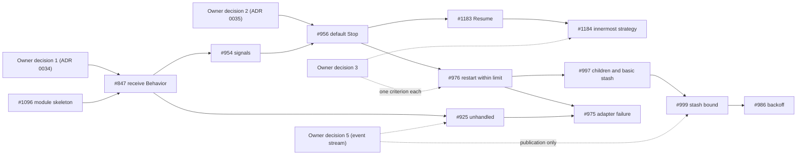

# Typed supervision stories reconciled against Pekko and ADR 0034/0035 (audit #004, block 3, 2026-10-26)

> **Resolution note 2026-11-04 (Owner decisions in ADR 0035, amendment).** #976 criterion 6 (D-a: "A `Setup` that fails on every re-run under unlimited `Restart`
> fails the actor") is replaced by ADR 0035 S-3 case (c), for an actor with no children at restart time (the variant with children is To be verified): the loop is a fatal error handled as in the fixed Pekko (`on`: exit 255 after CoordinatedShutdown; `off`: the
> ActorSystem terminates). #976 also needs the S-3 cases (a) and (b). #986 criterion 2 (D-f) is replaced by S-4: an unowned `ResetRestartCount` reaches the user behavior;
> D-f is withdrawn. Proposed criteria were posted as comments on #976 and #986; the issue bodies are not edited. Earlier text is kept as written.

> **Reconciliation 2026-10-27 (no decision taken).** Superseded statements, kept below as written: the "stop" recommendation the
> introduction ascribes to ADR 0035 came from readiness decision 3 and is withdrawn (S-2: follow Pekko). In section 2, a start failure
> stops because the default wrapper is still outermost, not because the parent receives `ActorInitializationException`; section 2 also
> omits Escalate for non-`Exception` causes and Stop for `DeathPactException`. #976 criterion 8 and #1184 AC-R4-3: the stop variant is
> no longer recommended (S-2). #976 criterion 6: D-a is a divergence with a concrete impediment (S-3). #986 criterion 2: D-f
> contradicts `SupervisionSpec.scala:1049-1051` (S-4). #986 criterion 4: D-b is Pekko behavior, not a difference. #999: publication of
> `Dropped` is a deferred capability. #1183 AC-R4-1: the cause wrapped by the initialization error is open (S-5). Current text: ADR 0035
> (revised 2026-10-27) and [`typed-owner-decisions-2026-10-27.md`](typed-owner-decisions-2026-10-27.md).

**Status: documentation only.** This reconciles nine Typed stories (#976, #997, #986, #999, #975, #1183, #1184, #925, #954) against
Apache Pekko v1.7.1 and the **proposed** [ADR 0034](../adr/0034-typed-behavior-boundary.md) and [ADR 0035](../adr/0035-typed-supervision.md).

- **ADRs not assumed.** Both ADRs are proposals. No story below is declared ready by assuming their acceptance.
- **Proposals only.** Every criterion change is a proposed text; no issue body, label or state was changed.
- **Source of the criteria.** The criteria follow Pekko's observable behavior.

Where a criterion touches Owner decision 3 (a Typed actor spawned from a Classic spawner, whose match-all `supervise` with a restart
limit is exceeded), the criterion states Pekko's behavior. The "stop" variant recommended by ADR 0035 is marked **proposed divergence,
pending Owner decision 3**. It is never folded into the criterion.

Baselines: goPekko `develop` `13fb9953879462adba4218114d6615dc3d3156b9`; the ADRs as on PR #1210 (`6789d20`) plus the corrections of this
PR; Pekko `9a54d1294c3ac7821bbed3c940769c3d5027d1ff`. Prefixes: `S` = `Supervision.scala`, `SO` = `SupervisorStrategy.scala`,
`SS` = `SupervisionSpec.scala`, `AA` = `internal/adapter/ActorAdapter.scala`, `SB` = `internal/StashBufferImpl.scala`, `TT` =
`actor-typed-tests/.../actor/typed`, all under `upstream/pekko/actor-typed*`. Levels: SPEC (a test asserts it, body opened) and READ
(code only; "no spec found" is not "no oracle").

## 1. Reconciliation matrix

| Story | Label today | ADR contracts it implements | Main criterion corrections | Unnecessary dependencies | Real readiness |
|---|---|---|---|---|---|
| #976 TYP-10 restart within limit | `blocked`, P0 | 0035: 2, 3, 6; uses 1, 13, 15, D-a, D-d | Restart sequence (timers, `PreRestart`, `Setup`), exact `WithLimit` window, pass-on to the enclosing supervisor; adds start failure, D-a and the decision-3 case | none removed; add #847 and #954 | blocked: decisions 1, 2; #1096, #847, #954, #956; decision 3 for one criterion |
| #997 TYP-12 children during restart | `blocked`, P0 | 0035: 7; basic part of 5 | `StopChildren` default and option, wait and stash, stop during the wait, failure during replay | none removed; add #954 | blocked: as #976, plus #976 |
| #986 TYP-11 backoff | `blocked`, P0 | 0035: 4, 8; parts of 6, 13 | delay formula, reset, owner-only signals, `WithMaxRestarts` (fails, no rethrow) | #821 (real-time timers exist); #1129 only for the shared clock option | blocked: as #976, plus #976, #997, #999 |
| #999 TYP-26 restart stash bound | `blocked`, P0 | 0035: 5 | lifetime of the stash, capacity, replay order, overflow `Dropped` (no sender), leftovers | #976 (replace by #997); #986 (reverse the edge) | blocked: as #976, plus #997; decision 5 for `Dropped` |
| #975 TYP-06 adapter failure | `blocked`, P1 | 0035: 9; 0034: B15, P5 | the signal first, then the default rethrow, then supervision once | #954 for `MessageAdaptionFailure` (its criteria do not deliver it) | blocked: as #976, plus #888, #976, #925 |
| #1183 TYP-49 Resume | `blocked`, P1 | 0035: 14 and the Resume guarantee; 0034: P3, P8 | correct spec anchors; start failure as `InitializationError`; signal failures; children untouched; Goexit never resumed | #1063 as a story edge (replace by decisions 1 and 2) | blocked: decisions 1, 2; #1096, #847, #956 |
| #1184 TYP-50 innermost strategy | `blocked`, P1 | 0035: nesting and replacement guarantees | rewrite AC-R1-1/R2-1 to declared strategies; add the replacement rule and the decision-3 case as separate criteria | #976 for R1-R3 (only for AC-R4-1) | blocked: decisions 1, 2 (3 for AC-R4-3); #847, #956, #1183 |
| #925 TYP-03 unhandled | `blocked`, P1 | 0034: B7, B13, P4, P7, X4 | `Unhandled` keeps the behavior; local hook; publication pending | #897 except for publication | blocked: decision 1; #1096, #847 (publication: decision 5, #897) |
| #954 TYP-04 signals | `blocked`, P1 | 0034: B8, B14, B16, B17, P5, P6 | `PostStop` rules, `Terminated`, death-pact cause; `PreRestart`, `ChildFailed`, `MessageAdaptionFailure` moved out | #925, #1113, #1063 | blocked: decision 1; #1096, #847 |

Every story stays blocked, so every `status:blocked` label is right. What changes is the list of blockers: the real blockers are the Owner decisions
on ADR 0034/0035, the module skeleton #1096, and the code stories #847, #954 and #956.

## 2. How decision 3 appears in the stories

Pekko facts (verified, READ unless stated):
- A supervisor drops an enclosing one only when both classes are **exactly equal** (`S:78-83`, `==`). The check runs at start and after
  every turn (`T/internal/InterceptorImpl.scala:82-85, 106-122`). The replacement itself is SPEC (`SS:1270`).
- The Classic spawn paths wrap the behavior in `supervise(_).onFailure(stop)`, whose class is `Throwable`, the default of `onFailure`
  (`T/scaladsl/adapter/package.scala:60, 74`; `T/Behavior.scala:82-85`).
- A user `onFailure(restart.withLimit(...))` without a type therefore replaces the wrapper. When the limit is exceeded, `S:337` rethrows
  and the rethrow reaches the Classic parent. Its default decider restarts the actor if the cause is an `Exception`
  (`AA/ActorAdapter.scala:55-58`; classic `FaultHandling.scala:218-223`). `PreRestart` is delivered, the initial behavior runs again
  and the limit count starts at zero (`AA/ActorAdapter.scala:309-323`).
- A narrower class (`onFailure[E]`) does not replace the wrapper, so the actor stops. So does backoff past `withMaxRestarts`, which
  fails instead of rethrowing (`S:338-340`), and so does a start failure (`ActorInitializationException` is Stop).

Only two stories carry it, each in **one separate criterion**: #976 ("Classic-parent limit") and #1184 (AC-R4-3). Each states the Pekko
behavior and marks the stop variant as a proposed divergence. Neither criterion can be checked off before decision 3. No other criterion
depends on it.

## 3. Stories

Each story lists: what is correct; the exact criteria (quoted current text, then replacement); dependencies; the contracts it produces
and consumes; the evidence; and its real readiness. The issue numbers that appear only in story bodies (#888, #897, #906, #821, #1129,
#1113) were taken from those bodies and not re-read here.

### #976 TYP-10 Restart a supervised Typed Behavior within its limit

**Correct.** The single outcome; the anchors `SO:44-45, 266`; "`PreRestart` only, no `PostStop`"; the edges to #956 and #1063.

**Criteria.**
1. Replace "Restart reruns the supervised setup at the documented boundary." with: "When a failure that a `Restart` strategy matches occurs while handling a message or a signal, the actor's timers are cancelled first, then the current behavior receives `PreRestart` (never `PostStop`), then the supervised behavior is rebuilt from its initial value: `Setup` runs again and state built after start is lost. The failing message is not redelivered, and later messages reach the new behavior in mailbox order. An error or panic in the `PreRestart` handler is logged and the restart continues." Evidence: `S:313-351, 392-419` (handler case READ); `SS:512`; `TT/TimerSpec.scala:174, 202` (`GotPreRestart(false)` at `:194`).
2. Replace "Failure matching and retry-window limits use Typed source semantics." with: "A strategy matches its cause and any specialization of it (Pekko: assignability on the thrown exception, `S:75-76`, `SS:512`; Go: the ADR 0035 matcher, difference D-e). `WithLimit(n, within)` allows n restarts inside a window that opens at the first counted failure; a failure after the window has expired restarts the actor and opens a new window with count 1; the (n+1)-th failure inside the window is not restarted and is passed unchanged to the enclosing supervisor; `WithLimit(0, w)` passes on the first failure; an unlimited `Restart` never passes a failure on." Evidence: `S:335-337, 430-440`; `SS:528`, `SS:550`, `SS:224`, `SS:261`.
3. Replace "Unmatched failures propagate to the outer behavior strategy as specified." with: "A failure the strategy does not match, or one past the limit, goes to the next enclosing `Supervise`, innermost first; if none matches, ADR 0035 contract 1 applies: under a Typed parent (M-A) the actor stops, `PostStop` is delivered and a watching parent receives `ChildFailed`." Evidence: `SS:528`, `SS:387`; `TT/WatchSpec.scala:100`.
4. Diagram: replace "Stop after accepted budget exhaustion" with "Pass the failure to the enclosing supervisor or the parent".
5. Add (start failure, contract 6): "If the initial `Setup` fails: under unlimited `Restart` the actor fails to start; under `WithLimit(n, w)` the start is retried until the limit is spent, then the actor fails; for n ≤ 1 the initial start is not retried." Evidence: `SS:1090`, `SS:1145`, `SS:1157`; n ≤ 1 READ (`S:302`).
6. Add (D-a): "A `Setup` that fails on every re-run under unlimited `Restart` fails the actor." Pekko recurses until a `StackOverflowError` (`S:384-386, 414-418`, READ). This is a proposed difference, pending decision 2.
7. Add (logging, contract 13): "Each handled failure is logged once, at ERROR by default." Evidence: `SS:528`.
8. Add (Classic-parent limit, **separate**): "Given a Typed actor spawned outside a Typed context whose behavior is `Supervise(b).OnFailure(AnyError(), Restart.WithLimit(n, w))`, when the limit is exceeded while handling a message or signal with an ordinary error, then, as in Pekko, the failure reaches the Classic parent, whose strategy decides; under its default the actor is restarted: `PreRestart`, `Setup` again, and the limit count starts from zero. With a narrower matcher the actor stops." Evidence: section 2 of this document; READ, no spec found. **Proposed divergence, pending Owner decision 3:** the actor stops instead. This criterion stays open until decision 3 is taken.

**Dependencies.** Justified: #956 (contract 1 and the wrapper); the acceptance of ADR 0035 (decision 2; decision 3 for criterion 8). Add: #847 (`Setup` start and re-run, ADR 0034 P1) and #954 (`PostStop` delivery). Do not make timers blocking: assert the `TimerSpec` case once the Typed timers story exists. The window clock can be local to the Typed module, so #1129 is not required.

**Contract.** Produces `Restart`/`WithLimit` and the restart sequence that #997, #986, #999 and #975 consume. Consumes ADR 0034 P1, P5 and P8, and ADR 0035 contracts 1, 2, 3 and 6.

**Evidence.**
- SPEC oracles: `SS:512, 528, 550, 224, 261, 1090, 1145, 1157`.
- READ rows: criteria 6 and 8, n ≤ 1, D-d. They need an ADR 0033 D13 applicability decision; a Pekko probe can be built for them.
- Go tests:
  - restart under M-A;
  - window reset with a module clock;
  - the limit edge;
  - the start-failure matrix;
  - a regression test showing that a Classic child still restarts.

**Readiness.** Blocked by decisions 1 and 2, #1096, #847, #954 and #956; criterion 8 also by decision 3.

### #997 TYP-12 Configure Typed child handling during restart

**Correct.** The edge corrected to #976; the scope (stop the children and wait for them).

**Criteria.**
1. Replace "stopChildren follows the source-backed Typed option." with: "`StopChildren` defaults to true for `Restart` and `RestartWithBackoff`; `WithStopChildren(false)` keeps every child alive across the restart and the restart does not wait." Evidence: `SO:162, 173, 199, 215`; `S:362, 385-386`; `SS:662`, `SS:666`.
2. Replace "Restart waits for stopped children at the documented boundary." with: "With `StopChildren` true, the supervisor stops every child that exists when the failure is handled, replacing any `WatchWith` on them by a plain watch, and re-runs `Setup` only after the last of those children has terminated (and, under backoff, after the delay). Meanwhile messages and other signals are retained and then delivered to the new behavior in arrival order. The children's `Terminated` signals are consumed by the supervisor and not delivered, and the `WatchWith` message of a stopped child is not delivered." Evidence: `S:226-229, 252-263, 421-428`; `SS:575`, `SS:618`.
3. Replace "A stop during child wait cannot publish a new Behavior incarnation." with: "If the actor is stopped while it waits for its children, `Setup` is not re-run, no retained message is delivered, and the behavior receives no `PostStop` after its `PreRestart`." Pekko retains the `PostStop` signal (`S:265-270`; READ, no spec found).
4. Extend "Include preserved/stopped child cases and the stop-during-restart boundary." with: "and a second failure during replay, which restarts the actor again and stops the children created in between (`SS:691`)".
5. Add: "The retained messages use the default restart-stash capacity (#999 makes it configurable) and are kept across a failure that happens while the restart is in progress." Evidence: `S:369-372`; `SS:1195`.

**Dependencies.** Keep #976 and the acceptance of ADR 0035. The removal of #986 was right. Add #954 (`Terminated`). The `SS:618` case needs the Typed `WatchWith` story; mark that case pending instead of adding a blocking edge. Overlap with #999: this is the first story where messages arrive mid-restart, so the basic keep-and-replay belongs here.

**Contract.** Produces the children wait and the basic restart stash. Consumes #976.

**Evidence.** Oracles: `SS:575, 579, 618, 662, 666, 691`. Go tests:
- slow-stopping children;
- `WatchWith` revocation;
- `WithStopChildren(false)`;
- a stop during the wait (READ; needs a probe).

**Readiness.** Blocked by decisions 1 and 2, #1096, #847, #954, #956 and #976.

### #986 TYP-11 Delay a Typed Behavior restart with backoff

**Correct.** The single-outcome scope; the finding that the formula, `ResetRestartCount` and the owner token were missing; the edge to #976.
The story's anchor "SupervisorStrategy.scala:186,320" is wrong: the formula is `S:185-196` (`calculateDelay`).

**Criteria.**
1. Replace "Bounded backoff/jitter and reset-after behavior are explicit." with: "Restart number k (from 0) is delayed by `min(maxBackoff, minBackoff·2^k)·(1 + r·randomFactor)`, r uniform in [0,1); the jitter is applied after the cap, so a delay can exceed maxBackoff by up to randomFactor; if the computation overflows, the delay is maxBackoff. `ResetBackoffAfter` defaults to (min+max)/2. The count returns to 0 if no failure is handled within `ResetBackoffAfter` after a restart completes." Evidence: `S:185-196, 241-246, 377-383, 397-399`; `SO:86`; `SS:912`, `SS:1117`, `SS:991`.
2. Replace "A stop during backoff prevents the delayed restart." with: "If the actor stops during the delay, `Setup` is not re-run. A restart or reset signal that belongs to another, nested supervisor is passed on, not consumed, and never reaches the user behavior." Evidence: `S:198-200, 222-250` (stop case READ); `SS:1060`, `SS:1069`. Pekko lets an unowned `ResetRestartCount` reach the user behavior (`SS:1049-1051`). Hiding it is difference D-f of ADR 0035, pending decision 2.
3. Replace "Max restarts and diagnostic level configuration remain independent." with: "After `WithMaxRestarts(n)` restarts with no reset in between, the next matched failure is logged and the actor **fails without a rethrow**, so the parent's strategy is not consulted and decision 3 does not apply: under a Typed parent the actor stops and a watching parent receives `ChildFailed`; under any other parent it stops itself. Only -1, the default, disables the limit. A failure of the initial `Setup` is always retried with backoff, ignoring the limit. `WithCriticalLogLevel(level, after)` changes the log level after `after` errors." Evidence: `S:106-108, 308-309, 335-341`; `AA/ActorAdapter.scala:168-172`; `SS:960`, `SS:1122`, `SS:1463`. The Scaladoc says "zero or negative disables" (`SO:329-331`); the code disables only for -1. The criterion follows the code (READ).
4. Add: "Messages and signals that arrive during the delay are retained and replayed (#999), not dropped (ADR 0035 D-b), and children are stopped under backoff." Evidence: `SS:882`, `SS:579`, `SS:666`.

**Dependencies.**
- Keep #976 and the acceptance of ADR 0035.
- Add #997 and #999: backoff always uses the stash (`S:369-376`).
- #821 is not needed: a real-time timer into the cell exists (`time.AfterFunc` with `Port`, ADR 0035 Capabilities). Deterministic tests need a clock. A module-local clock is enough; #1129 is needed only if the Owner prefers the shared clock export.

**Contract.** Produces `RestartWithBackoff`. Consumes #976, #997, #999 and a timer source.

**Evidence.**
- Oracles: `SS:912, 960, 991, 1060, 1069, 1117, 1122, 1463`.
- `WithMaxRestarts(0)` and stop-during-delay are READ; a probe is needed.
- Go tests use a manual clock and a fixed random source.

**Readiness.** Blocked by decisions 1 and 2, #1096, #847, #954, #956, #976, #997 and #999.

### #999 TYP-26 Bound the Typed restart stash

**Correct.** Capacity on both restart strategies; default 1000 (`actor-typed/src/main/resources/reference.conf:27`); `Dropped` on overflow.
The story's "Dropped with sender per ADR 0032" is wrong: `Dropped` has **no sender** and the actor is the **recipient**
(classic `ActorRef.scala:627-630`; `S:123`).

**Criteria.**
1. Replace "Capacity applies only to the documented restart-stash scope." with: "The restart stash exists from the handling of a restart-matched failure until the new behavior is set up, and retains every message and signal except the awaited children's `Terminated` and the supervisor's own restart signals. `WithStashCapacity(n)` with n ≥ 0 sets its capacity for `Restart` and `RestartWithBackoff`; a negative value or no setting uses the system restart-stash capacity, 1000 by default. A `Restart` with no children to stop completes at once and retains nothing." Evidence: `SO:163, 176, 200, 218`; `S:252-286, 365-376, 384-386`.
2. Replace "Successful restart replays retained messages in the accepted order." with: "After `Setup` re-runs, retained messages and signals are delivered to the new behavior in arrival order, before any later mailbox message; if one of them fails again under the same strategy, the actor restarts and the undelivered ones stay retained." Evidence: `S:404-410`; `SB:156-203`; `SS:882`, `SS:1195`, `SS:1199`.
3. Replace "Stop or superseded restart generation releases retained messages with one disposition." with: "When the stash is full, the arriving message or signal is discarded and recorded as `Dropped{msg, \"Stash is full in [RestartSupervisor]\", recipient: self}` with no sender (published once an event stream exists, Owner decision 5); if the new behavior stops during the replay, the remaining messages go to dead letters with the actor as recipient; if the actor stops before the replay, the retained messages are discarded with no event." Evidence: `S:120-124, 266-267, 282-283`; `SS:882`; `SS:912` (capacity 0); dead letters `SB:215-252` (READ); discard READ.

**Dependencies.** Keep the acceptance of ADR 0035. Replace #976 with #997, which produces the basic stash. **Reverse #986 → #999 into #999 → #986**: backoff consumes the stash, and the capacity also applies to `Restart` (`SS:1195`). #906 (event stream) is needed only for publishing `Dropped`, which also waits for decision 5.

**Contract.** Produces the capacity option and the overflow and leftover rules. Consumes #997 and, for publication, the event stream.

**Evidence.** Oracles: `SS:882, 912, 1195, 1199`. Go tests:
- capacity 0;
- overflow order;
- a failure during replay;
- leftovers on stop.

**Readiness.** Blocked by decisions 1 and 2, #1096, #847, #954, #956 and #997; publication by decision 5 and the event stream.

### #975 TYP-06 Supervise a failing message-adapter transform

**Correct.** The failure reaches the behavior first as a signal (`AA/ActorAdapter.scala:206`). It is rethrown only when unhandled
(`T/internal/BehaviorImpl.scala:73-76`). No partially adapted message is delivered.

**Criteria.**
1. Replace "Thrown/panicking transform behavior maps to the documented failure shape." with: "When a message-adapter function or a `PipeToSelf` mapping panics or returns an error, its cause is delivered to the behavior as `MessageAdaptionFailure{Cause}` and the adapted message is not delivered." Evidence: `AA/ActorAdapter.scala:104-112, 182-213`; `SS:1575`.
2. Replace "The actor default Stop or explicit supervision policy handles the failure once." with: "A behavior that handles `MessageAdaptionFailure` continues; `Empty` and `Ignore` ignore it; the default receive behaviors fail with the original cause, which supervision then handles once, matched on that cause, innermost first: default Stop terminates the actor, and a matching `Restart` delivers `PreRestart` and re-runs `Setup`." Evidence: `TT/scaladsl/AdaptationFailureSpec.scala:91, 105`; `SS:1575`, `SS:1637`, `SS:1644`.
3. Add, or record as an exclusion with a reason: "An adapter that returns a nil message is ignored with a warning." Evidence: `AA/ActorAdapter.scala:208-216` (READ).

**Dependencies.** Keep #888 (it produces the signal; ADR 0034 P5), #956 and the acceptance of ADR 0035. The #954 edge is wrongly justified: after this reconciliation #954 does not deliver `MessageAdaptionFailure`. Add #976 (the restart case) and #925 (the `Empty`/`Ignore` cases). The `PipeToSelf` case needs the pipeToSelf story. The `SS:1637`/`SS:1644` pair moves here from #1184.

**Contract.** Produces "an adapter failure is supervisable". Consumes ADR 0034 B15 and P5, and #888.

**Evidence.** Oracles: `AdaptationFailureSpec.scala:91, 105`; `SS:1575, 1637, 1644`.

**Readiness.** Blocked by decisions 1 and 2, #1096, #847, #956, #888, #976 and #925.

### #1183 TYP-49 Continue under explicit Resume without rerunning setup

**Correct.** The scope boundary; R1-R4; AC-R1-1 (Exc2 is a subtype of Exc1, `SS:62-63`); AC-R4-1 with `SS:1107`; the anchors
`SO:35, 125` and `S:169-176`.

**Criteria.**
1. AC-R2-1 evidence: replace "SupervisionSpec.scala:1671 documents that Resume has no second setup" (a code comment, not a test) with: "Evidence: ported spec `TT/ActorContextSpec.scala:281` 'not reset behavior upon resume' (a counter created inside `setup` reads 2 after the resumed failure), plus a Go setup-run counter equal to 1 after the resume; detecting mutation: re-run `Setup` on resume."
2. AC-R3-1 evidence: replace "SupervisionSpec.scala:498 `stop when unhandled exception` (restart variant)" with: "Evidence: `SS:502` 'stop when unhandled exception' (restart strategy), adapted to Resume; the resume-specific outcome is READ (`S:171`)."
3. AC-R4-1: replace its text with: "Given a `Setup` that fails under `Resume` for its error, when the actor starts, then the start fails with an `*actor.InitializationError` wrapping the setup error, no message is processed, and the setup ran exactly once (ADR 0034 P3; ADR 0035 contract 14: outcome adopted, mechanism not reproduced)."
4. Add AC-R1-2: "A failure raised while handling a signal (for example the death pact of an unhandled `Terminated`) under `Resume` for that cause keeps the actor alive with its state." (`S:153-154`, READ.)
5. Add AC-R1-3: "Under `Resume`, the actor's children and watches are unchanged after a resumed failure." (`S:175`, READ.)
6. Add AC-R3-2: "An `actor.ErrGoexit` end of a handler is never resumed." (ADR 0035 Supervise rule; `SS:214` is the restart analogue.)

**Dependencies.** Keep #847 and #956. Replace the story edge to #1063 with "acceptance of ADR 0034 (decision 1) and ADR 0035 (decision 2)". #1096 is a transitive blocker through #847. Decision 3 does not apply: Resume never rethrows. #956's title still says "and explicit Resume"; block 2 proposes moving that part here.

**Contract.** Produces the Resume semantics. Consumes the ADR 0035 `Supervise` matcher, ADR 0034 P3, P6 and P8.

**Evidence.** SPEC oracles: `SS:163`, `SS:834`, `ActorContextSpec.scala:281`, `SS:1107`. AC-R1-2, AC-R1-3 and the Resume variant of R3 are READ.

**Readiness.** Blocked by decisions 1 and 2, #1096, #847 and #956.

### #1184 TYP-50 Select the innermost matching strategy

**Correct.** The order rule (Context, R1-R3); rejecting a "most specific wins" rule; AC-R2-1's scenario and its mutation; the anchors
`SS:448/455`.

**Criteria.**
1. AC-R1-1: replace "Given resume for Exc2, restart for Exc3 and stop for the rest declared in that order …" (in `SS:176-199, 208, 849` no stop is declared: Exc1 falls to the default Stop) with: "Given `Supervise(b).OnFailure(ErrorAs[Exc2](), Resume).OnFailure(ErrorAs[Exc1](), Stop)`, when Exc2 (a specialization of Exc1) is raised, then the actor resumes with its state; when Exc1 is raised, then it stops with `PostStop`." Evidence: adapted from `SS:208`, `SS:849`. Detecting mutation: last-declared wins (Exc2 would stop).
2. AC-R2-1: replace "restart for Exception … the first goes to restart" with: "Given `Stop` for the RuntimeException analogue declared first and `Resume` for the Exception analogue declared second, when an IOException analogue then an IllegalArgumentException analogue are raised, then the first resumes (actor alive, state kept) and the second stops with `PostStop`." Evidence: `SS:455`, with resume in place of restart. The restart form becomes a regression test in #976.
3. AC-R3-1: replace "Ported pair SupervisionSpec.scala:208-220 … and :1637, :1644" with: "Ported pairs `SS:201`/`SS:208` and `SS:448`/`SS:455`; the `SS:1637`/`SS:1644` pair moves to #975." (`SS:214` is "not catch fatal error", and `SS:1637`/`SS:1644` go through message-adapter failures.)
4. Design "open choice … specificity rule": replace with "Innermost-first by declaration order, as proposed in ADR 0035 (Supervise); binding only once decision 2 is taken."
5. Add AC-R4-1: "A `Supervise` whose matcher equals an enclosing one's makes the enclosing one disappear, at start and when a handler returns a new supervised behavior. Given `Supervise(Supervise(b).OnFailure(m, Restart.WithLimit(1, w))).OnFailure(m, Resume)` under a Typed parent, when the limit is exceeded, then the actor stops instead of resuming." Pekko: the replacement is SPEC (`SS:1270`); this exact outcome is READ (`S:78-83, 337`). It needs #976; keep it here with that dependency, or move it to #976.
6. Add AC-R4-2: "Matchers that are not equal are both kept; a narrower inner matcher does not replace a broader outer one." (`SS:1270`: the `IllegalArgumentException` supervisor survives.)
7. Add AC-R4-3 (**separate**): "Given a Typed actor spawned outside a Typed context whose behavior is `Supervise(b).OnFailure(AnyError(), Restart.WithLimit(n, w))`, when the limit is exceeded while handling a message or signal, then, as in Pekko, the user supervisor has replaced the default stop wrapper and the failure reaches the Classic parent, whose strategy decides (Restart by default). With a narrower matcher the default wrapper stops the actor." READ, no spec found. **Proposed divergence, pending Owner decision 3:** the actor stops. This criterion stays open until decision 3 is taken.

**Dependencies.** Keep #847 and #956; add #1183 (Resume is the second strategy in the rewritten criteria). #976 is not needed for R1-R3, only for AC-R4-1. Replace "#1063" with "acceptance of ADR 0035 (decision 2); decision 3 for AC-R4-3".

**Contract.** Produces the selection rule and the matcher replacement rule. Consumes the ADR 0035 matcher (comparable values), M-A/M-B, Resume and Stop.

**Evidence.**
- SPEC oracles: `SS:201/208`, `SS:448/455`, `SS:849`, `SS:1270`.
- READ, needing a D13 decision: the replacement outcome under a limit, and the Classic-parent row.
- Go tests: the order matrix (nested and flattened); mutations (last-declared wins; no replacement); the M-A limit case; the M-B case written for whichever answer decision 3 gives.

**Readiness.** Blocked by decisions 1 and 2 (3 for AC-R4-3), #1096, #847, #956 and #1183; #976 for AC-R4-1.

### #925 TYP-03 Handle Typed unhandled results (part (a) after the split)

**Correct.** The split into #1181 (empty/ignore) and #1182 (stopped); replacing #870 with #897; the anchors `Behaviors.scala` 65, 76/90, 95, 100.

**Criteria.**
1. Replace "unhandled emits the accepted event without inventing successful handling." with three criteria:
   - "A handler returning `Unhandled` keeps the current behavior unchanged and counts as not handled (ADR 0034 P4; `T/Behavior.scala:187`; `ActorContextSpec.scala:100`)."
   - "Each unhandled message is recorded once through the module-local unhandled hook with the message and the recipient, and is never sent as a `DeadLetter` (ADR 0034 P7, X4)."
   - "Publication as `UnhandledMessage` on an event stream is pending Owner decision 5 and #897 and is not claimed (`TT/scaladsl/ActorContextDelegateSpec.scala:82`, an applicable oracle once published)."
2. Add: "`Unhandled` returned by a signal handler for a signal other than `Terminated` or `MessageAdaptionFailure` is dropped silently (ADR 0034 B13; `AA/ActorAdapter.scala:226-227`, READ)."

**Dependencies.** Keep #847. #897 is needed only for publication: split that criterion off or mark it conditional. #897 itself depends on #870.

**Contract.** Produces the unhandled outcome and the local hook. Consumes ADR 0034 P4 and P7.

**Evidence.** SPEC oracles: `ActorContextSpec.scala:100`, `ActorContextDelegateSpec.scala:82`. Go tests:
- `Same` after `Unhandled`;
- one hook record;
- no dead letter.

**Readiness.** Blocked by decision 1, #1096 and #847; publication by decision 5 and #897.

### #954 TYP-04 Deliver Typed lifecycle and termination signals

**Correct.** The signal anchors of the reconciliation (`MessageAndSignals.scala` 22, 42, 52, 81, 96-104, 125); the finding that `ChildFailed` and
`MessageAdaptionFailure` were missing; removing generic event-stream edges.

**Criteria.**
1. Replace "PreRestart, PostStop and Terminated are delivered at their accepted lifecycle boundaries." with:
   - "When the actor stops (`Stopped`, `StopSelf`, or a stop by its parent), the current started behavior receives `PostStop` exactly once; for `StoppedWith(cb)`, `PostStop` goes to the previous behavior and then `cb` runs." Evidence: `StopSpec.scala:55`; `ActorContextSpec.scala:159`.
   - "A deferred behavior that never started receives no `PostStop`." (B17, READ.)
   - "A watched actor's termination is delivered as `Terminated{Ref}` to the active signal handler." (P5.)
   - "The `Signal` set is sealed: `PreRestart`, `PostStop`, `Terminated`, `ChildFailed`, `MessageAdaptionFailure`; there is no `PreStart`." (B16.)
   - "The delivery of `PreRestart` belongs to #976, of `ChildFailed` to #956 and of `MessageAdaptionFailure` to #975 and the message-adapter story." Delivering them here would create cycles, because #956 depends on #954.
2. Replace "An unhandled Terminated follows Typed death-pact semantics." with: "If the handler leaves `Terminated` unhandled, the turn fails with a cause for which `errors.Is(cause, actor.ErrDeathPact)` holds and which names the subject; it is raised before the runtime sees it (ADR 0034 P6), so without Typed supervision the actor stops and `PostStop` is delivered." Evidence: `TT/WatchSpec.scala:165`; `ActorContextSpec.scala:483`. Supervising the death pact (`SS:1408`) belongs to #976 and #1183. The `ChildFailed` part of `WatchSpec.scala:165` needs #956.
   - **Update 2026-10-28:** the wording of items 1 and 2 above is superseded for `Terminated`: the signal identifies the actor by its `ID`, and an unhandled `Terminated` generates `ErrDeathPact` in the interpretation and, absent Typed supervision, stops the actor without returning the cause to the runtime (ADR 0034, "Amendment (accepted)"). This record is otherwise left as written.
3. Keep "Signal processing never overlaps message handling on the same cell." and append: "(runtime guarantee of the single cell, ADR 0034 B19, READ; Go evidence: a concurrent stress test with a re-entrancy counter)".

**Dependencies.**
- Keep #847.
- #925 is unnecessary: signals do not use the unhandled hook.
- #1113 is unnecessary: the runtime `Decider` already gets the child and the cause (`pekko-actor/actor/supervision.go:48`), and `ChildFailed` moves to #956.
  - **Update 2026-10-28:** `ChildFailed` does not move to #956: the Owner accepted a separate story, [#1250](https://github.com/getsyntegrity/gopekko/issues/1250) (`TYP-52`), that depends on #954 Slice B, #956, #1170, #1171 and #1113 (see `docs/scopes/954-typed-lifecycle-signals.md`, D-5, and `docs/scopes/954-slice-b-terminated-death-pact.md`). The statement about #1113 above is left as written: its criteria and dependencies are unchanged by this note.
- #1063 is unnecessary once `PreRestart` moves to #976.

**Contract.** Produces `PostStop` and `Terminated` delivery and the death-pact cause. Consumes `PostStopper`, `TerminatedHandler` and `ErrDeathPact` (`pekko-actor/actor/actor.go:36-46`, `errors.go:56-58`).

**Evidence.**
- SPEC oracles: `StopSpec.scala:43, 55`; `ActorContextSpec.scala:159, 483`; `WatchSpec.scala:165`.
- READ, needing a D13 decision: B17, and that signal processing never overlaps a message.

**Readiness.** Blocked by decision 1, #1096 and #847.

## 4. Dependency order after the corrections

Edges removed or reversed:
- removed: #821 → #986, #925 → #954, #1113 → #954, #1063 → #954;
- replaced: #976 → #999 by #997 → #999;
- reversed: #986 → #999 becomes #999 → #986;
- #954 → #975 is kept only for `PreRestart`/`PostStop`;
- #976 → #1184 applies only for AC-R4-1.

## 5. Corrections applied to the proposed ADRs in this PR

They are recorded in each ADR's "Revision log". In summary:
- **ADR 0035, decision 3 no longer stated as Pekko fact.** It no longer says that the Classic parent is "never" consulted under M-B. The Pekko bypass and its exact conditions are in the matrix, and "stop" is marked as the proposed divergence of decision 3.
- **ADR 0035, comparable matchers.** Matchers are now comparable values, so "equal matcher" is defined.
- **ADR 0035, two new differences.** D-e (wrap-chain matching) and D-f (an unowned reset signal) are added.
- **ADR 0035, contract corrections:**
  - contract 15 cites its specs (`TimerSpec.scala:174, 202`), and the diagram now cancels timers before `PreRestart`;
  - `Dropped` has no sender;
  - contracts 4, 5 and 6 are completed;
  - the `Decider` citation is corrected (`supervision.go:48`).
- **ADR 0034.** Line fixes in B9, B10, B13, B15 and X5, and X6 added (`UnhandledMessage` has no sender until the runtime envelope has one).
- **Readiness document of block 2.** Decision 3 is restated with its conditions and both acceptance wordings.

None of these corrections accepts anything; both ADRs stay **proposed**.

## 6. Not verified, and limits

- No Pekko test or probe was run; specs were read. No Go code exists; no Go suite was run.
- The two read-only research passes opened every Pekko line they cite. The author re-opened:
  - the replacement rule (`InterceptorImpl.scala:76-124`, `Behavior.scala:78-90`);
  - `TimerSpec.scala:174, 194, 202`;
  - `S:185, 196, 302, 308-309, 334, 344`;
  - `SO:329-331`;
  - classic `ActorRef.scala:627-630`;
  - `SS:1036-1051`;
  - the B9, B10, B15, X5 and B13 lines.
- Issue numbers that appear only in story bodies (#888, #897, #906, #821, #1129, #1113, #870) were not re-read.
- The Classic-parent case of decision 3 is READ only; no spec exercises it in Pekko.
