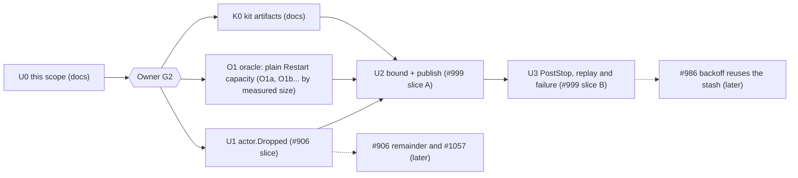

# Scope: Bound the Typed restart stash and its `Dropped` (#999, TYP-26; prerequisite slice of #906, EVT-06)

Status: **G2 granted by the Owner on 2026-11-13** as an express instruction, not by QA and not by the documental merge of PR #1560 (`2b799d9dd9cbcaff28db50237d25ebb44ecd6d73`; QA of that PR: <https://github.com/getsyntegrity/gopekko/pull/1560#issuecomment-6866363057>). The Owner approved D-1 to D-9 as recommended and, for D-10, the **procedure** of asking for a point exception if indispensable: **no budget exception is granted**, every PR stays within 400 authored lines and a unit that does not fit is split or gets a concrete request before it continues. Decisions as approved: D-4 runs O1 before U2 with **no waiver of the oracle**; D-7 runs the kit for U2/U3 with K0 and **no waiver**; D-8 renews the Go campaign after U1 integrates, coordinated with other core changes; D-9 accepts the export justified by its concrete consumer U2 within this sequence. Merging each unit's PR needs the Owner's later authorization; this G2 does not approve artifacts or hashes that do not exist yet, does not close #999 or #906 and claims no complete parity. The rows below keep the text that was reviewed; where they say "proposal" or "open" read them with these decisions. Originally written on 2026-11-13 against `origin/develop` `94c41305b7eb92ff99f0ad1cf2431212738449b6` (the worktree was cut from it; pekko pin `9a54d1294c3ac7821bbed3c940769c3d5027d1ff`, `v1.7.1`). Nothing here is implemented, no criterion of #999 or #906 is marked done and no normative decision is changed: every row marked **proposal** or **open** needs the Owner. This file is the one scope of #999; no earlier scope covers it (`976-typed-restart.md`, `997-restart-child-wait.md` and `889-typed-stash-buffer.md` each name #999 as the owner of the bound and leave it out), so nothing is duplicated.

**Kit run required (ADR 0017 "Delivery units", ADR 0024 T6, `AGENTS.md`)** for U2 and U3: they port `Supervision.scala:120-123, 254-286, 365-376` into `interpreter.go`. Proposal; the alternative is a waiver like #997's (D-7).

## Why this is small

The explicit user `StashBuffer` is already bounded (#889). What is unbounded is `held` in `pekko-actor-typed/typed/interpreter.go:42-46`, the buffer that fills while a restart waits for its children (`TODO(TYP-26)` at `:44`; README `pekko-actor-typed/README.md:239`). Pekko checks `stashBuffer.isFull` before each stash and publishes `Dropped` for the excess (`Supervision.scala:266-269, 280-286`, `dropped` at `:120-123`).

**The `EventStream` already exists**, so the old blocker (ADR 0035 contract 5, "publication is a deferred capability"; ADR 0036 EVT-1.3) has lifted: `actor.Publish(s *System, event any)` and `Subscribe[E, M]` are exported and delivery is a mailbox enqueue (`pekko-actor/actor/eventstream.go:81, 172`; #836, #870, #905, #1056 closed). `Publish` needs no new machinery to carry a new event type. The only thing missing is the **`Dropped` type**: `rg "type Dropped" pekko-actor` finds nothing, while `DeadLetter`, `SuppressedDeadLetter` and `AllDeadLetters` exist (`pekko-actor/actor/deadletter.go:26-55`, #871, #896 closed). Typed already reaches the system from its actor (`ctx.System()`, `interpreter.go:267`) and imports only `pekko-actor` (`scripts/deps.allow`).

## Contract, by confidence

### Accepted decisions (cited, not restated as new)

| Decision | Source |
|---|---|
| Restart stash exists; default capacity `restart-stash-capacity = 1000`; capacity "as an option"; signals other than the awaited children's `Terminated` are stashed too; overflow is `Dropped(msg, "Stash is full in [RestartSupervisor]")`, **no sender**, the actor as **recipient**; leftovers go to dead letters if the new behavior stops during replay; the stash is discarded with no event if the actor stops before the replay | ADR 0035 contract 5; ADR 0036 EVT-1.4 and Amendment (2026-11-05), row "Restart stash overflow" |
| Typed publishes to the stream of `pekko-actor` once it exists; each export Typed needs is justified in the story that introduces it | ADR 0036 EVT-1.2, EVT-1.3; EXP-1 (`typed-owner-decisions-2026-10-27.md:36`) |
| ADR 0032 D3, D4, D6 do not apply to this site (no sender to map) | ADR 0036 Amendment (2026-11-05); #999 comment of 2026-11-06 |
| `Dropped` keeps both `sender` and `recipient`, each producer sets them as its site says | ADR 0036 Amendment (2026-11-06, e), point c |
| Division: (a) restart-stash capacity depends on #906 and not on #986; (b) the backoff capacity waits for #986 | Owner note on #999, 2026-11-09 |
| A subscriber's full or stopped mailbox turns the delivery into a `DeadLetter`, not a `Dropped` | ADR 0038 D1 |

### Upstream behavior observed (oracle runs, Pekko 1.7.1)

| Observation | Source |
|---|---|
| Default capacity: 1500 messages during a child wait give 1000 replayed in order (`flood-1..1000`) and 500 `Dropped(Msg(flood-1001..), "Stash is full in [RestartSupervisor]", A)`, published **before** the child is released; no dead letter | W3d, `typed-restart-child-wait-2026-11-06.md:67` |
| Stop during the wait with a full stash: the same 500 `Dropped`, then **one more `Dropped(PostStop, ...)`** (501 in all); retained messages discarded, none is a dead letter | W3e, `:68` |
| `withStashCapacity(2)` and 5 messages while the slow child stops: 3 `Dropped` (`m3`..`m5`), sender `null` (`noSender`), recipient the restarting actor, reason as above; `m1`, `m2` processed after the restart | EVT-1 oracle D1, `evt-1-unhandled-dropped-2026-11-05.md:83` |
| A retained message and a retained `Terminated` of a non-awaited actor are replayed in arrival order (no dead letter); if the rebuilt behavior stops, the retained messages are `DeadLetter(msg, deadLetters, A)` in order once, and a retained typed `Terminated` is an ordinary `DeadLetter` | RS0, RS1, RS2, `restart-stash-held-2026-11-11.md:44-46` (already implemented, `interpreter.go:261-275`) |
| A stop during the wait (`context.stop(A)`) discards the retained inputs (`m1`, `m2`, `Terminated(X)`) with no event: none reached a behavior and none is a dead letter. Only `after-stop`, sent once the actor is stopped, is a `DeadLetter` (`deadLetters=1`, `dropped=0`) | W3a (`typed-restart-child-wait-2026-11-06.md:64`); `interpreter.go:277-282` |
| A stop **during the replay** is a different case: the child is released, `A.setup#2` runs, `m1` is replayed and `StopNow` stops the behavior; the messages retained behind it (`m-behind-1`, `m-behind-2`) are published as `DeadLetter` in order, then `after-stop` (`deadLetters=3`). This is the RS1/RS2 contract of the row above, not the discard of W3a; the `after-stop` dead letter is separate from the retained ones | W3c (`typed-restart-child-wait-2026-11-06.md:66`) |
| The `Dropped` of a MessageBuffer is a `DeadLetter` wrapping it, not a `Dropped` event (a different site; no Go producer) | EV9, `eventstream-spec-2026-11-06.md:156-166` |

### Read from source, not run (Supervision.scala, StashBufferImpl.scala, ActorSystem.scala)

| Reading | Location | Status |
|---|---|---|
| The awaited child's `Terminated` is consumed **before** the fullness check, so a full stash never interferes with the wait | `Supervision.scala:254-262` vs `:265-269` | not observed with a full stash |
| A non-awaited `Terminated` and any other signal are stashed or, when full, published as `Dropped(signal, ...)` | `:265-269` | only `PostStop` was observed full (W3e) |
| `isFull = (size == capacity)`; capacity `0` is full from the start, so everything is dropped | `StashBufferImpl.scala:69` | `SupervisionSpec.scala:912-921` (`withStashCapacity(0)`, `:921`) asserts it for **backoff**, not for plain `Restart` |
| `withStashCapacity(n)`: `n >= 0` is used, a negative value means the system default; the system default must be `>= 0` | `Supervision.scala:365-366`; `ActorSystem.scala:350-351`; `SupervisorStrategy.scala:148, 176` | proposal for Go below |
| The same stash survives a failure during the replay or the start, with its first capacity, holding the entries not yet replayed | `Supervision.scala:369-375, 406-408`; `SupervisionSpec.scala:1195, 1232` (`restart.withStashCapacity(4)`, retention only; no overflow) | no overflow observed |
| The reason text uses the supervisor class name, which backoff shares with restart | `Supervision.scala:120-123`; `SupervisionSpec.scala:882` (backoff) | observed for restart (W3d, D1) |

A correction to the reconciliation: `typed-supervision-stories-reconciliation-2026-10-26.md:160-166` cites `SS:882, 912` as evidence for `Restart`. Both tests use `restartWithBackoff` (`SupervisionSpec.scala:882` and `:912`); they confirm the `Dropped` shape and capacity 0 **for backoff**. The plain-`Restart` evidence is W3d, W3e and D1.

### Mapping to the Go interpreter (read at `94c41305`)

| Input while `waiting != nil` | Today (`interpreter.go`) | Occupies capacity | When full |
|---|---|---|---|
| User message `T` (`Receive`, `:164-166`) | appended to `held` | yes | `Dropped(msg)`, the arriving one is discarded |
| `Terminated` of an awaited child (`awaited`, `:468-480`) | consumed, never held | **no** | n/a: never stashed, never dropped |
| `Terminated` of any other actor (`awaited`, `:470-472`) | appended | yes | `Dropped(typed.Terminated)` (read, not run) |
| `PostStop` (a stop during the wait; `stop`, `:279-281`) | held discarded, no event | never stored | `Dropped(PostStop)` when the stash is full at that moment (W3e) |
| `PreRestart` | not held (runs before the wait) | no | n/a |
| `ChildFailed`, timers, Typed-parent signals | do not exist yet (#1346, contract 15) | would count once they exist | not covered here |

The entry discarded on overflow is **the arriving one**; the retained prefix keeps its order (W3d, D1). Retained entries are replayed before later mailbox messages and a failing replayed entry leaves the rest held ahead of new arrivals (`replay`, `:484-504`).

### Open (no decision exists; none is invented here)

1. **Shape of `Dropped` in Go** (field names, `Sender`/`Recipient` types). #906 AC1 only says "the accepted reason, sender and recipient fields". Pekko: `Dropped(message, reason, sender, recipient)` (`ActorRef.scala:622`). See D-2.
2. **Where the default 1000 lives.** No Go code reads `restart-stash-capacity`; `actor-typed-completion-design.md:205` (TY-24) marks the typed `reference.conf` keys "adapted, OD per key" (Owner decision per key). See D-3.
3. **Negative `WithStashCapacity(n)`** (Pekko: use the default) and **zero** (everything dropped). Proposed in the reconciliation, never accepted; needs an oracle or an ADR 0033 D13 approval for plain `Restart`. See D-4.
4. **Nested supervisors.** Pekko keeps one buffer per `RestartSupervisor`; Go has one `held` per interpreter shared by all layers. Which capacity rules when a nested layer restarts is unknown. Conservative rule (AGENTS "Unknown is an answer"): the capacity of the layer that creates the stash holds until it is released, with a greppable TODO.
5. **Whether `Dropped` joins `AllDeadLetters`** (Pekko: yes). #906 split that criterion to #1057 (`EVT-18`). See D-5.

## Order of delivery: #906 first, only its minimum

`Dropped` must exist before U2 can publish, and U2 is the first real consumer of the export. Nothing may drop silently and `DeadLetter` is not a substitute: W3d records "none is a dead letter" and ADR 0036 fixes the site as a `Dropped` event. Only the **type** is needed from #906 (the restart-stash site uses the 3-argument form, `ActorRef.scala:626-630`, with sender `noSender`). The rest of #906 stays out: the `MessageBuffer.drop` row binds no producer because `pekko-actor` has no `MessageBuffer` (ADR 0036 (e) point c), and condition (d) of that amendment is met by EV9, which ran an entry with a sender and one without (`eventstream-spec-2026-11-06.md:158-166`).

## Units (each at most 400 authored lines added plus deleted; sizes are **estimates**, to be measured by `git diff --numstat` on the PR)

Each unit is its own PR from `develop`. Kit manifest rows go beside the code in U2 and U3.

### K0. Kit artifacts for the port (docs only) — est. 120-180 lines
- **Result:** `migration/stage-1/typed-999-restart-stash/{manifest.tsv, RULEBOOK.md, RUNBOOK.md}` for the rows of `Supervision.scala:120-123, 254-286, 365-376` (shape of `typed-976-restart/`). Only needed if D-7 chooses a kit run.
- **Depends on:** G2. **Allowed:** that directory only. **Gates:** none beyond review (docs). **Oracle:** none. **Judge:** no effect (outside `pekko-actor/`).

### O1. Oracle: plain `Restart` capacity (evidence only) — est. 250-400 lines for the text and harness before logs; logs count
- **Result:** new dated oracle `docs/parity/oracles/restart-stash-capacity-<date>.md`, scenarios in `docs/parity/harness/src/` (not the judge, not its comparator or scenarios), and the run logs. Scenarios: capacity `0` on plain `Restart` with a child wait; `withStashCapacity(n)` with `n > 0` and overflow; a negative value; a full stash with a non-awaited `Terminated` (does the awaited child's `Terminated` still complete the restart?); capacity across a failure during replay; optionally a nested supervisor (open item 4).
- **Budget (`AGENTS.md`, "PR budget and commits"):** the current rule applies to the measured size of each PR. Logs are authored lines like any other file: being under a `.logs/` directory exempts nothing, and no generated-code header is added to a log to avoid the count. The exclusions are only those listed in `AGENTS.md` (code with the `// Code generated ... DO NOT EDIT.` header, depmap output under `migration/stage-N/`, vendored files, `go.sum`, `.claude/skills/`).
- **Partition if the measured size passes 400 (proposal):** measure with `git diff --numstat` before opening each PR and split by scenario group, never by dropping evidence. O1a: harness scenarios plus the oracle text for the first group, with its logs. O1b, O1c...: one further group each, with its scenarios, its section of the oracle text and its logs, each opened from `develop` after the previous one and citing the harness commit SHA that produced its logs. Each section of the oracle names the run (date, JDK, harness SHA) and the log file path, so a log line stays traceable to its scenario and to the rows of "Read from source, not run" that it moves. If the oracle text must stay one file, the first PR creates it and the later ones append their sections.
- **Exception, only if a single log or scenario cannot fit in 400 on its own:** it is a request to the Owner (D-10), pending until the Owner approves it, bounded to the named files and their measured line counts, and taken at that PR's G2, not before. Until then the unit is split as above. Nothing in this scope grants it.
- **Acceptance:** each row of "Read from source, not run" it covers moves to "observed" with the log line; anything not run stays labeled inferred; JDK 8 as in the earlier oracles (`restart-stash-held-2026-11-11.md:4`).
- **Depends on:** G2. **Oracle/kit:** it is the oracle; no kit run. **Judge:** no effect. **Skippable only** by an ADR 0033 D13 approval of alternative evidence for those rows (D-4).

### U1. `actor.Dropped` (the #906 slice) — est. 90-150 lines
- **Result:** an exported event type in `pekko-actor/actor` carrying the message, reason, sender and recipient, publishable with the existing `Publish` and received by `Subscribe[Dropped, M]`. Not a `DeadLetter`; not a member of `AllDeadLetters` (D-5); no constructor for `MessageBuffer.drop`.
- **Depends on:** G2 and D-2. **Allowed:** `pekko-actor/actor/dropped.go` (name proposal), its test, `pekko-actor/README.md`, the EXP-1 record in the PR body. No `go.mod`, no `scripts/deps.allow`.
- **EXP-1 record (proposal):** symbol `Dropped`; consumer `pekko-actor-typed/typed/interpreter.go` (U2, the publisher) and any subscriber. **Justification:** `Publish(s *System, event any)` and `Subscribe[E, M any]` (`pekko-actor/actor/eventstream.go:81, 172`) do not restrict the package that defines the event, so the stream is not the reason for the export. The reason is that the producer (Typed, U2) and the consumers (Classic subscribers of `pekko-actor`, and Typed ones) must name **one common type**. It has to live in the module both already depend on: `pekko-actor` imports no other goPekko module and `pekko-actor-typed` may import only `pekko-actor` (`scripts/deps.allow`), so a type defined in Typed would force every Classic subscriber to import Typed, which the direction forbids. ADR 0036 (EVT-1.2, EVT-1.3 and the Amendment of 2026-11-05/06) fixes `Dropped` as an event of the stream of `pekko-actor`, beside `DeadLetter`. Limits: it does **not** expose a way to publish a `DeadLetter`, a `MessageBuffer`, or membership of `AllDeadLetters`; test below.
- **Acceptance:** a subscriber of `Dropped` gets one event per `Publish` with all four fields intact, a nil `Sender` stays nil (Pekko `noSender`, EV9: `null`); a subscriber of `DeadLetter` gets nothing.
- **Tests:** public (`package actor_test`), `Subscribe` + `Publish`, no internal access.
- **Contracts and where each is checked** (replaces the original "Mutations to catch" row of U1; accepted by the Owner on 2026-11-13, express instruction on PR #1562, from the delta proposed in <https://github.com/getsyntegrity/gopekko/pull/1562#issuecomment-6866839730>; it applies to U1 only and does not waive the mutations of U2): (static, compile time, not counted as assertion detections) the field set and types of `Dropped`; (stream regression tests; no mutation is claimed that was not run) delivery once per `Publish`, no field lost, a nil `Sender` kept nil, no `DeadLetter` produced; (producer obligations, **real mutations required in U2**, each linked to its test and SHA) `Sender` nil, `Recipient` the actor, the reason text, one publication, never wrapped as `DeadLetter`.
- **Gates:** unit tests, per-module coverage 85, diff coverage 85, gocyclo 10, `scripts/check_deps.sh`, README contract. **Kit/oracle:** none (a type, no behavior beyond `Publish`); evidence is EV9 and D1. **Judge:** changes a non-`.md` file under `pekko-actor/`, so `core_sha` changes. The campaign is already not current on this HEAD (below); see D-8.

### U2. Bound the restart stash and publish `Dropped` (#999 slice A) — est. 300-380 lines
- **Result:** `RestartStrategy.WithStashCapacity(n)` (name per `SupervisorStrategy.scala:176`); default 1000 (D-3); while a restart waits, a message or non-awaited `Terminated` arriving at a full stash is discarded and published once as `Dropped{Msg, "Stash is full in [RestartSupervisor]", Sender: none, Recipient: self}`; the retained prefix is replayed in order; the awaited children's `Terminated` never occupies capacity.
- **Depends on:** U1, G2, K0 (if kit), O1 (or its waiver), D-2 to D-4. **Allowed:** `pekko-actor-typed/typed/{interpreter.go, supervise.go}`, new `restart_stash_*_test.go`, `pekko-actor-typed/README.md` (replace the known gap at `:239`), kit manifest rows. Nothing under `pekko-actor/`.
- **Acceptance:** (1) default capacity 1000: 1500 messages give 1000 replayed in order and 500 `Dropped` with that reason, recipient the actor, no sender, none as dead letter (W3d); (2) `WithStashCapacity(n)` and `0` as proven by O1 (or D13 approval); (3) a full stash does not stop the restart from completing (the awaited `Terminated` is consumed); (4) a non-awaited `Terminated` counts and, when full, is published as `Dropped` (only if O1 observes it); (5) a restart with no children retains nothing and drops nothing.
- **Tests:** public through `Spawn`, `Supervise(...).OnFailure(...)`, a child whose `PostStop` blocks on a channel and `Subscribe[Dropped, M]`; the stash content is read from replay order and the `Dropped` count, never from internals. No internal access needed; if the Dev needs `len(held)`, that is one internal test, labeled, limited to proving the bound, never to the order.
- **Mutations to catch:** capacity ignored (always append); off by one (`>` for `>=`); oldest dropped instead of the arriving one; `Dropped` published twice or not at all; a `DeadLetter` published instead of, or besides, `Dropped`; wrong recipient (parent) or a non-nil sender; the awaited child's `Terminated` counted against capacity (capacity 0 then never finishes the restart); retained entries lost or reordered; the stash re-created per wait so a replay failure resets it.
- **Gates:** as U1 plus `make ci-fast`; kit run per D-7; README contract (purpose, usage, limits). **Judge:** `pekko-actor-typed` is outside `core_sha` and `judge/go-scope.json` has no typed scenario: no effect. Not V3 parity.

### U3. `Dropped(PostStop)`, replay and failure (#999 slice B) — est. 200-300 lines
- **Result:** a stop during the wait with a full stash publishes one `Dropped(PostStop, ...)` and discards the rest with no event and no dead letter (W3e); a failure during replay keeps the unreplayed entries ahead of new arrivals under the same capacity; leftovers behind a rebuilt behavior that stops stay `DeadLetter(msg, deadLetters, self)` and the dropped ones are never dead-lettered.
- **Depends on:** U2. **Allowed:** `interpreter.go`, tests, README, kit rows.
- **Acceptance:** W3e exactly (501 `Dropped`, `floodDelivered = 0`, `deadLetters = 0`); not-full stop publishes no `Dropped` (W3a); replay failure with a full stash drops nothing already retained; RS1/RS2 unchanged.
- **Tests:** public; mutations: stop dead-letters the held inputs; `PostStop` dropped silently when full; `PostStop` published when not full; capacity restored on each nested wait.
- **Gates and judge:** as U2.

### Not in this scope
Backoff capacity and `ScheduledRestart` (#986); `AllDeadLetters` membership (#1057); the `MessageBuffer.drop` producer and #906's other criteria; the group-router stash (ADR 0036, "to be verified"); `Topic.Publish` (a `DeadLetter` wrapping a `Dropped`); `ChildFailed` (#1346); logging of the drop (#1179, #1479); a `System` setting for the default (D-3). Delivering these units does not close #906, #986 or #1057 and claims no Typed parity.

## Judge campaigns: what each unit does

The rule is `docs/judge.md:327-329` and `core_sha` (`judge/mutate_go.py:246-252`): a Go campaign applies only while **`pekko-actor/` without `*.md`**, the comparator, `judge/mutate_go.py`, the specs and the pinned toolchain are unchanged. Checked on this worktree (`python3 scripts/check-judge-matrix.py`, HEAD `94c41305`): "goPekko CURRENT ... detected 0/21 ... an input of the campaign changed since it ran"; the committed rows are tied to `815fc984`. So the renewal that is pending already has to run, and this scope does not touch it. Effect per unit: U0, K0, O1, U2, U3 none (docs, `docs/parity/`, `migration/`, `pekko-actor-typed/`); **U1 changes the core**, so a campaign renewed before U1 merges is stale again after it. The renewal after U1 is the one that counts for the code that includes `Dropped` (D-8).

## Decisions the Owner has to take

| # | Decision | Recommendation |
|---|---|---|
| D-1 | Order: U1 (`Dropped` type only) before U2; #906 stays open for its remainder | accept |
| D-2 | Go shape of `Dropped`: `Msg any`, `Reason string`, `Sender Handle` (nil = `noSender`), `Recipient ID` (as `DeadLetter.To`) | accept; `Recipient` as `ID` matches `DeadLetter`, `Handle` is the alternative |
| D-3 | Default 1000 as an unexported constant in `typed` for now, a System setting later (TY-24, "OD per key") | accept the constant; the setting is a separate decision |
| D-4 | Negative `WithStashCapacity` means the default, `0` drops all; evidence O1, or a D13 approval of alternative evidence for plain `Restart` | run O1 |
| D-5 | `Dropped` joins `AllDeadLetters` in #1057, not in U1 | accept |
| D-6 | Include `Dropped(PostStop)` (W3e) in #999 as U3; the story text omits it | accept |
| D-7 | Kit run for U2/U3 (with K0) or a waiver | kit run |
| D-8 | Run the pending judge renewal after U1 merges, or now and again after U1 | after U1 |
| D-9 | An export justified by the consumer in the next unit of the same scope (U1 then U2) is acceptable under EXP-1. If the Owner does not accept it, the Dev stops and proposes another partition or sequence that keeps every PR within 400 authored lines; U1 and U2 are never merged into one PR over the budget. Any exception for U1/U2 would be a separate request with named files and measured size, pending explicit Owner approval. D-10 does not cover it: it is only for O1 | accept |
| D-10 | Only if a single O1 log or scenario cannot fit in 400 authored lines: an exception for those named files at their measured size, decided at that PR's G2. **Pending the Owner; not granted, not assumed** | split O1 (a, b, ...) and do not ask |

## Definition of Done (for the scope, after G2)
Each unit merged with its tested head SHA, the gates it lists, QA from a clean read-only context, and #999 and #906 updated with links and no criterion ticked by anyone but the Owner. Until then this file claims nothing.
