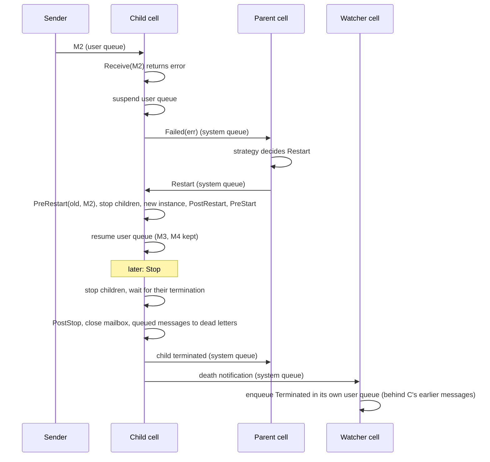

# Milestone 1: one vertical path, judged against Pekko

> **Historical (Owner scope change, 2026-10-17):** goPekko has no tenancy module. References to tenancy, `tenancy.Owner` or the tenant guard in this file describe the scope at the time and are not current requirements.

- Status: proposed, for owner review
- Date: 2026-10-08
- Depends on: [`docs/judge.md`](../../docs/judge.md), [ADR 0010](../../docs/adr/0010-actor-api.md), [ADR 0008](../../docs/adr/0008-envelope-and-metadata.md), all proposed

Milestone 1 delivers the smallest runtime that crosses every core subsystem once: **spawn → tell/ask → failure → restart → watch → stop → dead letter**. It is done when the scenarios below pass on Pekko `v1.7.1` and on goPekko under the judge contract, and the judge has caught every injected mutation on both sides. It replaces the "disposable full run of S1-S3" of the feasibility report (see its Amendments). Patterns beyond ask, routing, stash and timers are out.

## Prerequisites

1. The stage 1 gate is signed off, including the model plan.
2. ADR 0010 and ADR 0008 are accepted (or amended and accepted).
3. `migration/settings.go.json` is installed as `.claude/settings.json`.

## Scenarios

Relation ids refer to [`docs/judge.md`](../../docs/judge.md) §3. "Both" means both modes run; concurrent-only scenarios cannot be driven by a manual clock.

| Id | Script | Asserted | Mode | Oracle |
|---|---|---|---|---|
| S01 | Parent spawns a child and sends M1, M2, M3 | G2, G1, G3 | Both | Pekko |
| S02 | Two senders each send three messages to one receiver | G1 per pair; any interleaving accepted (N1) | Concurrent | Pekko |
| S03 | Ask from outside; the target replies | G8: `ask-replied` with the value, once | Both | Pekko |
| S04 | Ask from outside; the target never replies; clock advanced past the deadline | G8: `ask-failed(timeout)`, no reply event | Controlled | Pekko |
| S05 | Child fails on M2 of M1..M4; default hooks | G7 (Restart), G4: `pre-restart(1, M2)` → `post-stop(1)` → `post-restart(2)` → `pre-start(2)`; M3, M4 received by instance 2; M2 not received again | Both | Pekko |
| S06 | Child fails while messages from two senders are queued | G4 (queue kept), G1 per pair across the restart | Concurrent | Pekko |
| S07 | W watches C; C sends X to W, then stops | G6: `terminated` delivered; I1: X before `terminated(W, C)`, `post-stop(C)` before it; I2: once | Both | Pekko |
| S08 | W watches C after C has stopped | G6: `terminated` delivered | Both | Pekko |
| S09 | W watches C, unwatches, then C stops | G6: no `terminated` | Both | Pekko |
| S10 | Parent with two children is stopped while one message is in flight and two are queued | G5: both children's `post-stop` before the parent's; queued messages not received; G3: `post-stop` after the in-flight `Receive` returns; I3 (controlled: each dead-lettered once; concurrent: never both received and dead-lettered) | Both | Pekko |
| S11 | After `terminated` is observed, a message is sent to the dead actor | I3: `dead-letter(message, recipient)` once | Both | Pekko |
| S12 | Ask to an actor after its `terminated` was observed | I4: `ask-failed(recipient-terminated)` at once; message dead-lettered | Both | Pekko |
| S13 | W watches C; C fails and restarts | G6: no `terminated`; the Go body ends with a message to W after the restarted instance received `R`, so a late `terminated` cannot be missed | Both | Pekko, goPekko |
| S14 | Child's `pre-start` fails (Go: its factory fails, see docs/judge.md); W watches it | G7: Stop; `terminated(W, child)` | Both | Pekko, goPekko |
| S15 | Ask from outside; clock advanced past the deadline (timeout); then the target replies | I5: the late reply is published as `dead-letter` once and the ask result stays `timeout` | Controlled | Pekko |
| S16 | W calls `watchWith(C, X)` and then `watch(C)`; separately `watchWith(C, X)` twice | I6: the conflicting call fails W (`IllegalState`) and its supervisor decides; the repeat with the same message is a no-op (Go: the watchers use a comparable message type, because `WatchWith` compares messages with `==`) | Both | Pekko, goPekko |
| S18 | W watches C; C is held in `post-stop` until a message chain has run through W, then stops | G6: `terminated` delivered; I1: `terminated(W, C)` is handled after `post-stop(C)`, and a notification sent before it ends is seen | Both | Pekko |
| S17 | Ask from outside; the target replies `pong` and then `second` in the same turn | G8: the ask completes with the first reply (`pong`); the second reply does not change the result | Both | Pekko |
| S19 | `M1` is held inside `Receive` while `M2` and `M3` are queued behind it; the test goroutine stops the actor from outside (`System.Stop`), `M1` is released, then `M5` is sent to the stopped actor | G5: `M1` finishes before `post-stop`, `M2` and `M3` are never received (G5.b, concurrent only: one thread cannot hold the handler in controlled mode); G3.a; G5.d and G5.e: `post-stop` once; I3: `M5` sent to the stopped actor is dead-lettered (exactly once, controlled mode: I3.a), and no message is dead-lettered twice (I3.b) | Both | Pekko, goPekko |
| S20 | An actor is stopped before its first activation (its `Create` has not run yet) with `M1` queued. Divergence D2 until ADR 0012 was approved and implemented; since then a parity scenario | G5.e: `pre-start` and `post-stop` once each, in that order, and `M1` dead-lettered. Pekko passes; goPekko passes since the D2 fix (ADR 0012, approved for this case only). Historical: before the fix goPekko failed G5.e in every run, and M65 reproduces that behavior inside Pekko | Concurrent | Pekko (passes); goPekko in the approved-parity gate of `judge/go-scope.json`; not calibrated |
| S21 | Three senders each send four messages and a sentinel to one receiver whose handler yields the processor between `received` and `received-end` | G3.c: the `Receive` calls of one actor never overlap (a negative property: evidence over many runs, not a proof) | Concurrent | Pekko, goPekko |
| S22 | A parent `c` with two children, all default hooks, is stopped by its parent while a restart of `c` waits for the two children (each held in `post-stop`); a watcher watches `c` (ADR S11/H4, U7). In Go the default hook emits the unexported event `prerestart-default`, which the harness maps to `pre-restart` for default-hook nodes (#173); the directed mutant GMdefaultps restores the pre-U7 body of the default hook | G5.f: `c` has `pre-start` 1, `pre-restart` 1, `post-restart` 0 and `post-stop` 2; I2.a: one `terminated` at the watcher; G5.c: the final `post-stop` of each child comes before the final `post-stop-begin` of `c`. No G4.a and no G5.d (they require a second instance) | Concurrent | Pekko, goPekko |
| E01 | Ingress context with tenant T; A tells B, B tells C, C forwards to D | C and D see tenant T [C2] | Controlled | ADR 0008 |
| E02 | Ask from ingress with tenant T | The responder sees T; the reply carries no metadata and the caller gets the value [C2] | Controlled | ADR 0008 |
| E03 | Send to a tenant-scoped actor with no tenant, with a malformed tenant and with an unknown tenant | Each is `Rejected` with its reason (missing, malformed, unknown); `Receive` never runs; an asked message fails the ask with `rejected` (`ErrRejected`) [A1, T4] | Controlled | ADR 0008 |
| E04 | Message with tenant T dead-lettered; `terminated` after a watch made under tenant T | Dead letter and `terminated` both carry T [C2] | Controlled | ADR 0008 |
| E06 | Mutate caller byte metadata after enqueue and receiver-returned bytes after read | Neither mutation changes the stored snapshot. Unsupported values never reach an envelope: `WithUntyped` returns `ErrUnsupportedValue`, and a key of an unsupported type does not compile (`docs/adr/signatures`). `Tell` has nothing to reject [C1] | Controlled | ADR 0008 |
| E07 | Guard returns an error, panics, or returns after its budget expires | No `Receive`; one rejection each; the correlated ask completes once with `ErrRejected`; no per-delivery timeout goroutine [A1, T2] | Controlled | ADR 0008 |
| E08 | Ask 1: the actor forwards the asked message (first `Forward`) to a rejecting target. Ask 2: the actor makes a second `Forward` and a plain `Tell` to the same rejecting target, then replies normally | Ask 1 completes once with `rejected`. Ask 2 completes with the actor's reply value (a separate completion witness), not with `rejected`; neither extra send carries the correlation [F1, F2] | Controlled | ADRs 0010, 0008 |
| E09 | Stop requested while the handler waits on the actor-owned context; separately the caller cancels | Stop acceptance cancels the context and the handler returns before `post-stop`; caller cancellation does not cancel the handler; no hook overlap [K1] | Concurrent | ADR 0008 |
| E10 | Tenancy required. W watches C with a plain `Watch` from its own `PreStart`. W2 registers `WatchWith(C, X)` from its `PreStart` and then changes its own copy of `X`; W4 registers `WatchWith(C, Y)` from a message handler under tenant T. W3 watches C with no handler. C stops | The recording guard is not called for W's `terminated`, for `X` or for `Y`, so they were internal; W: `terminated` once, system metadata in its handler context, no tenant. W2: exactly the registered `X` once. W4: `Y` once, with tenant T. W3: the death pact fails W3 and its supervisor decides. W's `PreStart` context carried no tenant. The same value `X`, and a `Terminated`-shaped user type, sent with `Tell` and no tenant are `Rejected(tenant missing)` and do appear in the guard log. What W's handler sends carries no tenant, so a tenant-scoped target rejects it [P1, P2, P3, C2] | Controlled | ADR 0008 |
| E11 | Four observers: one panics, one is slow, one never returns, one has an overflowing queue. The script offers a known number of events | The sender's ask completes while one observer is blocked forever (deterministic witness; no timing comparison). `ObserverStats` (authoritative) show `Panicked`, `Slow`, `Dropped` and, after 10 consecutive panics, `Disabled`, and `Enqueued + Dropped` equals the number the script offered. `ObserverFault` events are checked only as best effort: their absence is not a failure. The non-returning observer stalls only its own goroutine [O1, O2, O3] | Concurrent | ADR 0008 |
| E12 | Shutdown with: an observer with a long queue, an observer that never returns, and a healthy one; the deadline of `Shutdown(ctx)` is short | `Shutdown` returns by the deadline plus a margin and does not wait for the stuck observer; `Enqueued = Delivered + Panicked + Abandoned` for each; events produced after the intake closes are `Dropped`; no event reaches an observer after `Shutdown` returns except the call already running; final `ObserverStats` readable; a second `Shutdown` is a no-op; no promise that the long queue was drained [O4] | Concurrent, `timing` tag | ADR 0008 |
| E13 | Tenancy required. (a) A sends B a message whose `ReplyTo` is a plain `Ref` to C; B replies with no tenant. (b) `AskFrom` to a responder that replies with a crafted value. (c) A message carries the `ReplyTo` of another ask that already completed, and the responder replies to it. (d) A responder answers a stored `ReplyTo` while processing another tenant's message. (e) Application code tries to give a `Tell` an ask correlation | (a) The reply is an application message to C: it appears in the guard log and is `Rejected(tenant missing)`. (b) The mapped result is in the guard log (origin Application) with the asker's metadata; the crafted value never bypasses the guard. (c) The reply is dead-lettered (I5) and reaches no actor. (d) The asker still gets the value: the documented limit, stated and tested. (e) There is no API to do it; a `Tell` made while processing an ask neither carries the correlation nor completes the ask (E08). No message becomes internal through a `ReplyTo` or a correlation [P1, P4] | Controlled | ADR 0008 |
| E14 | Tenancy required. An actor calls `AskFrom` in its `PreStart` | `ErrAskFromHook`; the actor fails as an initialization failure (default decider: Stop); no ask is created and no result is lost silently [H1] | Controlled | ADR 0010 |
| E15 | Tenancy required, the tenancy guard not registered; `NewSystem` | `NewSystem` returns an error and no actor runs [T1] | Controlled | ADR 0008 |
| E16 | Application code (a) writes the tenant by name with `WithUntyped`, (b) calls `WithTrusted` with a nil capability and with a capability of another system, (c) declares a caller-supplied key named like the tenant key before the tenancy extension installs | (a) `ErrTrustedKey`. (b) `ErrNoCapability`. (c) the extension's `Install` fails and `NewSystem` fails. No envelope carries a forged tenant. At compile time a user type cannot implement `Capability` (harness case `capability_forge`) [T3] | Controlled | ADR 0008 |
| E17 | An actor spawned with `tenancy.Owner` B receives messages from tenants A and B | A is `Rejected(tenant mismatch)`, B is delivered [T5] | Controlled | ADR 0008 |
| E18 | An actor keeps its `*Context[T]` in a field and uses it after `Receive` returned: `Tell` to a tenant-scoped actor, `Forward`, `AskFrom`, `Stop` | The `Tell` carries system metadata and no correlation and is rejected by the tenant-scoped target; `Forward`, `AskFrom` and `Stop` do nothing; each use is a `ContextMisuse` event [X1] | Controlled | ADR 0010 |
| E19 | A guard that never returns (declared `expect: stuck`) | The harness reports `stuck` with the partial log at the deadline, which is the passing outcome; the guard is not detached; no per-delivery timeout goroutine [T2] | Concurrent | ADR 0008 |
| E05 | E01's script run on the Pekko harness without metadata | goPekko's actor events satisfy the same relations as Pekko's (non-interference) | Controlled | Pekko |

### Ask increment I-2 (ACT-015, #161): scenario registration

ADR 0015 scenario ids are proposed ids. This slice implements the ones that need only the unexported endpoint, as in-package tests
(`pekko-actor/actor/ask_endpoint_internal_test.go`). They are **not** judge scenarios: the judge drives exported behavior, and the
first Ask judge scenario arrives with the exported `Ask` (#162). `judge/go-scope.json` is unchanged on purpose.

| Id | Condition | State |
|---|---|---|
| AK20 | invalid target (nil, typed nil, non-native, unregistered cell, ID coincidence): `ErrInvalidHandle` | Go test passes |
| AK21 | native ref of another System: accepted and owned by its own System (no origin identity, D6) | Go test passes |
| AK23 | endpoint vs Watch, WatchWith, Unwatch, Stop, Context.Stop, Done (D7/D8) | Go test passes; `Unwatch` pinned to the code, ADR text differs (Owner decision pending) |
| (D8) | unique `ask-<n>` identity, no `byID`/name entry, concurrent requests do not cross, first reply wins | Go test passes |
| AK01, AK02, AK03, AK05, AK08, AK12, AK13, AK15, AK22 | need the exported `Ask` | pending #162 to #165 |
| AK04, AK06, AK07, AK09, AK14, AK16, AK18, AK19a/b | later increments | pending |
| AK17 | needs `System.Shutdown` | blocked (D7) |

Source: `migration/stage-1/ask-endpoint-port/entries/milestone-1.entry.md`, moved here unchanged in substance (consolidation note: `migration/evidence/consolidation-2026-10-12.md`).

## How core, mailbox and supervision work together

Each actor has a **cell** that owns its instance, children, watchers and supervision state, and a **mailbox** with two queues: system messages (failure, restart, stop, watch notifications) are always drained before user messages, as in Pekko (`actor/…/dispatch/Mailbox.scala:230-280`). One goroutine at a time runs a cell's turn, taken from the **executor** port; the **clock** port drives ask timeouts. Both ports have controlled implementations for the judge.

The last step is what makes I1 hold in goPekko the same way it holds in Pekko (`actor/…/actor/dungeon/DeathWatch.scala:99-114`). That enqueue is a runtime delivery: it does not go through the guards (ADR 0008, "Provenance"). A closed mailbox forwards every send to the dead-letter path, which publishes on the event stream (I3). Stop acceptance also cooperatively cancels goPekko's actor-owned processing context as specified in ADR 0008; it cannot preempt a handler. PostStop and termination still wait for that handler to return.

## Relation, scenario, mutation

Every relation of [`docs/judge.md`](../../docs/judge.md) section 3 (tiers G, I and S) has at least one scenario that asserts it and at least one mutation (section 6) expected to break it. `scripts/check-judge-matrix.py` fails when a relation has no row, a scenario does not assert it, a mutation does not name it, or a scenario (other than E05) asserts no relation.

**Designed is not observed.** This table is the plan only; it holds no result. Observed detection is not typed in any document: 00b writes `judge/mutation-report.tsv`, one row per mutation, scenario and mode, with the run counts, the campaign `outcome`, the rules fired and the evidence of the execution (the exact columns are `HEADER` in `judge/mutate.py`), and the checker derives from it. A clause is observed on a side when at least one designed mutation applicable to that side was caught by that clause in a valid `failed` campaign (rule in `docs/judge.md` §6, item 4); a row for a pair that was not designed is an error. The Pekko file exists and the checker reports it (30 of 30 clauses; 14 of 14 G/I relations with every clause observed). The Go report of `judge/mutate_go.py` is committed (`judge/go-mutation-report.tsv`, one campaign) and the checker prints it apart as HISTORICAL and CURRENT; it derives **no** observed detection by relation on goPekko from it, so observed coverage by relation on goPekko is not claimed (**0 of 35 relations** by this checker). It prints the Go facts apart, never added to the Pekko ones: the scenarios the Go judge runs (S13, S14, S16, S19, S21 and S22 are registered above, with four designed Go mutations for the first three: GMrestartnotify, GMinitrestart, GMwatchoverwrite and GMwatchsamefail, and GMdefaultps for S22; the Go gate has 15 scenarios and 18 designed mutations plus one benign; S22 is not calibrated against Pekko mutations; S20 is a known divergence, D2, a diagnostic and in no row of this table), the designed Go mutations, and the measured Go calibration rows (S19 and S21: 2 of 2 measured on each platform, in `judge/calibration.macos.tsv` and in `judge/calibration.tsv`; a calibration of the two chosen mutants, not a detection claim on goPekko). The milestone is not done below full observed coverage on both sides.

| Relation | Scenarios | Mutations |
|---|---|---|
| G1 | S01, S02, S06 | M1 |
| G2 | S01 | M16 |
| G3 | S01, S10, S19, S21 | M16, M17, M64 |
| G4 | S05, S06, S22 | M3, M40, M41 |
| G5 | S10, S19, S22 | M2, M4, M7, M17, M63 |
| G6 | S07, S08, S09, S13 | M10, M11, M12, M58 |
| G7 | S05, S14 | M13, M14 |
| G8 | S03, S04, S17 | M36, M37, M61 |
| I1 | S07, S18 | M8, M9 |
| I2 | S07 | M5 |
| I3 | S10, S11, S19 | M6, M60, M62 |
| I4 | S12 | M15 |
| I5 | S15 | M38 |
| I6 | S16 | M43, M59 |
| P1 | E10, E13 | M18 |
| P2 | E10 | M19 |
| P3 | E10 | M20, M33 |
| P4 | E13 | M21, M31, M32 |
| F1 | E08 | M22, M23 |
| F2 | E08 | M39 |
| A1 | E03, E07 | M24, M42 |
| C1 | E06 | M25 |
| C2 | E01, E02, E04, E10 | M26, M54, M55, M56, M57 |
| H1 | E14 | M44 |
| K1 | E09 | M51, M52 |
| X1 | E18 | M53 |
| T1 | E15 | M47 |
| T2 | E07, E19 | M48 |
| T3 | E16 | M45, M46 |
| T4 | E03 | M49 |
| T5 | E17 | M50 |
| O1 | E11 | M27, M28 |
| O2 | E11 | M28, M29 |
| O3 | E11 | M30 |
| O4 | E12 | M34, M35 |
| N1 | S02 | n/a: never asserted, every allowed order passes (judge self-tests) |
| N2 | n/a | n/a |
| N3 | n/a | n/a |

## Integrating this chain

The chain is #5 → develop, #6 → #5's branch, #7 → #6's branch, #8 → #7's branch, each PR showing only its own diff. The repository allows squash, rebase and merge commits, and the branches are deleted on merge.

- **Merge commits, in order** (#5, then #6, #7, #8, #9). Each child already contains its parent, so nothing conflicts. When a parent's branch is deleted GitHub retargets the child to `develop`.
- **If a parent is squashed**, the child still carries the parent's original commits, which no longer match `develop`, and conflicts. Rebase the child onto `develop`, dropping the parent's commits, **before** merging it, and repeat for each child in order: `git rebase --onto origin/develop <old tip of the parent branch> <child branch>`, then `git push --force-with-lease`.
- Do not merge a child before its parent.

## Acceptance criteria

- [ ] Every scenario marked Controlled or Both passes in controlled mode on the Pekko harness and on goPekko.
- [ ] Every scenario marked Concurrent or Both runs `N` times in concurrent mode with zero violations, goPekko under `go test -race`. `N` is read per scenario from `judge/calibration.tsv`, produced by 00b with its derivation (`docs/judge.md` §5, "Concurrent run count"). No file, no number, no pass.
- [ ] The judge self-tests pass, and each mutation makes at least one scenario fail (the mutations without the `(goPekko)` mark on Pekko and on goPekko, the rest on goPekko; `docs/judge.md` §6). `judge/mutation-report.tsv` exists, was written by 00b, and `scripts/check-judge-matrix.py` reports full observed coverage on both sides.
- [ ] E01-E19 pass, E01-E04 and E06-E19 as `go-specs` specifications. `python3 scripts/check-judge-matrix.py` passes. E07 verifies budget expiry before a guard call; E19 is the deliberately non-returning guard, whose expected outcome is `stuck`.
- [ ] Negative assertions use the observation intervals and public completion witnesses in `docs/judge.md`; teardown events are recorded separately. S09 orders unwatch before stop within the watcher; S13 witnesses successful processing by the restarted instance before teardown.
- [ ] `go vet`, `go build`, `scripts/check_deps.sh` and the CI gate pass; `pekko-actor` imports no other goPekko module.
- [ ] The exported API is the ADR 0010 initial scope, which includes what ADR 0008 and the judge require (`DeadLettersPublished`, metadata keys and capability, guard and observer ports, `ObserverStats`, `Shutdown`, `ContextMisuse`), and nothing else.
- [ ] `migration/cost-log.tsv` has real per-step figures, used to recalibrate the feasibility estimates.

## Index of consolidated analysis and design items

- #350 ANA-003: analysis `docs/analysis/ana-003-journal-recovery.md`, evidence `migration/evidence/ana-003/`. Nature: support/verification (analysis); no port; kit phase 01 deterministic script only. Feeds #211 (section 8.1) and #222 (section 8.2). Depends on no open issue; informs #391, #393, #404 as pending.
- #393 TEN-005 (ADR 0016, `docs/adr/0016-tenant-identity-and-isolation-model.md`, proposed): nature = own extension (design); no Pekko source row; Pekko-parity column "not applicable, Pekko has no tenancy". No kit run, so no cost-log row. Closure checklist: ADR with layer matrix (done in PR); links from TEN-001 #205, TEN-003 #207, TEN-006 #394, PER-001 #211 and PER-007 #217 (pending); review and CI on the final SHA (see PR).

Source entries: `migration/evidence/ana-003/coordinator-entries.md` and `migration/evidence/ten-005/shared-entries.md`.

## Out of scope

Routing, patterns other than ask, stash, timers and receive timeout, `AllForOne`, escalation scenarios, windowed retry limits, priority and control-aware mailboxes, serialization, remote.

## Order of work

1. Judge self-tests and the Pekko harness for S01-S16 and E05; the Pekko-applicable mutations on a scratch Pekko copy; `judge/calibration.tsv` and `judge/mutation-report.tsv`. Gate: the judge is real.
2. The goPekko runtime for this path, as a Feature Branch Chain (`skills/gopekko-chained-pr`): the cell, mailbox and supervision are one dependency cycle and cannot land separately.
3. The goPekko harness and the E specifications; parity run; mutations on goPekko.
